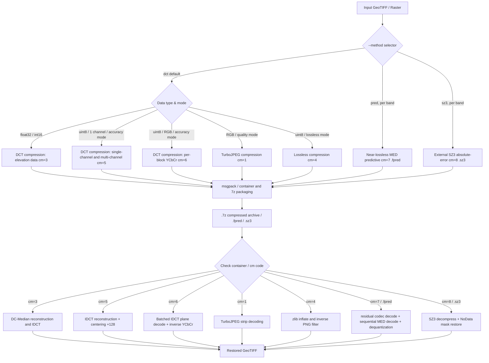
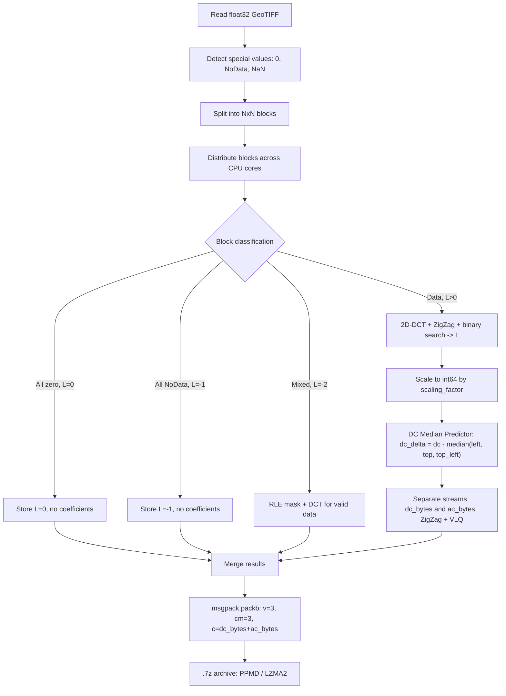
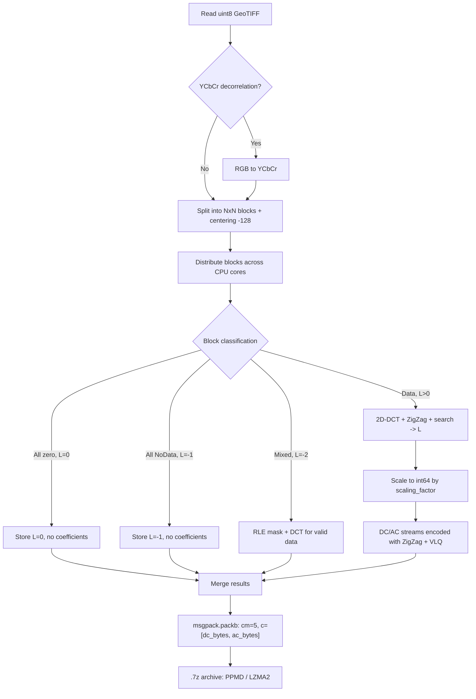
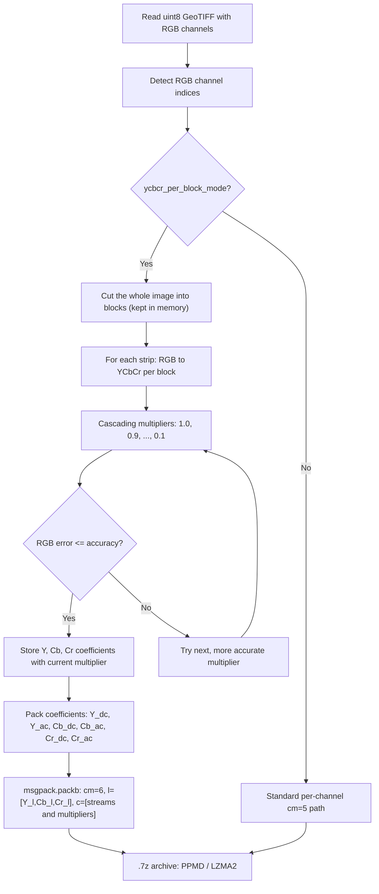
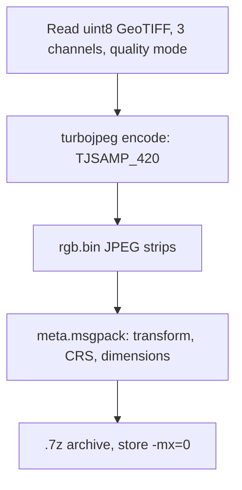
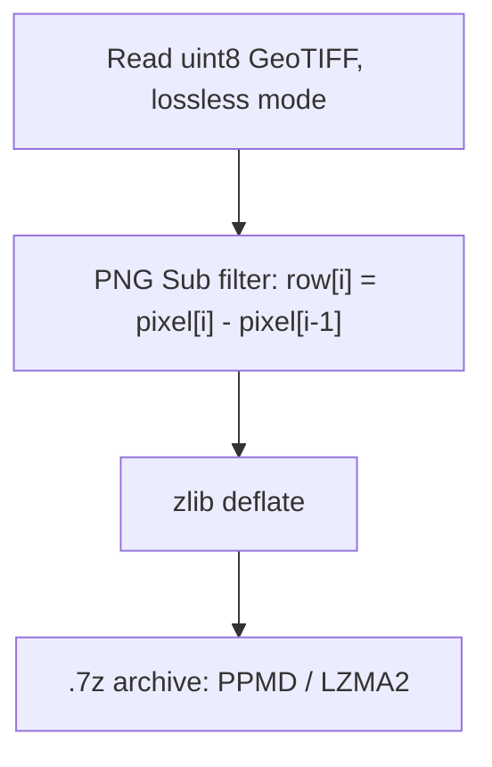
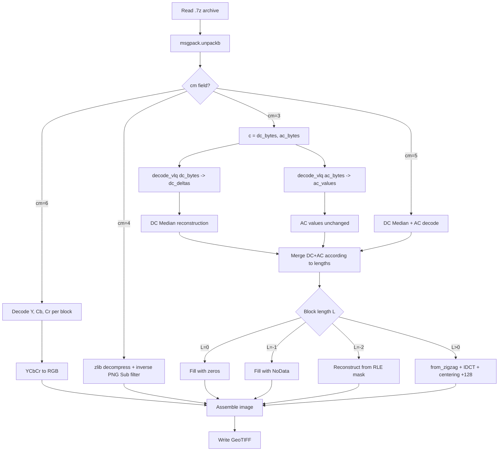
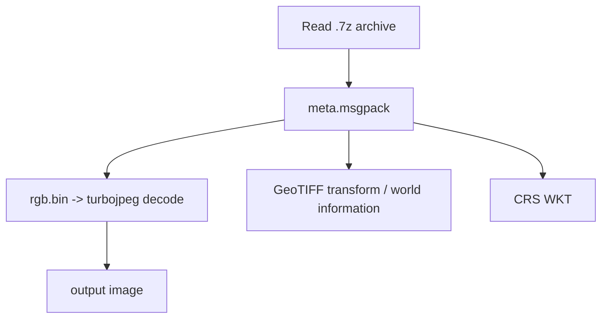
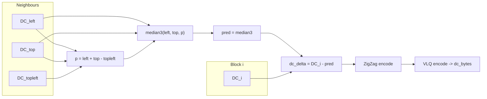
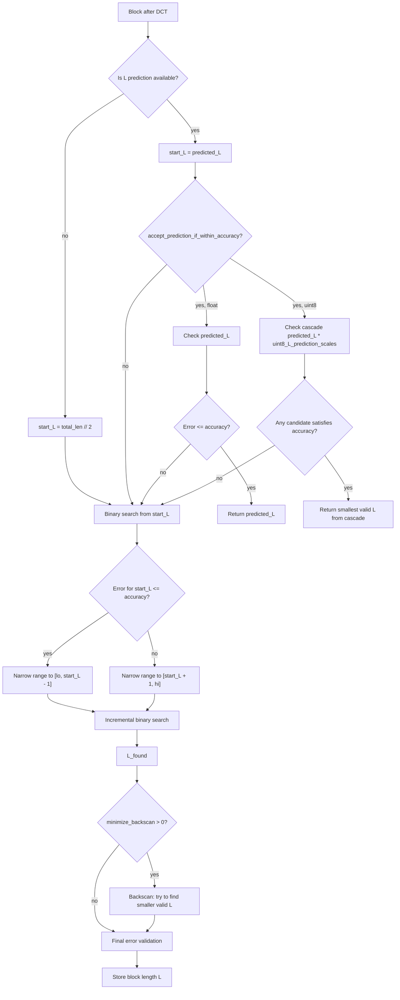

# FIDWAC v2 - Advanced Lossy DCT Compression for Geospatial Data

## Table of Contents

- [Compression Modes (cm)](#compression-modes-cm)
- [Abstract](#abstract)
- [System Requirements and Installation](#system-requirements-and-installation)
  - [System Requirements](#system-requirements)
  - [Full Installation Guide](#full-installation-guide)
  - [Third-Party Components, Links and Licenses](#third-party-components-links-and-licenses)
- [Running FIDWAC v2](#running-fidwac-v2)
  - [Desktop GUI (Tkinter)](#desktop-gui-tkinter)
  - [Web GUI (Flask)](#web-gui-flask)
  - [Command Line (CLI)](#command-line-cli)
  - [Interpolation (IDW)](#interpolation-idw)
  - [Compression Parameters](#compression-parameters)
- [Quick Verification](#quick-verification)
- [1. Introduction and Theoretical Context](#1-introduction-and-theoretical-context)
  - [1.1 Mathematical Basis of the DCT Transform](#11-mathematical-basis-of-the-dct-transform)
  - [1.2 Compression Optimization Problem](#12-compression-optimization-problem)
- [2. Main Differences from FIDWaC v1](#2-main-differences-from-fidwac-v1)
- [3. Data Flow Diagrams](#3-data-flow-diagrams)
- [4. VLQ (Variable-Length Quantity) Encoding](#4-vlq-variable-length-quantity-encoding)
- [5. Numba JIT Acceleration](#5-numba-jit-acceleration)
- [6. Methodology for Predicting the Optimal DCT Chain Length](#6-methodology-for-predicting-the-optimal-dct-chain-length)
- [7. Search Algorithm for the Optimal Length](#7-search-algorithm-for-the-optimal-length)
- [8. Data Encoding Modes After DCT](#8-data-encoding-modes-after-dct)
- [9. Data Preparation Methods](#9-data-preparation-methods)
- [10. Output File Format](#10-output-file-format)
- [11. System Implementation](#11-system-implementation)
- [12. Summary of FIDWAC v2 Innovations](#12-summary-of-fidwac-v2-innovations)
- [13. Performance Test Results - FIDWAC v2 vs SZ3](#13-performance-test-results---fidwac-v2-vs-sz3)
- [14. Benchmark Methodology (`analysis/tests`)](#14-benchmark-methodology-analysistests)
- [License and Citation](#license-and-citation)
- [Bibliography](#bibliography)

---

## Compression Modes (cm)

FIDWAC v2 selects the compression mode automatically based on data type and flags. Each mode uses a different format and offers a different error guarantee:

| cm | Mode | Input data | Error guarantee | How to select |
|----|------|------------|-----------------|---------------|
| 1 | TurboJPEG (quality) | uint8, exactly 3 RGB bands | none (JPEG quality parameter) | 3-band uint8 with `--no-uint8-accuracy-mode` (the shipped `config.json` has `uint8_accuracy_mode: true`, so without this flag RGB goes to cm=6) |
| 3 | DCT + DC predictor | float32/float64 (DEM/DTM), int16 | max error ≤ ε in raster units | `--method dct` + `--accuracy` (default for float) |
| 4 | Lossless PNG Sub + zlib | uint8, any number of bands | error = 0 (lossless) | `--lossless` (takes precedence over cm=5 and cm=6) |
| 5 | DCT integer per band | uint8 / int8 / uint16 / int16 | max error ≤ ε per band | `--uint8-accuracy` |
| 6 | Per-block YCbCr | uint8, ≥3 RGB bands | max error ≤ ε in RGB space | `--uint8-accuracy` + `--ycbcr-per-block` |
| 7 | Predictive MED (near-lossless) | float/int, per band | max error ≤ bound (`.fpred`) | `--method pred` |
| 8 | SZ3 (external) | float/int, per band | max error ≤ SZ3 ABS bound (`.sz3`) | `--method sz3` (requires `pysz`) |
| 0 | Legacy VLQ | old archives | — | decode only, detected automatically |

Notes:

- cm=1 uses a different archive layout (`rgb.bin` + `meta.msgpack`), not the `cm` msgpack field.
- In cm=6 only the 3 RGB bands go through the YCbCr path; remaining bands in the same archive are encoded as cm=5.
- The decoder detects the format automatically from the archive contents — no mode flag is needed for decompression.
- The code cm=2 is unused.

---

## Abstract

FIDWAC v2 (Fast Inverse Distance Weighting and Compression, version 2) is the next development version of the original FIDWaC system (https://github.com/ZSIP/FIDWaC.git). As in the first version, the system implements lossy compression of raster data with a guaranteed maximum approximation error, using a two-dimensional Discrete Cosine Transform (2D-DCT) and adaptive selection of the number of retained coefficients.

Version 2 adds Numba JIT acceleration for key mathematical operations, faster block indexing, a hybrid search algorithm with incremental error reconstruction, two graphical user interfaces (a Flask web GUI and a Tkinter desktop GUI), IDW interpolation of scattered points, and five core processing paths for UINT8/INT8/FLOAT data:

1. **DCT compression for elevation data (float32/int16)** - intended for single-channel continuous data such as DEM/DTM models or IDW interpolation grids. It guarantees a maximum error <= epsilon in the original units (metres, centimetres). It uses a DC Median predictor with separate DC/AC streams (`cm=3`).
2. **Standard DCT compression (uint8 accuracy)** - intended for single-channel images such as LiDAR intensity, hillshade, or individual raster bands. It guarantees a maximum error <= epsilon in grayscale values (0-255), without colour-space conversion (`cm=5`).
3. **Per-block YCbCr with cascading multipliers** - intended for multi-channel RGB imagery in accuracy mode. It guarantees a maximum error <= epsilon in RGB space by using block-wise fitting of coefficients and exact decoder-side RGB verification (`cm=6`).
4. **TurboJPEG (SIMD)** - an alternative fast RGB path without accuracy mode, based on JPEG quality settings. It uses standard JPEG compression through libjpeg-turbo and does not provide a formal maximum-approximation-error guarantee. This is a very fast file-packing method, but it can introduce excessive uncontrolled noise. It does not provide a single-channel mode or a multi-channel mode for more than 3 RGB channels (`cm=1` with `meta.msgpack`).
5. **Lossless compression** - intended for uint8 data requiring exact reconstruction (`max error = 0`). It uses a PNG Sub filter followed by zlib deflate. Every band is coded separately, so it works for one band as well as for any number of bands, and `--lossless` takes precedence over the accuracy modes (`cm=4`).

In addition to the default DCT/JPEG/Lossless routing (`--method dct`), FIDWAC v2 exposes two explicit alternative/benchmark modes selectable via CLI (`--method pred|sz3`) and the web GUI:

- **Near-lossless predictive path (`cm=7`, `--method pred`)** - a separate scalar-quantization (`Q = 2 * (epsilon - m) * 0.999`, `m` = one ulp of the output dtype at the data magnitude) + MED (LOCO-I) predictor workflow for smooth rasters (every band is coded separately), storing quantized residuals and a NoData mask per band in `.fpred` (standalone or wrapped in `.7z`).
- **External SZ3 benchmark path (`cm=8`, `--method sz3`)** - an opt-in wrapper around the `pysz` SZ3 compressor (`ABS` error bound) with NoData mask and GeoTIFF metadata preservation in `.sz3` (standalone or wrapped in `.7z`), enabling direct side-by-side comparison within the same CLI/GUI workflow.

**Interpolation and GUIs.** FIDWAC v2 keeps the inverse distance weighting (IDW) interpolation of the original FIDWaC (`interpolate.py`, package `interpolation/`): scattered points from TXT/CSV, LAS/LAZ or SHP files become a GeoTIFF grid, optionally with geoid correction, and the grid can go straight to compression (see [Interpolation (IDW)](#interpolation-idw)). Two GUIs run the same `compress.py` as the command line: the web GUI (Flask; tabs **Compression**, **Interpolation (IDW)** and **Tests**) and the desktop GUI (Tkinter; compression and decompression).

**FIDWAC advantage:** Unlike typical array compressors such as ZFP or SZ3, FIDWAC stores georeferencing parameters and raster metadata together with the compressed data. The archive includes the information required to reconstruct a ready-to-use GeoTIFF: CRS, affine transform, raster dimensions, NoData information, special-value masks, and compression parameters. Decompression therefore restores the spatially referenced GeoTIFF directly, without manual georeference reconstruction.

---

## Batched uint8 path (cm=5/cm=6), GPU and L prediction

This section describes the changes to the uint8 accuracy paths (cm=5 and cm=6).

### What changed

- **Three-phase search** (`engine/u8_lockstep.py`): binary search with backscan (numba `prange` or GPU), full-IDCT verification (scipy, vectorised, exact), quantisation and post-quantisation check (numba or GPU). Phases 1 and 3 work on whole arrays, not on per-block tuples.
- **GPU session** (`engine/gpu_u8/`): the whole batch (channels and RGB originals) is uploaded to VRAM once; each multiplier sends only row indices and parameters. CUDA kernels: `search_u8_phases.cu`, `session.cu`, `rgb_pre.cu`. Rows the GPU cannot decide exactly (rounding ties) are recomputed on the CPU and patched back into VRAM.
- **Array path** in `engine/blocks.py` and `compress/compression_dct.py`; vectorised block classification.
- **sf=1 without a format change** (`_integer_refine_batch`, `_integer_refine_block`, `_pair_move`): a block that no multiplier brings within the accuracy gets an integer search over its quantised coefficients (single +-1 moves, then pairs). The single-move phase runs on all such blocks at once on the CPU (`_integer_refine_batch`), bit-identical to the per-block search; only blocks that also need pair moves go through `_integer_refine_block`. The stream format and the decoder are unchanged, and the RGB group stays at sf=1. This applies only to blocks that would otherwise force sf=10. Only this small refinement step runs on the CPU (a GPU variant of it was tried and was not faster); the L search, quantisation and RGB error check of all blocks still run on the GPU when `gpu` is enabled (see GPU session above).
- **Channels without coefficients (`L = 0`) in cm=6**: the refinement can leave a whole Y, Cb or Cr channel of a block without coefficients. Such a channel is stored with `L = 0` and decodes as the neutral plane (128); `L = 0` in all three channels is the all-zero marker and decodes as black, so the refinement never stores three empty channels (Y keeps one zero DC coefficient). The encoder's decoder-equivalent checks use the same rule. Before commit `c717cea` the decoder filled a single empty channel with 0, which gave errors of up to 128 DN in whole 8×8 blocks at accuracy 2 although the archive was tagged VT; the archives themselves were correct and decode correctly with the current decoder.
- **Flagged constant blocks** (`_dc_only_rows`, `search_rows`): rows whose classic verification hits a rounding tie and whose final length is 1 (a constant block, only the DC coefficient) are decided in a vectorised way with scipy, i.e. with the same verification as the production path, without the full CPU search. The other cases (L > 1 or tolerance not met) take the previous path. The result is identical to the full CPU path, and the format and the decoder are unchanged.
- **L prediction** (`uint8_use_L_prediction`): off by default. With a GPU backend it is always off (with a message); on CPU it can be enabled with `true`.
- **Multi-file driver**: `compress_many.py` (one initialisation per worker process, dynamic file assignment).
- **Faster start-up**: `scipy.interpolate` is imported lazily (about 1 s less at start).

### How to enable

- The array path is the default for uint8 (cm=5/cm=6) and float32 (cm=3); the per-block path serves cases the arrays do not cover (heuristic predictors, NoData/zero masks). The worker count comes from `performance.parallel.num_processes`: `auto` = CPU count, capped when the GPU is active so that the CUDA contexts and the file batch fit in 75% of the free VRAM (`_gpu_process_cap` in `compress.py`). When many files run at once on one GPU (`compress_many.py`, `run_tests.py`), each process holds its own session: a 5120 × 5120 RGB file needs about 3 GB of VRAM, so on a 32 GB card about 7–8 such files can run at the same time without falling back to the CPU.
- GPU: controlled by `performance.gpu` (`auto` | `on` | `off`) and the CLI option `--gpu`, default `auto`: the GPU when the libraries are built and a CUDA device is present; otherwise the CPU with a note.
- The GPU libraries are not in the repository. Build with `bash engine/gpu_u8/build.sh` (needs `nvcc`; the script detects the architecture of the installed card through `nvidia-smi`, e.g. `sm_120` for an RTX 5090; `FIDWAC_CUDA_ARCH` overrides it and `sm_75` is the fallback). The build uses `-fmad=false`; without it the rounding does not match numpy.
- Missing libraries do not cause an error: the code silently runs on the CPU.

Example:

```
python3 compress.py -i in.tif -o out.7z --uint8-accuracy 2 --block-size 8 \
    --rgb-channel-indices 1,2,3 --ycbcr-per-block --quiet
```

Many files at once:

```
python3 compress_many.py --list files.txt -o out_dir \
    --uint8-accuracy 2 --block-size 8 --rgb-channel-indices 1,2,3 --ycbcr-per-block --quiet
```

### L prediction

`uint8_use_L_prediction` in `config.json` (default `false`). On CPU `true` enables it; with a GPU backend it is off regardless of the value.

The predictor runs as mode 3: L prediction followed by acceptance after decoding. It requires `uint8_use_L_prediction: true` and `accept_prediction_if_within_accuracy: true`. The candidates are `round(L_hat * s)` for `s` in `uint8_L_prediction_scales`, in ascending order; the first one whose error after decoding is within the accuracy is taken, and the remaining blocks go to the binary search. Mode 3 without acceptance (predict, then binary search) stays on the old per-block path and is slow.

The array path runs on CPU and GPU (`engine/u8_lockstep.py`, `accept_predicted`). Result on 10 files at accuracy 2, with the process limited to 4 cores (`taskset`) and 4 worker processes:

| variant | total time | size |
|---|---|---|
| binary (no prediction) | about 15 s | 10.84 MB |
| mode 3, array path | about 12 s (−17%) | 11.42 MB (+5%) |
| mode 3, old per-block path | about 173 s | 13.89 MB (+28%) |

The measurements ran on a server with 32 cores and 314 GB RAM. Limiting to 4 cores imitates a slower processor, not a laptop's memory. The predictor is an option for weaker hardware, not the default: on a machine with a GPU, binary search still gives the smallest files.

### Results (branch version, checked on `main`)

- File 1 at accuracy 2: GPU and CPU give the identical file (768,067 B), error <= 2 in every band, tag VT.
- 20 files at accuracy 2 (reference set `multi_uint_6ch_auto_2px`): total size +0.002% against the reference; size not larger in 12 of 20 files (the rest differ by at most 0.2%); error <= 2 in 20 of 20.
- 10 files at accuracy 5: sizes identical to the production version before these changes (10 of 10).
- Time, 10 files at accuracy 2, 8 processes: GPU about 9-10 s, CPU about 12-13 s. One file: GPU about 4.8 s, CPU about 5.6 s. Production: about 55-90 s per file (measured on an idle machine).
- CPU time (user + system), batch of 10 files, 8 processes, median of 5 runs: before the change 90.2 s, after it 75.5 s (about 16% less). CPU time is less sensitive to machine load than wall-clock time; it also includes waiting for the GPU, which is the same in both versions. Wall-clock time did not change measurably.

### Limitations

- The float32 path (cm=3) uses the array search on the CPU only (no GPU kernels). Float16 is unchanged.
- The forward DCT and the IDCT verification stay on the CPU (scipy), because only scipy gives the same rounding at ties.

## System Requirements and Installation

### System Requirements

#### Operating Systems

- **Windows 10 or Windows 11** with **WSL2** (Windows Subsystem for Linux 2)
- **macOS** (Intel or Apple Silicon) with Python 3.10+
- **Linux** (native):
  - Debian/Ubuntu 20.04 LTS or newer
  - Fedora 35+
  - RHEL 8+
  - Arch Linux
  - Other distributions with Python 3.9+

#### Required Components

**On Windows:**
- WSL2 installed and configured
- Any Linux distribution (Debian recommended)

**On Linux (WSL2 or native):**
- Python 3.9 or newer
- pip (Python package manager)
- Basic build tools: `build-essential` or equivalent
- For full functionality (JPEG compression, GDAL, etc.):
  - `libgdal-dev` (Debian/Ubuntu), `gdal-devel` (Fedora/RHEL), `gdal` (Arch)
  - `cmake` and `nasm` (Debian/Ubuntu, Fedora/RHEL, Arch). `nasm` enables SIMD in libjpeg-turbo; libjpeg-turbo itself is built by the installer from `install/turbojpeg`, so no system package is needed
  - `llvm-dev` (Debian/Ubuntu), `llvm-devel` (Fedora/RHEL), `llvm` (Arch)
  - `7zz` (7-Zip-ZSTD) is not a distribution package: `install/setup_linux.sh` installs the newest release into `/usr/local/bin/7zz` (sudo is needed; see [Third-Party Components, Links and Licenses](#third-party-components-links-and-licenses))

**On macOS:**
- Python 3.10+ (Conda or python.org installer recommended); the web GUI needs Flask, installed from `install/requirements.txt`
- Homebrew packages for full functionality:
  - `gdal`
  - `jpeg-turbo`
  - `sevenzip` (provides `7zz`; this is the upstream 7-Zip build, the zstd fork has no macOS build)
- Xcode Command Line Tools: `xcode-select --install`

**RAM:** minimum 2 GB; for large rasters see "Memory use and file size" below
**Disk space:** minimum 500 MB (+ space for processed raster files)

#### Memory use and file size

Compression and decompression of the main modes work in strips, so the memory taken by the image itself does **not** grow with the size of the raster: per-block RGB (`cm=6`) and uint8 (`cm=5`) bands are compressed in strips of block rows, float32 bands (`cm=3`) in memory up to 256 MB per band and in strips above that, and all of them are decompressed strip by strip into the GeoTIFF. The blocks are independent, so a strip gives the same blocks as the whole image: for a fixed block size the archive is identical to the one made without strips (checked on test images, byte for byte).

Peak memory (sum of the memory of all processes, 1 GB = 2^30 bytes), measured with the default settings (`num_processes: auto`, GPU `auto`) on a Linux server with 45 cores and 235 GB RAM. Matrix size is width x height x bands; "raw" is the size of the uncompressed array.

| Data and mode | Matrix (px) | Pixels per band | Raw | RAM, compression | RAM, decompression |
| --- | --- | --- | --- | --- | --- |
| RGB uint8, per-block YCbCr (`cm=6`), accuracy 5 | 5 120 x 5 120 x 3 | 26 M | 0.07 GB | 2.3 GB | 1.3 GB |
| RGB uint8, `cm=6`, accuracy 5 | 8 300 x 8 300 x 3 | 69 M | 0.19 GB | 2.6 GB | 2.5 GB |
| RGB uint8, `cm=6`, accuracy 5 | 12 000 x 12 000 x 3 | 144 M | 0.40 GB | 3.1 GB | 2.8 GB |
| 1 band uint8 (`cm=5`), accuracy 5 | 12 000 x 12 000 x 1 | 144 M | 0.13 GB | 1.5 GB | 0.9 GB |
| 6 bands uint8 (`cm=5`), accuracy 5 | 12 000 x 12 000 x 6 | 144 M | 0.80 GB | 3.2 GB | 2.6 GB |
| Float32 (`cm=3`), accuracy 0.05 | 4 000 x 4 000 x 1 | 16 M | 0.06 GB | 1.5 GB | 0.8 GB |
| Float32 (`cm=3`), in memory (up to 256 MB per band) | 8 100 x 8 100 x 1 | 66 M | 0.24 GB | 5.9 GB | 2.5 GB |
| Float32 (`cm=3`), strips (above 256 MB per band) | 12 000 x 12 000 x 1 | 144 M | 0.54 GB | 5.7 GB | 3.2 GB |
| Float32 (`cm=3`), 5 bands, accuracy 0.05 (real DSM and orthophoto bands) | 9 037 x 9 677 x 5 | 87 M | 1.63 GB | 10.4 GB | 3.7 GB |
| RGB uint8 (`cm=6`), accuracy 5, real orthophoto that compresses badly (1.2x) | 22 347 x 24 521 x 3 | 548 M | 1.53 GB | 10.1 GB | 11.2 GB |

Compression time grows in proportion to the number of pixels (for example RGB 12 000 x 12 000: 51 s, 6 bands of 12 000 x 12 000: 42 s).

- Strip size: about 8 million pixels per strip for `cm=6`, 16 million for `cm=5` (`RGB_STRIP_PIXELS` and `DCT_STRIP_PIXELS` in `compress/compression_dct.py`). A band of at most 16 million pixels is processed whole, as before.
- **Automatic block size** (`--auto`) on a band above 16 million pixels is chosen from a window of up to 2048 x 2048 pixels in the middle of the band, not from the whole band, so on such bands it can differ from the choice for the whole image. With a fixed `--block-size` there is no difference.
- **Modes that still read a whole band into memory:** lossless (`cm=4`) and `--method pred` / `--method sz3` (`cm=7`, `cm=8`). RGB without `--ycbcr-per-block` is compressed band by band as `cm=5`, so it works in strips. For very large rasters (hundreds of millions of pixels) in the three modes above, split the raster into tiles before compression; each tile keeps its own georeferencing, so the tiles can be mosaicked again afterwards. Memory use of these modes was not measured.
- **What still grows with the content:** the stored coefficients are collected in memory before the archive is written, and read back in memory on decompression. Their number is the number of kept DCT coefficients, so it is higher for images that compress badly. The 548 million pixel orthophoto above keeps 0.69 coefficients per pixel (377 million in total, compression 1.2x) and needed about 30 bytes per stored coefficient in both directions (10 to 11 GB). An image that compresses well needs less. The test images in the first rows were made by repeating one orthophoto, so their archives are much smaller than for a real image of that size (the archiver finds the repeats); the number of stored coefficients per pixel is that of the original orthophoto.
- Memory use also grows with the number of worker processes; it was measured only at the default setting.

### Full Installation Guide

The complete installation instructions for Windows (WSL2), Linux, macOS, Conda setup, and troubleshooting are available in [install/README.md](install/README.md).

Recommended first command after setup:

```bash
python3 install/verify_install.py --require-web --require-turbojpeg
```

---

### Third-Party Components, Links and Licenses

FIDWAC v2 uses the external programs and libraries listed below. Links point to the official GitHub repositories. Licenses are taken from each project's own license files and package metadata; check the LICENSE file in the linked repository for the full text. Transitive Python dependencies are installed by pip and keep their own licenses.

The 7-Zip-ZSTD binary is not stored in this repository: `install/setup_linux.sh` downloads the newest release from GitHub and checks its SHA-256. SZ3 and libjpeg-turbo sources are vendored under `install/` together with their license files.

**External applications and native libraries**

| Component | Used for | GitHub | License |
| --- | --- | --- | --- |
| 7-Zip-ZSTD (`7zz`) | Creating and extracting `.7z` archives (installed system-wide by `install/setup_linux.sh`) | https://github.com/mcmilk/7-Zip-zstd | LGPL-2.1-or-later; some files LGPL with unRAR restriction; some files BSD-3-Clause |
| SZ3 | SZ3 backend (`--method sz3`), vendored in `install/sz3` | https://github.com/szcompressor/SZ3 | BSD-3-Clause (UChicago Argonne, LLC) |
| pysz (SZ3 Python binding) | Built from `install/sz3/tools/pysz` for `--method sz3` | https://github.com/szcompressor/SZ3/tree/master/tools/pysz | BSD-3-Clause |
| libjpeg-turbo | JPEG quality mode (`cm=1`), vendored in `install/turbojpeg`, built into the virtual environment | https://github.com/libjpeg-turbo/libjpeg-turbo | IJG License (libjpeg API) and Modified BSD-3-Clause (TurboJPEG API and build system); other components as listed in its `LICENSE.md` |
| zstd (libzstd) | Development files needed to build SZ3 (`libzstd-dev`) | https://github.com/facebook/zstd | BSD-3-Clause or GPL-2.0 (dual license, you may choose) |
| NASM | SIMD code in libjpeg-turbo (build time, optional) | https://github.com/netwide-assembler/nasm | BSD-2-Clause |
| Zenity | Window that lets the user choose the interface in `run_linux.sh` (installed by `setup_linux.sh`) | https://gitlab.gnome.org/GNOME/zenity | LGPL-2.0-or-later |
| CMake | Building libjpeg-turbo and SZ3 (build time) | https://github.com/Kitware/CMake | BSD-3-Clause |
| GDAL | Raster I/O (bundled in rasterio wheels; system packages `libgdal-dev`, `gdal-devel`, `gdal`) | https://github.com/OSGeo/gdal | MIT-style (components listed in `LICENSE.TXT`) |
| LLVM | `llvm-dev` installed by the installer (build time) | https://github.com/llvm/llvm-project | Apache-2.0 with LLVM Exceptions |
| Python | Interpreter, 3.10 or newer | https://github.com/python/cpython | Python Software Foundation License 2.0 |
| ZSIP/FIDWaC (IDW algorithm) | Original interpolation algorithm, adapted in `interpolation/` (copyright notice kept in `interpolation/idw.py`) | https://github.com/ZSIP/FIDWaC | MIT |
| Geoid model PL, WGS 84 grid 0.01° (`interpolation/geoid/PL_geod.7z`) | Optional geoid correction of interpolated elevations (`--geoid`) | — (data, not a repository) | To be confirmed by the author before publication: the archive does not state its source or licence |

**Python packages (from `install/requirements.txt`)**

| Package | Used for | GitHub | License |
| --- | --- | --- | --- |
| NumPy | Array processing | https://github.com/numpy/numpy | BSD-3-Clause (bundled components have other permissive licenses) |
| SciPy | Scientific routines | https://github.com/scipy/scipy | BSD-3-Clause |
| rasterio | Reading and writing rasters (GDAL bindings) | https://github.com/rasterio/rasterio | BSD-3-Clause |
| laspy | Reading LAS and LAZ point clouds (interpolation input) | https://github.com/laspy/laspy | BSD-2-Clause |
| lazrs | LAZ decompression used by laspy | https://github.com/laz-rs/laz-rs | MIT (package metadata) |
| pyshp | Reading and writing shapefiles (SHP input, points output) | https://github.com/GeospatialPython/pyshp | MIT |
| matplotlib | PNG preview of the interpolated grid | https://github.com/matplotlib/matplotlib | Matplotlib License (PSF-based) |
| msgpack (msgpack-python) | Binary serialization of compressed data | https://github.com/msgpack/msgpack-python | Apache-2.0 |
| py7zr | Pure-Python fallback for `.7z` archives when `7zz` is missing | https://github.com/miurahr/py7zr | LGPL-2.1-or-later |
| tqdm | Progress bars | https://github.com/tqdm/tqdm | MPL-2.0 AND MIT |
| Numba | JIT acceleration (installs llvmlite) | https://github.com/numba/numba | BSD-2-Clause (llvmlite: BSD-2-Clause and Apache-2.0 with LLVM exception) |
| PyTurboJPEG | Python wrapper for libjpeg-turbo | https://github.com/lilohuang/PyTurboJPEG | MIT |
| Flask | Web GUI (`app.py`) | https://github.com/pallets/flask | BSD-3-Clause |
| Werkzeug | WSGI layer of Flask (installed with Flask) | https://github.com/pallets/werkzeug | BSD-3-Clause |
| PyInstaller | Windows executable build (`build_windows.bat`, optional) | https://github.com/pyinstaller/pyinstaller | GPL-2.0-or-later with a special exception that allows bundling |

The web GUI front end (HTML, CSS and JavaScript) is written for this project and uses no third-party JavaScript or CSS libraries.

If you redistribute a bundled build, comply with all licenses above, in particular the LGPL components (7-Zip-ZSTD, py7zr) and the GPL-based PyInstaller build.

---

## Running FIDWAC v2

### Desktop GUI (Tkinter)

The desktop GUI is the same compression front end as the web GUI, built with Tkinter (`gui/` package, entry point `app_tk.py`). Start it with `python3 app_tk.py` on a machine with a display (on WSL2 through WSLg). It needs no browser and no network port.

- **Main** tab: input (file or folder) and output folder with **Browse…** buttons, presets, float settings (accuracy: slider, typed value 0.001-1.0 and the buttons 0.01 / 0.05 / 0.1 / 0.5 / 1.0; method `dct` / `pred` / `sz3`, block size or automatic selection of 8 / 16 / 32, backend) and 8-bit settings (Quality, Accuracy or Lossless PNG; JPEG quality, 8-bit accuracy, RGB bands, YCbCr multipliers).
- **Advanced** tab: model and search options (advanced heuristic, accept prediction, backscan), automatic block-size settings, *Parallel Processing* (processes, files at the same time and the **GPU** choice: `auto` = GPU when found, otherwise CPU with a note; `on` requires the GPU; `off` = CPU only) and *Output Settings* (archive method, LZMA2 block size, TIFF compression, CRS or no CRS, temporary files, quiet mode, log panel).
- **Run**, **Stop** and the log. Archives (`.7z`, `.fpred`, `.sz3`) given as input are decompressed to GeoTIFF.

The settings are passed to `compress.py` (the GPU choice as `--gpu`) and saved to `config.json`, the same as in the web GUI. The desktop GUI has no interpolation or tests tab; use `interpolate.py` or the web GUI for them.


### Web GUI (Flask)

The graphical interface is a local web application that runs in your browser. Every file is processed by the same `compress.py` code as the command line.

Start it:

```bash
# Windows: run_windows.bat starts WSL and the Linux launcher (JPEG, SZ3 and 7zz are checked first)
run_windows.bat

# Linux / WSL
bash run_linux.sh                 # http://127.0.0.1:5010/
bash run_linux.sh --port 8080     # another port

# Activated environment (Linux, macOS, Conda)
python3 app.py --host 127.0.0.1 --port 5010
```

Open **http://127.0.0.1:5010/** in a browser (from Windows, `http://localhost:5010/` also works through WSL). By default the app listens on `127.0.0.1`, so only this computer can reach it. `--host 0.0.0.0` makes it reachable from the network, but the app has no login: use it only on trusted networks.

The page has three tabs: **Compression**, **Interpolation (IDW)** (see [Interpolation (IDW)](#interpolation-idw)) and **Tests**. In the Compression tab the page has two columns:
- **Left:** input (a single file or a folder with subfolders), output folder, method and accuracy (predefined values 0.01 / 0.05 / 0.1 / 0.5 and the presets Quick, Balanced, High Quality and Lossless), block size, 8-bit options (JPEG quality, 8-bit accuracy, RGB bands, YCbCr multipliers) and **Advanced**.
- **Right (both tabs):** Run and Stop, progress, the results table (validity VT/VF, sizes, ratio) and the log. Run starts the job of the active tab.

Choose files and folders with the **Browse…** buttons. Inputs can be rasters (GeoTIFF, PNG, JPEG, BMP, ASC, IMG) or archives (`.7z`, `.fpred`, `.sz3`); archives are decoded to GeoTIFF. Every run saves the current settings to `config.json`, the same file the command line reads. Only one job runs at a time; **Files at the same time** processes several files of a folder in parallel and shares the CPU processes between them.

The **Tests** tab runs the benchmark suite `analysis/tests/run_tests.py` (not included in this branch; without it the tab only shows a hint) (FIDWAC v2 variants and SZ3, section 14) from the browser: datasets (folders of `.tif` / `.png` files; **Scan** reads the files and fills in their parameters), variants, files per dataset, workers, *Resume* (skip finished combinations) and *Dry-run* (plan only). Results go to `results_<dataset>.csv` and `features.csv` and are shown on the **Results page** (`/tests/results`). The tab is shown only when `analysis/tests/run_tests.py` exists.


### Command Line (CLI)

#### Compress a single file:

```bash
# Activate the environment (venv)
source ~/.fidwac/venv/bin/activate

# OR activate Conda environment
conda activate fidwac

# Compress with default DCT parameters
python3 compress.py -i input.tif -o results/ --accuracy 0.05 --auto

# Compress an elevation raster with explicit DCT parameters
python3 compress.py -i input_dem.tif -o results/ --accuracy 0.10 --block-size 8 --backend binary

# Compress a raster (every band separately) with the near-lossless predictive MED path (cm=7)
python3 compress.py -i input_dem.tif -o results/input_pred.7z --accuracy 0.05 --method pred

# Compress a raster (every band separately) with the external SZ3 benchmark path (cm=8)
python3 compress.py -i input_dem.tif -o results/input_sz3.7z --accuracy 0.05 --method sz3

# Compress an RGB raster in accuracy mode (per-block YCbCr path cm=6 when RGB indices are provided)
python3 compress.py -i orthophoto.tif -o results/ --uint8-accuracy 5 --rgb-channel-indices 1,2,3 --ycbcr-per-block

# Compress an RGB raster in JPEG quality mode (cm=1)
python3 compress.py -i orthophoto.tif -o results/ --no-uint8-accuracy-mode --rgb-quality 90
```

#### Decompress:

```bash
# Decompress from FIDWAC archive (.7z) or direct container (.fpred / .sz3)
python3 compress.py -i input_archive.7z -o reconstructed/
python3 compress.py -i input_pred.fpred -o reconstructed/
python3 compress.py -i input_sz3.sz3 -o reconstructed/
```

### Interpolation (IDW)

FIDWAC v2 turns scattered points into a raster with inverse distance weighting (IDW). The algorithm comes from the original FIDWaC ([ZSIP/FIDWaC](https://github.com/ZSIP/FIDWaC), MIT licence) and is adapted in the `interpolation/` package. Inputs are:

- TXT or CSV tables: one header line, then `x`, `y`, `z` in the first three columns;
- LAS and LAZ files, optionally filtered by ASPRS class (`--las-classes 2` keeps ground points);
- SHP point files, with the height in the attribute named by `--z-field` (default `z`).

A folder is processed recursively, and its subfolder structure is repeated in the output folder. Results of earlier runs (names containing `-dist-`) are skipped.

Processing of one point file (`interpolation/run.py`), in the order of the original FIDWaC:

1. Read the points; rows with NaN or -9999 are removed, LAS/LAZ points are optionally filtered by class.
2. Optional geoid correction: the nearest geoid point (KD-tree, at most `--geoid-max-distance` away) gives the undulation that is subtracted from z.
3. Build a grid aligned to multiples of `--resolution` that covers all points (at most 400 million cells).
4. Find the N nearest points of every cell centre within `--max-distance` with a KD-tree (`scipy.spatial.cKDTree`, all CPU cores, queries in blocks of 500 000 cells to limit memory).
5. IDW: the weighted mean of the points found, with weights 1 / d^p (power p = `--weights`, default 2 as in the original). A zero distance is replaced with half of the smallest non-zero distance; with `--r-min-function`, distances below `r_min` are reduced in the same way. A cell with no point within the radius stays NoData (-9999).
6. Optional Gaussian smoothing (`--smooth-level` = sigma in cells), then the exports and, with `--compress`, compression by `compress.py`.

The GeoTIFF (Float32, DEFLATE, NoData -9999, CRS from `--source-crs`) is always written; the other files are optional:

| Option | File | Content |
| --- | --- | --- |
| `--csv` | `*_result.csv` | `x,y,value` for every cell, values before smoothing |
| `--surfer` | `*_grid.grd` | Surfer ASCII grid (DSAA) |
| `--shp` | `*_points.shp` | the input points, with a `.prj` file |
| `--png` | `*_preview.png` | colour preview of the grid |

File names carry the parameters, for example `points-N-10-R-0.5-dist-5.0_geotif.tif`.

**Command line** (`interpolate.py`):

```bash
# One point file: 10 neighbours, 0.5 m cells, 5 m search radius (defaults from config.json)
python interpolate.py -i points.las -o results/interpolation

# Folder of point files, geoid correction, extra CSV and PNG outputs
python interpolate.py -i points_folder/ -o results/interpolation --geoid --csv --png

# Interpolation, then compression of the GeoTIFF into a .7z package (DCT, accuracy 0.05)
python interpolate.py -i points.csv -o results/interpolation --compress --method dct --accuracy 0.05
```

Main options (defaults come from the `interpolation` block of `config.json`; `python interpolate.py --help` lists all of them):

| Option | Default | Meaning |
| --- | --- | --- |
| `-N`, `--neighbours` | 10 | nearest points used per cell |
| `--resolution` | 0.5 | cell size, in units of `--source-crs` |
| `--max-distance` | 5 | search radius, in the same units |
| `--weights` | 2 | power p of the weights 1 / d^p; must be positive (higher values give the nearest points more influence) |
| `--leafsize` | 10 | KD-tree leaf size (build speed against memory) |
| `--z-field` | `z` | height attribute of SHP files |
| `--csv`, `--surfer`, `--shp`, `--png` | from `config.json` | extra outputs (table above); `--no-csv` etc. switch them off |
| `--smooth` / `--no-smooth`, `--smooth-level` | on, 1 | Gaussian smoothing and its sigma in cells |
| `--r-min-function`, `--r-min` | off, 0.5 | reduce distances below r_min (original rule) |
| `--las-classes` | all | LAS/LAZ classes to keep, for example `2,6` |
| `--geoid`, `--geoid-file` | off, bundled model | subtract the geoid undulation from heights |
| `--source-crs`, `--geoid-crs` | `epsg:2180`, `epsg:4326` | CRS of the points and of the geoid grid |
| `--geoid-max-distance` | 2000 | geoid points farther than this are not used |
| `--compress`, `--method`, `--accuracy` | off, `dct`, from `config.json` | compress the GeoTIFF with `compress.py`; the package gets the same VT/VF check as any other output |

The bundled geoid model `interpolation/geoid/PL_geod.7z` covers Poland (WGS 84 longitude and latitude, 0.01° grid). Its source and licence are not stated in the archive and must be confirmed before publication (see the licence tables).

**Web GUI:** open the **Interpolation (IDW)** tab. It offers the same options, with file browsers for the points and the geoid model and a check of the geoid file. Choose *Interpolation only* for the GeoTIFF, or *Interpolation and compression* to also write the `.7z` package with the method (`dct`, `pred`, `sz3`) and accuracy of the Compression tab. Every run saves the settings to the `interpolation` block of `config.json`. The desktop GUI (Tkinter) has no interpolation tab.

**Differences from the original FIDWaC** (deliberate changes):
- A cell with fewer than N points inside the search radius is interpolated from the points that exist. The original Dask variant (`idw_dask: true`) gives such cells values close to zero.
- The grid covers the full extent of the points; the original cut off up to one cell at the far edge.
- The GeoTIFF is north-up (negative Y cell size); the original wrote a positive one.
- The Surfer grid has the standard DSAA header with `zmin zmax`; the original wrote the cell size there.
- Smoothing is kept as in the original, so a NaN cell spreads into its neighbours.
- The geoid search limit (2000 m) is a setting, not a constant in the code.
- `--weights` is the power p of the weights 1 / d^p. In the original the power was fixed at 2 in the code and `weights` only multiplied the weights, which cancels in the weighted mean, so changing it had no effect; with the default 2 the results are the same.
- One IDW engine (NumPy with KD-tree queries in blocks) replaces the original choice between `idw_numpy` / numexpr and `idw_dask`; the KNN map and the Streamlit interface of the original are not carried over.

### Compression Parameters

- `--method {dct,pred,sz3}`: selects the compression family (`dct` by default). When `--method dct` is active, the program automatically routes the raster to `cm=1`, `cm=3`, `cm=4`, `cm=5`, or `cm=6` according to raster type and CLI/config flags. When `--method pred` (`cm=7`) or `--method sz3` (`cm=8`) is explicitly selected, rasters with any number of bands are routed to the predictive MED or external SZ3 pipeline, each band coded separately.
- `--accuracy`: maximum error. For 8-bit rasters it is in pixel values; the web GUI takes it from the 8-bit accuracy field when `pred` or `sz3` is selected.
- `--uint8-accuracy`: maximum pixel error for uint8 accuracy paths (`cm=5`, `cm=6`).
- `--rgb-quality`: JPEG quality for the TurboJPEG RGB path (`cm=1`).
- `--block-size`: DCT block size (`8`, `16`, `32`).
- `--rgb-channel-indices`: enable RGB-aware routing (`cm=6`) for multichannel rasters.

Full parameter documentation can be found in `compress.py` (`python3 compress.py --help`) or in the web GUI.

---

## Quick Verification

Use this command after environment setup to quickly verify dependencies, archive backend, lookup models, and a synthetic compression/decompression round-trip:

```bash
python3 install/verify_install.py --require-web --require-turbojpeg
```

Expected summary line:

```text
[OK] environment: FIDWAC v2 verification passed
```

---

## 1. Introduction and Theoretical Context

### 1.1 Mathematical Basis of the DCT Transform

FIDWAC v2 implements the two-dimensional type-II Discrete Cosine Transform (DCT-II), defined for a block matrix `A` of size `N x N` as:

$$
X_{u,v} =
\frac{2}{N}\alpha(u)\alpha(v)
\sum_{i=0}^{N-1}\sum_{j=0}^{N-1}
A_{i,j}
\cos\left(\frac{\pi(2i+1)u}{2N}\right)
\cos\left(\frac{\pi(2j+1)v}{2N}\right)
$$

where `alpha(k) = 1/sqrt(2)` for `k = 0`, and `alpha(k) = 1` otherwise.

With this normalization the transform is orthonormal, and the inverse transform (IDCT) is:

$$
A_{i,j} =
\frac{2}{N}
\sum_{u=0}^{N-1}\sum_{v=0}^{N-1}
\alpha(u)\alpha(v)X_{u,v}
\cos\left(\frac{\pi(2i+1)u}{2N}\right)
\cos\left(\frac{\pi(2j+1)v}{2N}\right)
$$

### 1.2 Compression Optimization Problem

For each block `B_k` of size `N x N`, the system solves the following minimization problem:

$$
\min_{L_k} \quad L_k
\quad \text{subject to} \quad
\max_{(i,j)} \left|B_k[i,j] - \hat{B}_k^{(L_k)}[i,j]\right| \leq \varepsilon
$$

where:

- `L_k` - the number of retained DCT coefficients in zigzag order for block `k`
- `B_hat_k(L_k)` - reconstruction using `L_k` coefficients
- `epsilon` - the requested accuracy

---

## 2. Main Differences from FIDWaC v1

| Aspect | FIDWaC v1 | FIDWAC v2 |
| ------ | --------- | --------- |
| **Serialization** | JSON text | msgpack binary + VLQ (Variable-Length Quantity) |
| **Coefficient representation** | ZigZag + int32 (signed 32-bit integers) | ZigZag + VLQ (variable-length integer encoding) |
| **Archive compression** | py7zr (Python) | native 7zz (7-Zip-ZSTD, installed by the setup script), multithreaded; configurable LZMA2 block size (default 2m) |
| **7z compression method** | default | PPMD / LZMA2 / BZIP2 / DEFLATE |
| **Automatic DCT length search (`L`)** | binary search | hybrid: linear window + binary search |
| **JIT acceleration** | none | Numba JIT for key operations |
| **GUI** | simple Streamlit interface (`streamlit run app.py`) | Web GUI (Flask, in the browser; tabs Compression, Interpolation (IDW) and Tests) and desktop GUI (Tkinter, `app_tk.py`); both run `compress.py`, with recursion and directory-structure preservation |
| **IDW interpolation** | `interpolation.py` (KD-tree, NumPy/numexpr or Dask engine) | `interpolate.py` + `interpolation/` package: one NumPy engine with KD-tree queries in blocks, cells with fewer than N points use the points that exist, north-up GeoTIFF, standard Surfer header, optional compression of the result (`--compress`) |
| **Prediction** | none | Simple / Advanced Heuristic lookup tables |
| **RGB compression** | none | 1) per-block YCbCr (`cm=6`, accuracy-based, error <= epsilon), 2) TurboJPEG strips (quality-based, no max-error guarantee) |
| **uint8 accuracy (`cm=5`)** | none | DCT binary search with pixel-error guarantee <= epsilon (minimum epsilon=2), centering -128, adaptive `sf` |
| **Lossless PNG (`cm=4`)** | none | PNG Sub filter + zlib deflate, max error = 0 |
| **YCbCr decorrelation** | none | RGB to YCbCr before DCT, reducing inter-channel correlation |
| **Per-block YCbCr (`cm=6`)** | none | Hybrid per-block cascading selection of YCbCr multipliers, exact decoder-side error verification in RGB (`ycbcr_decode_verify`), batched IDCT plane decoding |
| **Single-band near-lossless & benchmark paths (`cm=7`, `cm=8`)** | none | Optional explicit `--method pred` (MED + scalar quantization `.fpred`) and `--method sz3` (external SZ3 `.sz3`), integrated with `.7z` and GeoTIFF metadata restoration |

---

## 3. Data Flow Diagrams

### 3.0 Modular Architecture and Input Routing

FIDWAC v2 uses a modular architecture that routes the input raster according to `--method` (`dct` by default, or explicit `pred` / `sz3`), data type, and number of channels (`cm` coding mode):


### 3.1 Compression - DCT Path (float32, `cm=3`)



### 3.2 Compression - uint8 Accuracy Path (`cm=5`)



### 3.3 Compression - Per-block RGB YCbCr Path (`cm=6`)



### 3.4 Compression - RGB/JPEG Quality Path



### 3.5 Compression - Lossless Path (`cm=4`)



### 3.6 Decompression - DCT Path



### 3.7 Decompression - RGB/JPEG Path



### 3.8 DC Median Predictor (`cm=3`, `cm=5`, `cm=6` streams)



---

## 4. VLQ (Variable-Length Quantity) Encoding

The implementation uses two encoding stages.

**Stage 1 - ZigZag:** a one-to-one mapping from signed integers to non-negative integers:

$$
\mathcal{Z}(x) =
\begin{cases}
2x, & x \geq 0, \\
-2x - 1, & x < 0.
\end{cases}
$$

**Stage 2 - VLQ (Variable-Length Quantity, Base-128):** a variable-length representation with continuation bits.

**Efficiency:** ZigZag + VLQ reduces the size of DCT coefficients compared with an int32 representation (signed 32-bit integers). The actual savings depend on the value distribution in the image and should be evaluated empirically on the target data.

---

## 5. Numba JIT Acceleration

Version 2 compiles key incremental reconstruction, binary search, backscan, and predictive decoding operations with Numba JIT (`@njit`, cache in `/dev/shm` or `/tmp`):

| Function | Description |
| -------- | ----------- |
| `_nb_max_err(diff)` | maximum absolute error from the diff buffer |
| `_nb_step_add(diff, basis_k, coeff_k)` | incrementally add coefficient `k` |
| `_nb_step_sub(diff, basis_k, coeff_k)` | incrementally remove coefficient `k` |
| `_nb_jump_diff(diff, basis, coeffs, cur_L, target_L)` | jump to any `L` during binary search |
| `_med_decode(res)` | sequential MED (LOCO-I) index reconstruction for `cm=7` decompression |

This removes Python overhead from the inner incremental-reconstruction and MED decoding loops. JIT compilation is cached for subsequent runs.

The parallel kernels (`prange`) use numba's default OpenMP threading layer. With `--backend heuristic` the program switches to numba's `workqueue` layer before the first parallel launch, because the GNU OpenMP layer aborts the forked pool workers of the advanced heuristic and the run would hang.

---

## 6. Methodology for Predicting the Optimal DCT Chain Length

### 6.1 Goal of Prediction

All prediction backends have the same role: they provide a starting point `L_hat` for the search algorithm. They do not replace final error validation. The following condition is always checked:

$$
\max |B - \hat{B}| \leq \varepsilon
$$

Better prediction means fewer iterations and faster compression.

**Available backends:**

- **Binary search** - reference mode without prediction. It checks reconstruction error and searches for the smallest valid DCT chain length `L`, so it usually produces the smallest file. It is more precise in minimizing `L`, but can be slower than predictive modes.
- **Advanced Heuristic** - computes four DCT block features (`ac_abs_mean`, `zero_ratio`, `ac_std`, `std_dev`) and uses pre-trained lookup tables. This mode often reduces compression time by choosing a starting point close to the expected `L`. When `accept_prediction_if_within_accuracy` is enabled, a valid prediction can be accepted without a full binary search, which is faster but may produce a larger file. The current fast lookup grid uses 2D quantile-grid indices: 64x29/31 for float (N=8/16), and 39x10 for uint8.
- **Simple Heuristic** - predicts from block variance and simple statistical rules. It can speed up analysis for specific low-variation data, for example smooth seabed or terrain surfaces.

### 6.2 Choosing the Mode and Parameters

The best parameter fit depends on the user, the data characteristics, and the operational priority: smallest file, shortest compression time, or a compromise between both. Before compressing large collections, it is recommended to run short tests on small representative samples and compare at least `binary` and `heuristic` with the Advanced Heuristic enabled.

Example comparison settings:

| Mode | `backend` | `advanced_heuristic` | `backscan_break_after` | `accept_prediction_if_within_accuracy` |
| ---- | --------- | -------------------- | ---------------------- | -------------------------------------- |
| `binary` | `heuristic` | `False` | `0` | `False` |
| `advanced_heuristic_accept` | `heuristic` | `True` | `0` | `True` |

**`advanced_heuristic_accept`** means Advanced Heuristic plus `accept_prediction_if_within_accuracy=True`. If the lookup prediction gives an `L_hat` that satisfies the error condition, the algorithm accepts it without further binary search:

$$
\max \left|B - \hat{B}^{(\hat{L})}\right| \leq \varepsilon
$$

For float data, one predicted `L_hat` is checked. For uint8 data, the system uses the `uint8_L_prediction_scales` cascade and checks successive lengths `L_hat * s` (default: `0.9`, `1.0`, `1.1`, `1.3`, `1.5`, `2.0`). If a candidate satisfies accuracy, the smallest valid candidate from the cascade is accepted without a full binary search. If no candidate satisfies accuracy, the program switches to standard binary search using the prediction as the starting point.

### 6.3 Empirical Testing

Real prediction-backend results should be evaluated on the target data sets (DSM, DTM, orthophotos), because they depend on variance, value distribution, the share of smooth blocks, and the amount of highly variable detail. Before compressing large data collections, run short tests on small samples: compare `binary` and `heuristic`, several block sizes, the target accuracy, and settings such as `accept_prediction_if_within_accuracy`, `minimize_backscan`, and `backscan_break_after`. These tests help select a configuration that fits the data type and can then be applied to the full data series.

### 6.4 Simple Heuristic

Prediction based on block variance:

$$
\hat{L}_{heur} =
\left\lfloor
\beta(\varepsilon) \cdot N^2 \cdot \gamma(\sigma_B^2)
\right\rfloor
$$

where `beta(epsilon)` is the base share of retained coefficients for the requested accuracy, and `gamma(sigma_B^2)` is a correction derived from block variance.

### 6.5 Advanced Heuristic (Lookup Tables in `./models/`)

The `models/` directory contains pre-built lookup models trained on tens of millions of blocks to speed up DCT length prediction. These models were prepared from diverse DTM/DSM and RGB data and can be used as default prediction tables. For specialized data sets, it is recommended to build custom NPZ tables fitted to the data type, required accuracy, and value range, for example the vertical accuracy of elevation data. Such fitting can significantly improve the compression process and the trade-off between runtime and output size.

The implementation extracts **four DCT block features**: `ac_abs_mean`, `zero_ratio`, `ac_std`, and `std_dev`. The first two (`ac_abs_mean`, `zero_ratio`) are used directly as indices into the current 2D quantile lookup grid. `ac_std` and `std_dev` are still computed as diagnostic/extension features and for compatibility with earlier feature analysis. Lookup tables are precomputed offline and loaded at startup.

$$
\hat{L}_{adv} =
\mathcal{T}_{grid}\left[
\mathrm{qbin}\left(\log\left(1+\text{ac\_abs\_mean}\right)\right),
\mathrm{qbin}\left(\text{zero\_ratio}\right)
\right]
$$

**Available lookup models** (`models/` directory):

#### float32 Models (Elevation Data)

| Model | Description |
| ----- | ----------- |
| `lookup_N8_acc0.01_grid.npz` | N=8, accuracy=0.01 m |
| `lookup_N8_acc0.05_grid.npz` | N=8, accuracy=0.05 m |
| `lookup_N8_acc0.10_grid.npz` | N=8, accuracy=0.10 m |
| `lookup_N8_acc0.50_grid.npz` | N=8, accuracy=0.50 m |
| `lookup_N8_acc1.00_grid.npz` | N=8, accuracy=1.00 m |
| `lookup_N16_acc0.01_grid.npz` | N=16, accuracy=0.01 m |
| `lookup_N16_acc0.05_grid.npz` | N=16, accuracy=0.05 m |
| `lookup_N16_acc0.10_grid.npz` | N=16, accuracy=0.10 m |
| `lookup_N16_acc0.50_grid.npz` | N=16, accuracy=0.50 m |
| `lookup_N16_acc1.00_grid.npz` | N=16, accuracy=1.00 m |

NPZ keys: `grid` (uint16, 64x29 for N=8 / 64x31 for N=16), `edges_acm` (float32, 65/65), `edges_zr` (float32, 32), `acm_lookup`, `zr_lookup`.

#### uint8 YCbCr Models (RGB Images, `cm=6`)

For per-block RGB YCbCr (`cm=6`), the implementation includes separate lookup models fitted to a specific `uint8_accuracy`. The `models/` directory contains files for two scaling factors (`sf=1`, `sf=10`) and six predefined accuracies: `2`, `3`, `5`, `10`, `20`, `30` pixels. Each file contains three channel-specific prediction grids: Y, Cb, and Cr.

| Model | Description |
| ----- | ----------- |
| `lookup_uint8_ycbcr_L_N8_sf1_acc{A}_grid.npz` | N=8, sf=1, accuracy=A px |
| `lookup_uint8_ycbcr_L_N8_sf10_acc{A}_grid.npz` | N=8, sf=10, accuracy=A px |

where `{A}` is one of `{2, 3, 5, 10, 20, 30}`.

The code first tries to load the file that exactly matches the requested `uint8_accuracy`, for example `lookup_uint8_ycbcr_L_N8_sf1_acc5_grid.npz` for accuracy=5 and sf=1. If such a file is not available, it selects the nearest lower predefined accuracy from `{2, 3, 5, 10, 20, 30}`. This is a safer choice because it usually uses a more accurate model than requested. If that file is also unavailable, the program falls back to the general YCbCr grid without an accuracy suffix (`lookup_uint8_ycbcr_L_N8_sf{sf}_grid.npz`), and then to the standard uint8 grid (`lookup_uint8_L_N8_sf{sf}_grid.npz`).

NPZ keys for accuracy-specific models: `grid_L_Y`, `grid_L_Cb`, `grid_L_Cr` (float32, 39x10), `edges_acm` (float64, 40), `edges_zr` (float64, 11), `coverage_Y`, `coverage_Cb`, `coverage_Cr` (int32, 39x10).

The 39x10 grids represent 39 bins of `ac_abs_mean` by 10 bins of `zero_ratio`. In `cm=6`, the predictor uses `grid_L_Y`, `grid_L_Cb`, and `grid_L_Cr`, so the starting length `L` can be predicted separately for luminance and chrominance.

**Example model generation:** scripts for collecting features and building `.npz` files are located in `research/`. This is research and helper code, not a ready-made production pipeline. Treat it as an example of the data structure, feature extraction approach, and lookup-grid construction method that should be adapted to your own data sets, accuracy levels, and directory layout.

For the RGB/YCbCr path, the example process has two stages: first, `research/uint8_ycbcr_L_lookup.py` can collect Y, Cb, and Cr block features together with target `L` values; then `research/build_ycbcr_lookup.py` can convert feature files from `results/ycbcr_features/` into `.npz` models saved in `models/`:

```bash
python3 research/build_ycbcr_lookup.py \
    --features results/ycbcr_features \
    --models models \
    --block-sizes 8 \
    --scaling-factors 1,10 \
    --accuracies 2,3,5,10,20,30 \
    --percentile 90
```

The tables are precomputed offline and loaded at program startup.

---

## 7. Search Algorithm for the Optimal Length

### 7.1 Starting Point (`start_L`)

The search for DCT length `L` starts from a point determined by the available prediction. Prediction never replaces error validation; it only narrows or accelerates the search.

1. **Advanced Heuristic (`advanced_heuristic=True`)**

   - For float data, the predictor computes four DCT features: `ac_abs_mean`, `zero_ratio`, `ac_std`, `std_dev`.
   - The current lookup table determines `predicted_L` from (`ac_abs_mean`, `zero_ratio`).
   - `predicted_L` becomes the starting point: `start_L = predicted_L`.
   - If `accept_prediction_if_within_accuracy=true`, the program first checks whether `predicted_L` satisfies the requested accuracy. If yes, it can finish the search for this block without a full binary search. If not, it switches to binary search from this starting point.

2. **uint8 / RGB YCbCr with L prediction (`uint8_use_L_prediction=True`)**

   - For 8-bit data, `L` prediction comes from NPZ grids fitted to `sf`, `N`, and, for `cm=6`, `uint8_accuracy`.
   - If `accept_prediction_if_within_accuracy=true`, the program checks candidates from `uint8_L_prediction_scales`, by default: `0.9`, `1.0`, `1.1`, `1.3`, `1.5`, `2.0`.
   - The tested lengths are `predicted_L * scale`, clipped to the valid `L` range.
   - If at least one candidate satisfies accuracy, the smallest valid length from the cascade is selected.
   - If no candidate satisfies accuracy, the program switches to standard binary search using `predicted_L` as the starting point.

3. **Simple Heuristic (`advanced_heuristic=False`)**

   - Prediction is based on block variance.
   - The prediction result becomes `start_L = predicted_L`.
   - Further fitting uses binary search and, if configured, minimization backscan.

4. **No prediction / reference mode**

   - If prediction is unavailable, the starting point is half of all coefficients: `start_L = total_len // 2`.
   - Pure binary search then finds the smallest `L` satisfying the requested error.

### 7.2 Workflow (`refine.py`)



### 7.3 Features Used for Prediction

**Advanced Heuristic** (`advanced_heuristic=True`):

- The extractor computes **four DCT block features**:
  1. **`ac_abs_mean`** - mean absolute value of AC coefficients. Higher value means more high-frequency energy and usually larger `L`.
  2. **`zero_ratio`** - fraction of zeros in AC coefficients. Higher value means fewer significant coefficients and usually smaller `L`.
  3. **`ac_std`** - standard deviation of AC coefficients.
  4. **`std_dev`** - block standard deviation derived from DCT via Parseval's theorem.
- The current NPZ format (`lookup_N{8,16}_acc{*}_grid.npz`) performs prediction by lookup in a 2D quantile grid indexed by (`ac_abs_mean`, `zero_ratio`): 64x29 for N=8 and 64x31 for N=16.

**Simple Heuristic** (`advanced_heuristic=False`):

- Uses **pixel variance** of the block, without NPZ files.
- Algorithm:
  1. Compute the base length from accuracy: `base_L = accuracy_to_ratio[accuracy] * N^2`.
  2. Compute pixel variance: `var = np.var(block)`.
  3. Apply a correction from variance thresholds:
     - `var > high_threshold` -> correction = 1.3 (difficult block)
     - `var > mid_threshold` -> correction = 1.1
     - `var < low_threshold` -> correction = 0.8 (easy block)
     - otherwise -> correction = 1.0
  4. Result: `predicted_L = base_L * correction`.

### 7.4 Search Parameters

| Parameter | Default | Applies to | Description | Effect on speed/file |
| --------- | ------- | ---------- | ----------- | -------------------- |
| `minimize_backscan` | 10 | **all backends** | backscan steps after finding `L` | larger = slower, smaller file |
| `backscan_break_after` | 3 | **all backends** | stop after N consecutive failures (0 = exhaustive) | larger = faster, larger file |
| `accept_prediction_if_within_accuracy` | True | **all backends** (float and uint8) | accept a valid prediction without further search | True = faster, may produce a larger file |
| `uint8_L_prediction_scales` | `[0.2, 0.3, 0.5, 0.7, 1.0, 1.1, 1.5, 2.0]` | uint8 accuracy + accept | multiplier cascade for predicted `L` | wider cascade = higher chance of fast acceptance, possible larger file |

> **Note:** `minimize_backscan` and `backscan_break_after` work for **all** backends, including `binary`. More backscan means smaller files and more computation. In the current `config.json`, `backscan_break_after=3`, so the backscan may stop after three consecutive failed attempts to find a shorter valid `L`.

---

## 8. Data Encoding Modes After DCT

The most important encoding modes are:

| Mode | Data | Stored data |
| ---- | ---- | ----------- |
| `cm=3` | float32/int16, e.g. DTM/DSM | DCT with accuracy guarantee, DC/AC storage |
| `cm=5` | single uint8/int channels | DCT accuracy for 8-bit data, DC/AC storage |
| `cm=6` | RGB in accuracy mode | per-block YCbCr, separate Y/Cb/Cr storage with exact decoder-side RGB verification |
| `cm=4` | uint8 lossless | lossless PNG Sub filter + zlib |
| `cm=1` / `jpeg_strips` | RGB without accuracy mode | TurboJPEG quality-based, `rgb.bin + meta.msgpack` |
| `cm=7` (`--method pred`) | float/int rasters (each band separately) | near-lossless scalar quantization + MED predictor residuals (`.fpred` / `.7z`) |
| `cm=8` (`--method sz3`) | float/int rasters (each band separately) | external SZ3 (`pysz`) absolute-error payload + NoData mask (`.sz3` / `.7z`) |
### 8.1 Common DC/AC Storage

For DCT paths, coefficients are stored in two streams:

- `dc_bytes` - the first DCT coefficient of each active block, stored as a difference from neighbouring blocks,
- `ac_bytes` - the remaining coefficients of the block, stored without DC prediction.

Both streams are encoded with ZigZag + VLQ. This makes small numbers and small differences occupy fewer bytes.

DC prediction is applied only to active blocks with `L > 0`. Special blocks such as all-zero or all-NoData blocks do not store DCT coefficients and do not participate in DC prediction.

Prediction rule:

```text
plane = left_dc + top_dc - top_left_dc
predicted_dc = median(left_dc, top_dc, plane)
dc_delta = dc - predicted_dc
```

If neighbours are missing, the code uses a simple fallback:

| Available neighbours | DC prediction |
| -------------------- | ------------- |
| left + top + top_left | `median(left, top, left + top - top_left)` |
| only left | `left` |
| only top | `top` |
| no neighbours | `0` |

This mechanism is lossless with respect to the stored DCT coefficients. It does not change `L`, accuracy, or reconstruction quality. It only changes how coefficients are written into the archive.

### 8.2 Elevation Mode (`cm=3`)

`cm=3` is used for elevation and numerical data such as DTM/DSM (FLOAT). The program:

1. splits the raster into blocks,
2. applies DCT,
3. finds the smallest `L` satisfying the requested error,
4. stores block lengths in `l`,
5. stores coefficients as `c = [dc_bytes, ac_bytes]`.

Accuracy is measured in the units of the input data, for example metres or centimetres. Georeferencing, NoData, raster dimensions, and the GeoTIFF transform are stored in archive metadata.

### 8.3 Single-channel uint8 Mode (`cm=5`)

`cm=5` is used for 8-bit channels such as intensity, hillshade, or image bands processed independently. Before DCT, values are centred around zero, and the search finds `L` satisfying `uint8_accuracy`.

In the current code, `cm=5` also uses `c = [dc_bytes, ac_bytes]`. The older single VLQ stream is supported only for backward compatibility when decompressing older archives.

Compression also works for multi-channel rasters, both with and without RGB channels. Input data is read through `rasterio`, typically from GeoTIFF files. Alpha channels are skipped, and remaining bands are compressed as data channels.

If three RGB channels are configured and `ycbcr_per_block_mode` is enabled, RGB channels are compressed jointly through `cm=6`. Any remaining channels are compressed independently through the standard DCT path (`cm=5` for 8-bit accuracy data or `cm=3` for numerical data). If RGB is not defined, all channels are treated independently.

Each channel may store its own scaling factor `sf` and block size `N`. In msgpack, the channel block size `N` is technically stored in `ch_data["bs"]`, and decompression reads it before reconstructing the channel. This lets the archive restore data correctly even when channels were saved with different settings, for example after automatic parameter selection or retry with a smaller block size.

### 8.4 Per-block RGB YCbCr Mode (`cm=6`)

`cm=6` is the accuracy path for RGB images. The program first converts RGB to YCbCr because separating luminance and chrominance reduces inter-channel correlation and usually improves DCT compression:

- `Y` - luminance,
- `Cb` - blue chrominance,
- `Cr` - red chrominance.

For each block, the program compresses Y, Cb, and Cr separately, then performs full YCbCr to RGB reconstruction and checks the real maximum error in R, G, and B. A block is accepted only when the RGB error is within `uint8_accuracy`.

Accuracy selection uses the multiplier cascade from `config.json`:

```json
"ycbcr_fallback_multipliers": [1.0, 0.9, 0.8, 0.7, 0.6, 0.5, 0.4, 0.3, 0.2, 0.1]
```

For a given multiplier, the error limit for Y, Cb, and Cr is `uint8_accuracy * multiplier`. A larger multiplier is looser and usually produces a smaller file, but may fail final RGB validation. Smaller multipliers force more accurate YCbCr reconstruction and are used for more difficult blocks.

The program does not always start from the first multiplier. Based on chrominance difficulty and, when available, `L` prediction, it may start at a later cascade index. If the selected multiplier fails RGB validation, the program moves to subsequent, more accurate multipliers. The `fallback` flag marks blocks that had to move beyond the predicted start point.

The `cm=6` archive stores three sets of lengths and coefficients:

| Field | Content |
| ----- | ------- |
| `l` | `[Y_lengths, Cb_lengths, Cr_lengths]` |
| `c` | `[Y_dc, Y_ac, Cb_dc, Cb_ac, Cr_dc, Cr_ac, mult_y, mult_cb, mult_cr, fallback]` |

The `mult_y`, `mult_cb`, `mult_cr`, and `fallback` values are required for correct RGB block reconstruction. When `ycbcr_decode_verify=true` (default), each candidate accepted in the cascade is verified by `_rgb_error_via_decoder` using the exact decoder path (`reconstruct_block` IDCT, `+128` clipping to `[0, 255]`, and `ycbcr_to_rgb`), and if all multipliers fail, a DC-only fallback block is stored with its true decoder error rather than a synthetic zero error. During decompression, `_reconstruct_plane_batched` reconstructs Y, Cb, and Cr planes in vectorized batches, converts back to RGB, and clips values to the 0-255 range.

### 8.5 Lossless uint8 Mode (`cm=4`)

`cm=4` is used for exact reconstruction of uint8 data (`max error = 0`). It does not use DCT. Instead it applies:

- a PNG Sub filter, storing differences between neighbouring pixels in a row,
- zlib deflate compression.

This mode usually produces larger files than DCT accuracy mode, but preserves data without any loss. The output filename contains the suffix `LF`.

### 8.6 Main msgpack Fields

| Field | Meaning |
| ----- | ------- |
| `cm` | coding mode: `3`, `4`, `5`, or `6` |
| `l` | block lengths `L`; for `cm=6`, separate for Y, Cb, and Cr |
| `c` | coefficient data or lossless data |
| `m` | RLE masks for NoData, zeros, NaN (type 3) and +/-inf (types 4, 5) |
| `sf` | channel scaling factor, if stored |
| `bs` | stored block size `N` for the channel; if missing, global `n` is used |

The main implementation files are `core/codec.py`, `compress/compression.py`, and `compress/decompression.py`.

### 8.7 TurboJPEG Mode (`cm=1`, quality-based)

TurboJPEG is the fast path for RGB `uint8` images when `uint8_accuracy_mode=false`. In this mode, the program does not use FIDWAC block DCT with error validation. Instead it uses `libjpeg-turbo` and stores the image as JPEG strips (`jpeg_strips`).

This path is controlled by JPEG quality:

```json
"rgb_quality": 85
```

Higher `rgb_quality` usually means better image quality and a larger file. Lower values mean more loss and a smaller file. This mode does not guarantee a maximum error in pixels or data units and can introduce excessive uncontrolled noise. It is limited to RGB images; it does not provide a single-channel mode or a multi-channel mode for more than 3 RGB channels. For RGB compression with a guaranteed error, use `cm=6`.

The archive format differs from the standard DCT path:

| Archive file | Meaning |
| ------------ | ------- |
| `rgb.bin` | consecutive JPEG strips stored as binary data |
| `meta.msgpack` | metadata: `mode="jpeg_strips"`, strip sizes and offsets, CRS, GeoTIFF transform, NoData |

During decompression, the program reads `meta.msgpack`, decodes JPEG strips, and assembles the full RGB image. Georeferencing and CRS are restored from archive metadata.

### 8.8 Near-Lossless Predictive Mode (`cm=7`, `--method pred`)

`cm=7` (`compress/compression_pred.py`) is an explicit, opt-in mode for smooth rasters (`--method pred`); each band is coded separately. Unlike `cm=3`/`cm=5`, it does not apply a block DCT transform:
1. NoData, NaN and +/-inf pixels are excluded from the data and restored exactly: the validity mask is packed with `np.packbits` and compressed with `zlib`, and an optional second stream (`compress/special_values.py`, written only when some pixel is NaN or inf) records per pixel whether it is nodata, NaN, +inf or -inf. Only inside the encoder are these positions filled with the nearest valid pixel (`scipy.ndimage.distance_transform_edt`) so they add no residual cost; the fill is never stored or decoded. Original zeros decode as exact zeros, but a non-zero value with `|v| < Q/2` also decodes as 0, because it is inside the allowed error.
2. Valid pixels are uniformly quantized once in the spatial domain with step `Q = 2 * (epsilon - m) * 0.999`, where `m` is one ulp of the output dtype at the data magnitude (`compress/float_storage.py`). The margin keeps the stored raster within `epsilon` after float32 rounding; without it a float32 result could exceed `epsilon` by rounding alone (measured at values near 100 and 2000 with `epsilon=0.05`).
3. Integer quantization indices `q = round(filled / Q)` are predicted using the non-linear MED (LOCO-I) predictor (`median(a, b, a + b - c)`), and exact integer residuals `res = q - pred` are zigzag-mapped to unsigned integers and packed with the smaller of two codecs: `lzma-be` (one byte per pixel plus a list of escaped values >= 255, packed with raw LZMA2 `lc=0, lp=0, pb=0`) or `bz2-zz` (bzip2 over 16/32-bit words). On the tested DEM and orthophoto luminance this is 27-41% smaller than the earlier `zlib` packing, with identical decoded rasters.
4. During decompression (`_med_decode`, compiled with Numba `@njit`), indices are reconstructed losslessly from the residuals, multiplied by `Q`, rounded/clipped for integer data types, and masked with NoData.

The payload is stored in a `.fpred` container (`FPRD` magic + JSON metadata header with the `res_codec` field + packed residuals + `zlib` mask) and can be written directly or wrapped inside a `.7z` archive (LZMA2). Files written before `res_codec` existed (`zlib` residuals) still decode. MED works on one band at a time, so every band of a multi-band raster is coded separately. For RGB orthophotos, `cm=6` (`--method dct` with `--ycbcr-per-block`) gave the smallest file in our RGB test at the same maximum error.

**Quality trade-off (PSNR vs maximum error).** `cm=7` guarantees the maximum error `<= epsilon`, not PSNR. Every pixel is quantized with the same step `Q`, so the error is spread evenly over `[-epsilon, +epsilon]` and the RMSE is about `epsilon / sqrt(3)` (about `0.58 * epsilon`). The DCT paths guarantee the same maximum error but usually stay well below it, so for the same `epsilon` the PSNR of `cm=7` is lower. Measured values (single raster per row, `epsilon` given as the maximum-error bound):

| Data | `epsilon` | DCT (`cm=3`/`cm=6`) | `cm=7` (MED) |
| ---- | --------- | ------------------- | ------------ |
| `urban_buildings.tif` (float DEM) | 0.05 | RMSE 0.0145, PSNR 79.2 dB | RMSE 0.0288, PSNR 73.2 dB |
| orthophoto RGB, `cm=7` applied to R, G, B separately (in-memory experiment, not available in the CLI; size = raw residuals packed with 7z) | 5 | PSNR 43.2 dB (`cm=6`), archive 4.88 MB | PSNR 39.0 dB, 3.33 MB |

Choose `cm=7` when the maximum-error guarantee and a small file matter more than average error. If the average error (PSNR/RMSE) must match a DCT result, use a smaller `epsilon` for `cm=7`; the file-size cost of that has not been measured here.

### 8.9 External SZ3 Benchmark Mode (`cm=8`, `--method sz3`)

`cm=8` (`compress/compression_sz3.py`) is an explicit comparator/benchmark mode, applied to every band (`--method sz3`) backed by the external `pysz` (`SZ3`) library:
1. Valid pixels are extracted, and NoData / NaN / +/-inf positions are zero-filled and stored in a separate `zlib`-compressed bitmask, with the same optional NaN/inf code stream as `cm=7`, so they are restored exactly. SZ3 does not preserve zeros exactly: original zeros decode to values within `epsilon` of 0, not necessarily 0.
2. The 2D array is compressed with SZ3 in `ABS` error-bound mode with `absErrorBound = epsilon - m`, using the same float-storage margin `m` as `cm=7`.
3. Spatial metadata (`H`, `W`, `eps`, `nodata`, `dtype`, `crs_wkt`, `transform`, `ratio`), the SZ3 byte stream, and the validity mask are written to a `.sz3` container (`SZ3D` magic, one payload per band) or wrapped into a `.7z` archive.4. Decompression restores the GeoTIFF with full CRS, affine transform, original data type (with integer rounding/clipping when applicable), and NoData mask.

---

## 9. Data Preparation Methods

### 9.1 Block Extraction and Padding

The image is split into square blocks of size `N x N` (for example 8x8 or 16x16). If image dimensions are not multiples of `N`, missing pixels are filled by padding. Blocks containing only zeros or only NoData values (-9999) are skipped during DCT processing and encoded with a single marker, which speeds up compression.

### 9.2 Handling NoData and Zeros

Blocks containing NoData, zero, NaN or +/-inf values are encoded specially for better compression:

1. **Detection:** masks are created for NoData, zero, NaN and +/-inf positions. NaN and +/-inf cannot enter the DCT, so they are masked like NoData and restored exactly (mask types 3, 4 and 5).
2. **Interpolation:** NoData, zero, NaN and +/-inf values are replaced with mean values from neighbouring pixels (nearest-neighbour style interpolation), which smooths the data and improves DCT compression.
3. **DCT compression:** performed on the interpolated block without holes.
4. **Storage:** position masks are encoded with RLE together with DCT coefficients.
5. **Decompression:** masks restore the original NoData, zero, NaN and +/-inf values to their exact positions.

### 9.3 Automatic Block Size Selection

Automatic selection is used when `auto_select_block_size=true`. The code distinguishes two paths: numerical/float data and integer/uint8 data.

**Float / elevation data (`cm=3`):**

The program first computes channel variability, then selects candidate block sizes `N`:

- `sigma > auto_select_std_threshold_high` (default `10.0`) -> only `N=8` is tested,
- `auto_select_std_threshold_medium < sigma <= auto_select_std_threshold_high` (default `5.0-10.0`) -> `N=8` and `N=16` are tested,
- `sigma <= auto_select_std_threshold_medium` -> `N=8`, `N=16`, and `N=32` are tested.

This list is further restricted by `allowed_block_sizes` from `config.json`. For each allowed `N`, the program samples blocks (`auto_select_sample_size`, default `1000`), performs trial compression, and estimates msgpack size. The `N` with the smallest estimated size is selected.

**Integer / uint8 data (`cm=5`):**

For uint8 data, the code selects not only block size `N`, but also the scaling factor `sf`. It first tries to use the fast table `models/lookup_uint8_grid.npz`, which predicts `(sf, N)` from sample DCT features. If the table is unavailable, the program switches to sampling.

Sampling and preliminary candidate selection are controlled by three parameters in `config.json` or the web GUI:

- `auto_select_sample_size` (default `1000`) - maximum number of blocks used for trial compression. Blocks are sampled across the channel, so a larger value gives a more stable estimate at the cost of time.
- `auto_select_std_threshold_high` (default `10.0`) - high-variability threshold. If channel standard deviation is above this value, float data tests only `N=8`, because strong local variability usually requires smaller blocks.
- `auto_select_std_threshold_medium` (default `5.0`) - medium-variability threshold. If standard deviation is between the medium and high thresholds, `N=8` and `N=16` are tested; below the medium threshold, `N=32` is also allowed.

In sampling mode, the program tests combinations of `sf` from `uint8_scaling_factor` and allowed `N` values. It chooses the smallest estimated size among configurations that satisfy `uint8_accuracy`. If no sampled configuration passes validation, it chooses the configuration with the smallest estimated size.

**Retry after validity failure:**

If full-channel compression returns `validity=False` and `N > 8`, the program retries with a smaller block size: `32 -> 16 -> 8`. During retry, `auto_select_block_size` is disabled so that the smaller block size is forced. The output filename receives `_VT` (valid) or `_VF` (invalid).

---

## 10. Output File Format

FIDWAC stores the result as msgpack data optimized for compression inside a `.7z` archive. The archive contains compressed data and the metadata required to automatically restore a GeoTIFF, including raster dimensions, CRS, georeferencing transform, NoData, masks, and compression parameters.

### 10.1 Container and Archive Formats

| Path | When used | Archive / container content |
| ---- | --------- | --------------------------- |
| DCT / accuracy (`cm=3`, `cm=4`, `cm=5`, `cm=6`) | elevation data, single uint8 channels, RGB accuracy, lossless (`--method dct`) | one `{name}.msgpack` file packed into `.7z` |
| TurboJPEG (`cm=1`, `jpeg_strips`) | RGB `uint8` when `uint8_accuracy_mode=false` (`--method dct`) | `rgb.bin` with JPEG strips and `meta.msgpack` in `.7z` |
| Predictive MED (`cm=7`) | raster with `--method pred` (each band separately) | `{name}.fpred` (`FPRD` payload per band: header + packed residuals (`res_codec`) + mask; several bands are stored in an `MBND` container), standalone or inside `.7z` |
| External SZ3 (`cm=8`) | raster with `--method sz3` (each band separately) | `{name}.sz3` (`SZ3D` payload per band: header + SZ3 stream + mask; several bands in an `MBND` container), standalone or inside `.7z` |

The DCT path is used when error control or lossless reconstruction is important. The TurboJPEG path is faster and quality-based, but it does not provide a maximum-error guarantee.

To create archives, the program uses the native multithreaded `7zz` (7-Zip-ZSTD, installed by `install/setup_linux.sh`) when available, then `7zip` or `7z`, and falls back to `py7zr` if necessary.

LZMA2 archives are written with a block (chunk) size set by `output.lzma2_block_size` (default `2m`; CLI `--lzma2-block-size`, also in both GUIs; empty = 7-Zip default). 7-Zip compresses the blocks in parallel with a dictionary fitted to the block, so archiving is much faster while the archive stays a standard LZMA2 `.7z` readable by any 7-Zip and by `py7zr`. On three 5120 × 5120 RGB files (accuracy 2) archiving took 0.4–0.5 s instead of 5–11 s (2.8–5.7 s instead of 7–19 s on one thread), the whole encoding 13–17 s instead of 18–27 s, and the archive size changed by −0.8% to +0.02% with an identical payload. Blocks of 512k start to enlarge the archive; zstd (7-Zip-ZSTD) was 1.4–6.2% larger at its fast levels and slower than LZMA2 at levels 19–22.

### 10.2 DCT Archive

A DCT archive has a simple structure:

```text
output.7z
└── {name}.msgpack
```

The `.msgpack` file contains both compression data and spatial metadata. For a single channel, fields `l`, `c`, `m`, and `cm` are stored directly in the dictionary. For multi-channel rasters, the `channels` field is used, and each channel has its own compression data such as `cm`, `l`, `c`, `m`, `sf`, and `bs`.

Main fields:

| Field | Meaning |
| ----- | ------- |
| `v` | format version |
| `cm` | channel compression mode |
| `ch` | number of data channels |
| `n` | global block size `N` |
| `channels` | list of channels in a multi-channel raster |
| `s`, `p` | original raster size and padded size |
| `t`, `r` | GeoTIFF transform and CRS |
| `d`, `dn` | NoData value and whether NoData is present |
| `ycbcr_rgb` | RGB channel indices if the YCbCr path was used |

### 10.3 TurboJPEG Archive

The TurboJPEG path stores the RGB image as JPEG strips:

```text
output.7z
├── rgb.bin
└── meta.msgpack
```

`rgb.bin` contains concatenated JPEG strips. `meta.msgpack` describes how to read them: strip sizes, `y_start` positions, JPEG quality, image dimensions, CRS, GeoTIFF transform, and NoData. During decompression, the program restores the full RGB raster and writes it as GeoTIFF.

### 10.4 Filename

The archive name encodes the most important settings, including automatic or fixed `N`, accuracy or JPEG quality, DCT type, decimal places, and CRS.

Example scheme for the DCT path:

```text
{name}_{AUTO|N}{N}_{Acc...|U8acc...|Lossless}_tdct{dct}_dec{decimal}_CRS{crs}_{VT|VF|LF}.7z
```

For TurboJPEG, the name includes JPEG quality, for example `_Q85_`.

For `--method pred` and `--method sz3` the name is `{name}_PRED_eps{epsilon}_{VT|VF}.fpred` or `{name}_SZ3_eps{epsilon}_{VT|VF}.sz3`. `VT` means the stored raster meets `epsilon`. Both methods accept rasters with any number of bands; every band is coded separately with the same error bound.

| Suffix | Meaning |
| ------ | ------- |
| `_VT` | all blocks satisfy the requested error |
| `_VF` | some blocks exceed the requested error |
| `_LF` | lossless mode `cm=4` |
| `_Q85` | TurboJPEG with quality 85 or another `rgb_quality` value |

---

## 11. System Implementation

### 11.1 Modular Architecture

```text
FIDWAC_v2/
├── app.py                  # Entry point of the Flask web GUI
├── app_tk.py               # Entry point of the Tkinter desktop GUI
├── compress.py             # CLI interface for compression and decompression
├── interpolate.py          # CLI interface for IDW interpolation
├── config.py               # Configuration dataclasses and config.json handling
├── compress/               # Compression and decompression package
│   ├── compression.py      # Main controller routing to DCT, JPEG, or lossless paths
│   ├── compression_dct.py  # DCT compression for float32 and uint8 accuracy (cm=3/5/6)
│   ├── compression_jpeg.py # TurboJPEG quality-based path for uint8 RGB (cm=1)
│   ├── compression_lossless.py # PNG Sub + zlib lossless path (cm=4)
│   ├── compression_pred.py # Near-lossless MED predictive path, band by band (cm=7)
│   ├── compression_sz3.py  # External SZ3 benchmark path, band by band (cm=8)
│   ├── multiband.py        # MBND container for several bands (.fpred / .sz3)
│   ├── output_crs.py       # output CRS policy: input CRS, config CRS or none
│   ├── compression_utils.py
│   └── decompression.py    # Unified decompression (.7z, .msgpack, .fpred, .sz3, batched cm=6 IDCT)
├── core/                   # Core coding and transform algorithms
│   ├── codec.py            # VLQ, ZigZag, DC Median Predictor, Numba JIT
│   └── dct.py              # Precomputed IDCT bases and math operations
├── predictor/              # L prediction backends
│   ├── predictor.py        # HeuristicPredictor and AdvancedHeuristicPredictor
│   ├── predictor_npy.py    # Quantile-grid queries
│   └── predictor_uint8.py  # uint8 L predictor and YCbCr channel grids
├── engine/                 # Block processing engine
│   ├── blocks.py           # Raster blocking, multiprocessing, YCbCr decorrelation
│   ├── refine.py           # Hybrid L search
│   └── utils.py            # Interpolation, RLE masks, helpers
├── interpolation/          # IDW interpolation (adapted from ZSIP/FIDWaC)
│   ├── points.py           # Point readers (TXT/CSV, LAS/LAZ, SHP), geoid correction
│   ├── idw.py              # Grid, KD-tree IDW, Gaussian smoothing
│   ├── export.py           # GeoTIFF, CSV, Surfer grid, points SHP, PNG preview
│   ├── run.py              # Pipeline for one point file, optional compression
│   └── geoid/PL_geod.7z    # Bundled geoid model (Poland)
├── gui/                    # Tkinter desktop GUI (panels, presets, runner, theme, widgets)
├── webui/                  # Flask web GUI
│   ├── __init__.py
│   ├── server.py           # Routes: page, folder browser, run, status, stop, tests
│   ├── jobs.py             # One job at a time; runs compress.py / interpolate.py / run_tests.py
│   ├── settings.py         # Form defaults, validation, presets, CLI arguments, tests settings
│   ├── interp.py           # Interpolation tab: defaults, validation, interpolate.py arguments
│   ├── templates/          # index.html, _interp_panel.html, tests_results.html
│   └── static/             # app.css, app.js, interp.js, tests.js (no third-party libraries)
├── models/                 # Precomputed lookup tables (*.npz)
└── research/               # Research scripts for feature collection and example NPZ model building
    ├── build_ycbcr_lookup.py
    └── ...                 # Additional training/analysis tools that require adaptation to your data
```

**Streaming path** (`compress_channel_dct_streaming`): used for large elevation files (DSM/DTM) where loading a full channel into RAM is impractical. Workers extract blocks internally, avoiding per-block pickling overhead. This path is selected automatically when a file exceeds the memory threshold.

### 11.2 Configuration (`config.json`)

`config.json` groups program settings into six blocks: working directories, compression parameters, performance, prediction, output format and IDW interpolation. The fields below match the current repository. The web GUI (`app.py`) can also modify and overwrite this file when a job starts.

#### `directories`

| Parameter | Meaning |
| --------- | ------- |
| `source` | default input-data directory |
| `results` | default output directory |
| `models` | NPZ lookup-model directory for heuristics |
| `cache` | auxiliary directory for training/cache data |

#### `compression`

| Parameter | Current | Meaning |
| --------- | ------- | ------- |
| `method` | `"dct"` | compression method family: `"dct"` (default), `"pred"` (`cm=7`), or `"sz3"` (`cm=8`) |
| `accuracy` | `0.05` | maximum error for float data such as DTM/DSM (also `pred` / `sz3`); for 8-bit inputs the web GUI uses the 8-bit accuracy field |
| `block_size` | `8` | base block size `N`; may be changed by auto-selection |
| `decimal_places` | `2` | number of decimal places used when quantizing DCT coefficients |
| `crs` | `""` | output CRS: empty = CRS of the input file (no CRS if the input has none); `none` = write without a CRS; an EPSG code such as `epsg:2180` replaces the input CRS |
| `auto_select_block_size` | `true` | enables automatic `N` selection and, for uint8, `sf` selection |
| `auto_select_sample_size` | `1000` | number of blocks used for trial evaluation |
| `allowed_block_sizes` | `[8, 16, 32]` | allowed `N` values for auto-selection |
| `uint8_accuracy_mode` | `true` | enables accuracy mode for 8-bit data |
| `uint8_accuracy` | `10` | maximum pixel error for uint8 accuracy paths |
| `uint8_scaling_factor` | `[1, 10]` | candidate `sf` values tested for uint8 data |
| `ycbcr_per_block_mode` | `true` | enables per-block RGB YCbCr path (`cm=6`) |
| `ycbcr_decode_verify` | `true` | verifies final `cm=6` candidate with exact decoder IDCT + RGB reconstruction |
| `ycbcr_fallback_multipliers` | `1.0 -> 0.1` | accuracy-multiplier cascade for RGB YCbCr blocks |
| `rgb_quality` | `85` | TurboJPEG quality, used only when `uint8_accuracy_mode=false` |
| `lossless` | `false` | enables PNG/zlib lossless mode for uint8 (`cm=4`); takes precedence over `uint8_accuracy_mode` and the per-block RGB path |

#### `performance`

| Parameter | Meaning |
| --------- | ------- |
| `num_processes` | `"auto"` uses the CPU core count, capped with an active GPU so that the CUDA contexts and the file batch fit in 75% of the free VRAM; a fixed number can also be provided |
| `gpu` | `auto` (GPU when available, otherwise CPU with a note), `on` (GPU required), `off` (CPU only); CLI `--gpu` |
| `fast_eval_basis` | uses a fast IDCT basis when evaluating error |
| `verify_with_full_idct` | final verification by full IDCT reconstruction |
| `l2_precheck_enabled` | quick precheck that rejects obviously too-short `L` values |
| `incremental_backscan` | accelerates reducing `L` after a valid length is found |

#### `model`

| Parameter | Current | Meaning |
| --------- | ------- | ------- |
| `backend` | `binary` | backend for finding `L` (`binary` or `heuristic`) |
| `advanced_heuristic` | `false` | uses lookup tables from `models/` when `heuristic` is active |
| `minimize_backscan` | `10` | number of backward steps for finding a smaller `L` |
| `backscan_break_after` | `3` | stop backscan after three consecutive failed attempts |
| `accept_prediction_if_within_accuracy` | `false` | allows accepting a prediction if it already satisfies accuracy |
| `uint8_use_L_prediction` | `false` | uses `L` prediction for uint8 blocks |
| `uint8_L_prediction_scales` | `[0.2, 0.3, 0.5, 0.7, 1.0, 1.1, 1.5, 2.0]` | cascade of lengths tested around predicted `L` |

#### `output`

| Parameter | Current | Meaning |
| --------- | ------- | ------- |
| `quiet` | `false` | shows logs and progress bars |
| `delete_temp_files` | `true` | removes temporary files after archive creation |
| `compression_method` | `LZMA2` | 7z method for DCT archives (`LZMA2`, `PPMD`, `BZIP2`, `DEFLATE`) |
| `lzma2_block_size` | `2m` | LZMA2 block size of the `.7z` archive (e.g. `1m`, `2m`, `4m`; empty = 7-Zip default); smaller blocks compress much faster with nearly the same size (section 10) |
| `tiff_compression` | `DEFLATE` | GeoTIFF compression used during decompression |

RGB per-block mode (`cm=6`) activates when the data is `uint8`, `uint8_accuracy_mode=true`, three `rgb_channel_indices` are provided, and `ycbcr_per_block_mode=true`. Otherwise channels are compressed independently.

#### `interpolation`

Defaults of `interpolate.py` and of the Interpolation (IDW) tab; the matching options are described in [Interpolation (IDW)](#interpolation-idw).

| Parameter | Current | Meaning |
| --------- | ------- | ------- |
| `z_field_name` | `z` | height attribute of SHP files |
| `filter_las`, `filter_classes` | `false`, `[2]` | keep only these LAS/LAZ classes |
| `neighbours` | `10` | nearest points per cell (N) |
| `resolution` | `0.5` | cell size, in units of `source_crs` |
| `max_distance` | `5.0` | search radius |
| `weights` | `2.0` | power p of the weights 1 / d^p |
| `leafsize` | `10` | KD-tree leaf size |
| `r_min_function`, `r_min` | `false`, `0.5` | reduce distances below `r_min` |
| `smooth_result`, `smooth_level` | `true`, `1.0` | Gaussian smoothing, sigma in cells |
| `geoid_correction`, `geoid_correction_file` | `false`, `interpolation/geoid/PL_geod.7z` | geoid correction and its model |
| `source_crs`, `geoid_crs` | `epsg:2180`, `epsg:4326` | CRS of the points and of the geoid grid |
| `geoid_max_distance` | `2000.0` | geoid points farther than this are not used |
| `csv_result`, `surfer_grd`, `save_points_shp`, `preview_png` | `true`, `false`, `false`, `false` | default extra outputs |

### 11.3 Web GUI (`app.py`, `webui/`)

The web GUI is a Flask application with three tabs: Compression, Interpolation (IDW) and Tests. `app.py` starts it at http://127.0.0.1:5010/ by default. Its routes are in `webui/server.py`:

- `GET /` - the page with the settings form, filled from `config.json`.
- `GET /api/browse` - the folder and file browser behind the **Browse…** buttons.
- `POST /api/run` - validates the form (`webui/settings.py`), saves it to `config.json` and starts a job.
- `GET /api/status` - progress, results, errors and new log lines (the page polls it every 0.8 s).
- `POST /api/stop` - stops the running `compress.py` processes.
- `GET /api/inspect-input`, `GET /api/geoid-info` - check the selected input and the geoid file.
- `GET /api/tests-info`, `GET /api/tests-scan`, `GET /tests/results` - the Tests tab: suite settings, the Scan button and the results page.

Each file of a job runs as a `compress.py --quiet` subprocess (an interpolation job runs `interpolate.py`, a test job `analysis/tests/run_tests.py`), so the results are the same as on the command line. The form covers the CLI parameters: method (`dct`, `pred`, `sz3`), accuracy with predefined values and presets, block size and automatic selection, 8-bit mode (JPEG quality, accuracy, lossless), RGB bands and YCbCr multipliers, backend and search options, archive method, TIFF compression and CRS.

> **Note:** The **Advanced** section of the web GUI exposes the performance switches (L2 precheck, incremental backscan, full IDCT verification). Their defaults come from `config.json`.

**Uint8 Accuracy mode:** when Accuracy mode is selected for 8-bit RGB data using per-block YCbCr (`cm=6`), the system uses `lookup_uint8_ycbcr_L_N8_sf{sf}_acc{A}_grid.npz` tables if available for the requested accuracy. It falls back to `binary` when no file is available.

**Accept prediction:** `accept_prediction_if_within_accuracy` allows the program to skip binary search when the heuristic prediction already satisfies accuracy. It works for both float and uint8 data.

**Directory processing (recursion + structure preservation):**

- Compression: recursively scans the input directory and recreates subdirectory structure in `output_dir`.
- Decompression: recursively scans `.7z`, `.fpred`, and `.sz3` files and recreates subdirectory structure in `output_dir`.


---

## 12. Summary of FIDWAC v2 Innovations

FIDWAC v2 introduces the following improvements over FIDWaC v1:

| No. | Area | FIDWaC v1 | FIDWAC v2 |
| --- | ---- | --------- | -------- |
| 1 | **DCT-II + ZigZag scanning** | Cosine transform and zigzag scanning. | Keeps the DCT-II + ZigZag approach, following JPEG-like coefficient ordering. |
| 2 | **`L` search** | Classic binary search starting from `agt = len // 2`. | Hybrid search: linear window + binary search + minimization backscan. |
| 3 | **RLE masks for NoData/zeros** | Special-value coding and nearest-neighbour interpolation. | Keeps this logic and integrates it with the new format and DCT paths. |
| 4 | **Multiprocessing** | Parallel block processing with `multiprocessing.Pool`. | Parallel block processing with batching and lower orchestration overhead. |
| 5 | **Serialization** | JSON / text-based data storage. | `msgpack`, a binary serialization format better suited for archive compression. |
| 6 | **RGB paths** | No dedicated RGB compression. | Two paths: per-block YCbCr (`cm=6`, accuracy-based, error <= epsilon) and TurboJPEG SIMD (`cm=1`, quality-based, no error guarantee). |
| 7 | **Coefficient encoding** | ZigZag coefficients stored as `int32` after `scaling_factor`. | ZigZag + VLQ (Variable-Length Quantity), variable-length encoding after ZigZag mapping. |
| 8 | **DC Median Predictor + DC/AC** | No separate DC prediction or DC/AC streams. | Spatial DC prediction (`median3` from left, top, top_left), delta storage, and separate DC/AC streams for `cm=3`, `cm=5`, and `cm=6` channels. |
| 9 | **Numba JIT** | Pure Python/NumPy in critical sections. | Numba JIT acceleration for incremental reconstruction and backscan. |
| 10 | **Hybrid binary search** | Returned the first `L` satisfying accuracy. | Performs backscan after finding a valid `L` to find a smaller valid length. |
| 11 | **`L` prediction** | No prediction; start from `agt = len // 2`. | Simple / Advanced Heuristic with automatic fallback; the AI path was removed. |
| 12 | **Archive compression** | `py7zr`, Python-based, usually single-threaded. | Native 7z/7zz with PPMD/LZMA2; priority: `7zz > 7zip > 7z > py7zr`; LZMA2 blocks of 2 MB by default (`lzma2_block_size`), compressed in parallel. |
| 13 | **GUI** | Simple Streamlit interface; mostly CLI usage. | Flask web GUI in the browser (Compression, Interpolation (IDW) and Tests tabs: settings form, presets, folder browser, live progress, results table and log) and a Tkinter desktop GUI for compression and decompression. |
| 14 | **Adaptive backscan** | No backscan. | `minimize_backscan` and `backscan_break_after`; by default the search may stop after 3 consecutive failed attempts. |
| 15 | **Adaptive `N` selection** | Fixed block size from configuration. | Automatic `N` selection based on image statistics and sampling. |
| 16 | **IDCT basis** | Full IDCT evaluated repeatedly. | Precomputed basis vectors accelerate reconstruction checks. |
| 17 | **DCT feature analysis** | No feature-grid predictor. | Predictor computes 4 features (`ac_abs_mean`, `zero_ratio`, `ac_std`, `std_dev`), while fast lookup uses (`ac_abs_mean`, `zero_ratio`). |
| 18 | **Lookup grids** | No precomputed prediction tables. | Precomputed lookup grids with interpolation/fallback for empty cells. |
| 19 | **Fast L2 verification** | More complete candidate evaluation. | L2 precheck rejects unsuitable lengths before full error evaluation. |
| 20 | **Format versioning** | Limited format compatibility control. | Version number in the header and backward-compatibility mechanisms. |
| 21 | **Recursive directories** | No full input directory hierarchy restoration. | GUI and CLI scan directories recursively and restore hierarchy in the output directory. |
| 22 | **YCbCr decorrelation** | No RGB -> YCbCr transform. | RGB -> YCbCr before DCT for uint8 accuracy, reducing file size at the same RGB error guarantee. |
| 23 | **uint8 accuracy mode (`cm=5`)** | No dedicated accuracy path for single 8-bit channels. | Maximum error guarantee for values 0-255, centering -128, and adaptive `scaling_factor`. |
| 24 | **Lossless PNG mode (`cm=4`)** | No dedicated lossless uint8 mode. | PNG Sub filter + zlib, `max error = 0`. |
| 25 | **Per-block RGB YCbCr (`cm=6`)** | No RGB path with error guarantee. | Default RGB accuracy path with cascading multipliers, RGB validation, and compact stream packing. |
| 26 | **Decoder-verified RGB YCbCr (`ycbcr_decode_verify`)** | Encoder-side fast check only. | Final `cm=6` candidate is verified with the exact decoder IDCT + `clip(+128)` + `ycbcr_to_rgb` pipeline (`_rgb_error_via_decoder`). |
| 27 | **Batched `cm=6` plane decoding** | Block-by-block IDCT loop during decompression. | `_reconstruct_plane_batched` evaluates `scipy.fft.idct` on block chunks. |
| 28 | **Explicit predictive (`cm=7`) & SZ3 (`cm=8`) modes** | DCT-only pipeline. | Optional `--method pred` (`.fpred` MED + scalar quantization) and `--method sz3` (`.sz3` external SZ3) with full `.7z` and GeoTIFF metadata integration. |
| 29 | **IDW interpolation** | `interpolation.py` with NumPy/numexpr or Dask engine; cells with fewer than N points could get values close to zero (Dask). | `interpolate.py` / `interpolation/`: one KD-tree engine with block queries, the points that exist are used, north-up GeoTIFF, geoid limit as a setting, optional compression of the grid with the VT/VF check, web GUI tab. |
---

## 13. Performance Test Results - FIDWAC v2 vs SZ3

Tests were performed on real geospatial data: digital surface and terrain models (DSM, DTM; Float32), six-band multiband imagery (UInt8) and RGB orthophotos (UInt8). The reference compressor was **SZ3** 3.3.2 (command-line tool, default algorithm settings, absolute error bound `-M ABS -A ε`; each band compressed as a separate 2D array, Float32 directly with `-f`, UInt8 as 32-bit integers with `-I 32`). The tests used the latest, continuously developed version of FIDWaC v2, so the values may differ from those of earlier releases.

> **Test environment:** AMD Ryzen 9 5950X, 128 GB RAM, NVIDIA RTX 5090, Ubuntu 22.04 under WSL2

**How the numbers are computed:**

- **Random samples instead of fixed file counts:** for each dataset, three independent random samples of 1,000 files were drawn from the full collection, i.e. 3,000 runs per dataset, variant and error bound. Files drawn more than once give identical results (`max_diff = 0`), which also serves as a reproducibility check.
- **Source collections:** 6,000 DSM, 6,000 DTM and 10,000 multiband files (FIDWAC dataset on Zenodo, DOI 10.5281/zenodo.21393089) and 10,000 RGB orthophotos (299.5 GB, not deposited because of the repository size limit).
- **Compression ratio:** CR = size of the uncompressed raster array (rows × columns × bands × bytes per sample) / size of the archive. The size of the input file depends on its container (GeoTIFF, PNG), on its internal compression and on the file system, so it is given only in parentheses for comparison with earlier results. Totals are sums over all runs.
- **Medians:** quality metrics are medians per file after discarding the 2% largest values of each group; the earthwork-volume error is the magnitude |ΔV/V|.

---

### 13.1 Results Table

#### UInt8 and RGB (sums over all runs; CR in parentheses relative to the input file size)

| Dataset | Max error [DN] | SZ3 size [GB] | FIDWAC v2 size [GB] | CR SZ3 | CR FIDWAC v2 |
| ------- | :------------: | :-----------: | :-----------------: | :----: | :----------: |
| Multiband UInt8 (6 bands, 12.13 GB raw) | 2 | 3.82 | **3.46** | 3.18 (2.57) | **3.51 (2.84)** |
| | 5 | **2.34** | 2.73 | **5.19 (4.19)** | 4.45 (3.60) |
| | 10 | **1.47** | 2.12 | **8.27 (6.69)** | 5.73 (4.63) |
| | 20 | **0.82** | 1.44 | **14.82 (11.98)** | 8.42 (6.81) |
| RGB orthophotos (3 bands, 235.93 GB raw) | 2 | 78.92 | **55.80** | 2.99 (1.24) | **4.23 (1.76)** |
| | 5 | 44.68 | **32.19** | 5.28 (2.19) | **7.33 (3.04)** |
| | 10 | 24.79 | **21.81** | 9.52 (3.95) | **10.82 (4.49)** |
| | 20 | **11.80** | 12.09 | **19.99 (8.30)** | 19.52 (8.10) |

FIDWAC v2: `auto` for the multiband imagery, N = 8 for the RGB orthophotos.

#### Float32 (DSM 1,920 MB and DTM 480 MB raw; sums over all runs)

| Dataset | ε [m] | SZ3 [MB] | FIDWAC v2 N = 8 [MB] | FIDWAC v2 auto [MB] | CR SZ3 | CR N = 8 | CR auto |
| ------- | :---: | :------: | :------------------: | :-----------------: | :----: | :------: | :-----: |
| DSM | 0.01 | 463.8 | 706.2 | 707.3 | **4.14** | 2.72 | 2.71 |
| DSM | 0.05 | 295.8 | 476.5 | 477.6 | **6.49** | 4.03 | 4.02 |
| DSM | 0.1 | 240.7 | 460.7 | 461.8 | **7.98** | 4.17 | 4.16 |
| DSM | 0.5 | 138.1 | 285.7 | 287.3 | **13.90** | 6.72 | 6.68 |
| DSM | 1.0 | 99.9 | 261.7 | 262.4 | **19.22** | 7.34 | 7.32 |
| DTM | 0.01 | 43.5 | 86.7 | 87.3 | **11.04** | 5.54 | 5.50 |
| DTM | 0.05 | 16.7 | 28.4 | 28.3 | **28.79** | 16.92 | 16.96 |
| DTM | 0.1 | 9.3 | 15.5 | 15.7 | **51.62** | 30.99 | 30.59 |
| DTM | 0.5 | 2.0 | 3.6 | 3.0 | **241.81** | 134.76 | 159.01 |
| DTM | 1.0 | 1.1 | 3.0 | 2.1 | **434.69** | 161.82 | 229.35 |

---

### 13.2 Charts

#### Rate-distortion curves

Total compression ratio against the median reconstruction error per file (RMSE for the elevation models, mean colour difference ΔE76 for the UInt8 imagery); each point is one error bound ε.

#### Derived terrain quantities (DSM, DTM)

Median slope RMSE (Horn method) and median |ΔV/V| of the earthwork volume (ppm, logarithmic scale) against the error bound ε.

> The rate-distortion and derived-terrain charts are in the manuscript; the benchmark harness and its chart scripts (`analysis/tests`) are not part of this branch.

---

### 13.3 Result Analysis

#### UInt8 / RGB (imagery: orthophotos, multiband rasters)

- **RGB orthophotos:** FIDWAC v2 gives a higher compression ratio than SZ3 at 2, 5 and 10 DN (4.23, 7.33 and 10.82 versus 2.99, 5.28 and 9.52), and both compressors are comparable at 20 DN (19.52 versus 19.99). At every bound FIDWAC v2 also gives a lower colour error: median mean ΔE76 of 0.56–2.16 against 1.02–5.23 for SZ3.
- **Multiband imagery:** FIDWAC v2 gives the higher compression ratio only at 2 DN (3.51 versus 3.18). At 5, 10 and 20 DN SZ3 produces smaller archives, while FIDWAC v2 reproduces the data more accurately at every bound (higher PSNR, lower ΔE76).

Part of the advantage on RGB data results from the **per-block YCbCr transform with cascading multipliers (`cm=6`)**, which decorrelates the colour channels; SZ3 compresses each band independently.

#### FLOAT32 (DEM: DSM, DTM)

SZ3 gives higher compression ratios than FIDWAC v2 at every bound, with the largest difference on the smooth DTM surfaces (28.79 versus 16.92 at 0.05 m, compared with 6.49 versus 4.03 for DSM). The Lorenzo/interpolation predictor of SZ3 works very well on near-flat surfaces, while the DCT must still store the DC and several AC coefficients of each block.

At the same error bound, however, FIDWAC v2 reconstructs both surfaces more closely, with a lower RMSE at every bound, and preserves derived terrain quantities better: the slope error is lower on DSM at every bound and on DTM up to 0.1 m, and the median earthwork-volume difference stays below 1 ppm, whereas for SZ3 it reaches 91 ppm (DSM) and 361 ppm (DTM) at 1 m. On the smooth DTM at 0.5–1 m SZ3 gives a slightly lower slope error (2.86–3.29° versus 3.34–3.83°).

#### Application Context: Morphological Data (CMORPH)

FIDWAC (Łysko et al., 2025) was used in the **CMORPH** software (Śledziowski et al., 2025), which processes high-resolution UAV/LiDAR DEM data for automatic shoreline detection and dune/cliff morphology analysis. The input data are GeoTIFF files (float32/uint8) with sub-metre resolution.

FIDWAC v2 was used to compress data sets in a project carried out under the **INFOSTRATEG V** Strategic Programme for Scientific Research and Development Works of the National Centre for Research and Development, topic: **"Automatic detection of topographic objects (ADETOPO)"**. The project was implemented by a scientific-industrial consortium consisting of the Maritime University of Szczecin and GISPRO.

---

### 13.4 Conclusions

| Data type | Recommendation | Reason |
| --------- | -------------- | ------ |
| RGB orthophotos (ε ≤ 10 DN) | **FIDWAC v2** | 14–41% higher CR and a lower colour error, guaranteed per-pixel error |
| RGB orthophotos (ε = 20 DN) | either | comparable CR (−2%); FIDWAC v2 keeps the lower colour error |
| Multiband UInt8 (ε = 2 DN) | **FIDWAC v2** | +10% CR and a lower error |
| Multiband UInt8 (ε ≥ 5 DN) | **SZ3** for size, **FIDWAC v2** for accuracy | SZ3 archives are 14–43% smaller; FIDWAC v2 errors are lower |
| Float32 DTM / DSM | **SZ3** for size, **FIDWAC v2** for accuracy | SZ3 CR is 1.5–2.7 times higher; FIDWAC v2 has a lower RMSE and volume error |
| **Data requiring a max-error guarantee and GIS metadata** | **FIDWAC v2** | stores georeferencing, NoData and parameters in one archive and controls the per-pixel error |

---

## 14. Benchmark Methodology (`analysis/tests`)

The comparison results come from a reproducible test harness (`analysis/tests/run_tests.py`, not included in this branch) that runs every (dataset × file × error bound × variant) combination and writes one CSV row per combination.

### 14.1 Test matrix

- **Datasets:** `dsm` and `dtm` (Float32 GeoTIFF tiles), `multi_uint_6ch` (six-band UInt8 GeoTIFF), `rgb` (three-band UInt8 PNG orthophotos with `.pgw`). `multi_float32_5ch` has only 3 files and is excluded from the results.
- **Error bounds:** 0.01, 0.05, 0.1, 0.5 and 1.0 for Float32; 2, 5, 10 and 20 DN for UInt8.
- **Variants per dataset:** DSM and DTM `fidwac_n8`, `fidwac_n16`, `fidwac_auto`, `sz3_default`; multiband `fidwac_auto`, `sz3_default`; RGB `fidwac_n8`, `sz3_default`.
- **Sampling:** `run.max_files_per_dataset` files are drawn at random from each dataset (`run.random_sample_seed`); the results above combine three samples of 1,000 files.
- **Rerunning a list of combinations:** `--manifest` (file list per dataset) together with `--threshold` and `--variant` reruns exactly those combinations; `--results-suffix` writes them to a separate directory.
- Each combination = compress → decompress → metric evaluation.

### 14.2 Metrics reported per combination

- **Compression:** `cr` = uncompressed raster bytes / archive bytes, `out_bytes`, compressor version `sw`, wall-clock times for compression and decompression, **peak RSS** of the compressor process (VmHWM sampled via `/proc` every 0.1 s; runs shorter than that report 0).
- **Errors on valid pixels (all bands jointly):** `psnr` (MAX = 255 for uint8, `max−min` of the source for float), `mse`, `rmse`, `max_abs_err`, `p50/p90/p99_abs`, `mean_abs`, `rel_l2`, `rel_linf`, `frac_zero`, `hist_e` (100-bin histogram of |e|/eps).
- **Per-pixel error-bound check:** `err_exceed_count` counts pixels where `|e| − eps > 1 ulp(float32)` evaluated at that pixel's magnitude. The reconstruction is written as **float32**, so a value whose true error is exactly `eps` may round to `eps + ~1 ulp`; such cases are a representation artefact, not a violation. In the merged results no run exceeds its error bound.
- **Quality tests beside PSNR** (dataset-dependent, `config.json`):
  - **Edge preservation:** Sobel gradient magnitudes; gradient RMSE + F1 agreement of the strongest-gradient pixels.
  - **SSIM:** 11×11 window, dynamic range per original band; `ssim_mean` and `ssim_p05` (5th percentile).
  - **Distribution shift / bias:** normalised Wasserstein-1/KS distance; for RGB the CIE76 ΔE in Lab.
  - **DEM/DSM only:** hillshade RMSE, slope RMSE [°], relative earthwork-volume difference (summaries use |ΔV/V|).
- **Summaries:** `summary_medians.py` (medians per dataset × variant × bound, values above the 0.98 quantile dropped), `plot_sweep.py`, `plot_review_figs.py` and `plot_manuscript_figs.py` (charts).

### 14.3 Execution model

- **Local runs:** `--workers` sets the number of combinations processed at the same time. With the GPU, each process holds its own session (about 3 GB of VRAM for a 5120 × 5120 RGB file), so on a 32 GB card about 7–8 RGB files at a time avoid falling back to the CPU; times measured with many parallel jobs are longer than single-file times.
- **Cluster runner (optional):** the master copies each batch into local RAM (`/dev/shm`) and pushes it to a worker; batch size is bounded by file count and by free `/dev/shm` space; a batch is accepted only when the worker's `count-done` equals the manifest's expected key count, otherwise it is relaunched or requeued.
- **Resume/dedup:** keys `dataset|file|threshold|variant` are collected from all CSVs at startup; rows with an `error` field never count as done.

### 14.4 Error found and corrected during the tests

The tests revealed that at 2 DN about 30% of the RGB runs and 1.3% of the multiband runs exceeded the error bound in whole 8 × 8 blocks (up to 128 DN) although the archives were tagged VT. The cause was the decoder, which filled a colour channel stored without coefficients (`L = 0`) with 0 instead of the neutral 128 (section *Batched uint8 path*). The archives were correct; after the fix (commit `c717cea`) all affected files were recomputed, and none of the 168,000 runs exceeds its error bound.

---

## License and Citation

FIDWAC v2 is distributed under the MIT License. See `LICENSE` for the full text.

---

## Bibliography

1. Śledziowski, J., Maćków, W., Łysko, A., Giza, A., Tanwari, K., & Terefenko, P. (2025). CMORPH – An open-source application for coastal morphology detection and analysis. *SoftwareX*, 31, 102295. ISSN 2352-7110. [https://doi.org/10.1016/j.softx.2025.102295](https://doi.org/10.1016/j.softx.2025.102295).
2. Łysko, A., Maćków, W., Forczmański, P., Terefenko, P., Giza, A., Śledziowski, J., Stępień, G., & Tomczak, A. (2023). CCMORPH — Coastal Cliffs Morphology Analysis Toolbox. *SoftwareX*, 22, 101386. ISSN 2352-7110. [https://doi.org/10.1016/j.softx.2023.101386](https://doi.org/10.1016/j.softx.2023.101386).
3. Łysko, A., Maleika, W., Maćków, W., Bondarewicz, M., Śledziowski, J., & Terefenko, P. (2025). FIDWaC - Fast inverse distance weighting and compression. *SoftwareX*, 31, 102300. ISSN 2352-7110. [https://doi.org/10.1016/j.softx.2025.102300](https://doi.org/10.1016/j.softx.2025.102300).
4. Ahmed, N., Natarajan, T., & Rao, K. R. (1974). Discrete Cosine Transform. *IEEE Transactions on Computers*, C-23(1), 90-93.
5. Pennebaker, W. B., & Mitchell, J. L. (1992). *JPEG Still Image Data Compression Standard*. Springer.
6. Sayood, K. (2017). *Introduction to Data Compression* (5th ed.). Morgan Kaufmann.
7. ZSIP/FIDWaC - Original implementation: https://github.com/ZSIP/FIDWaC
8. ZSIP/FIDWAC_v2 - https://github.com/ZSIP/FIDWAC_v2

---

*FIDWAC v2 was developed as an extension of the FIDWaC project, adding advanced entropy coding, statistical prediction, and JIT acceleration for lossy compression of geospatial data.*
