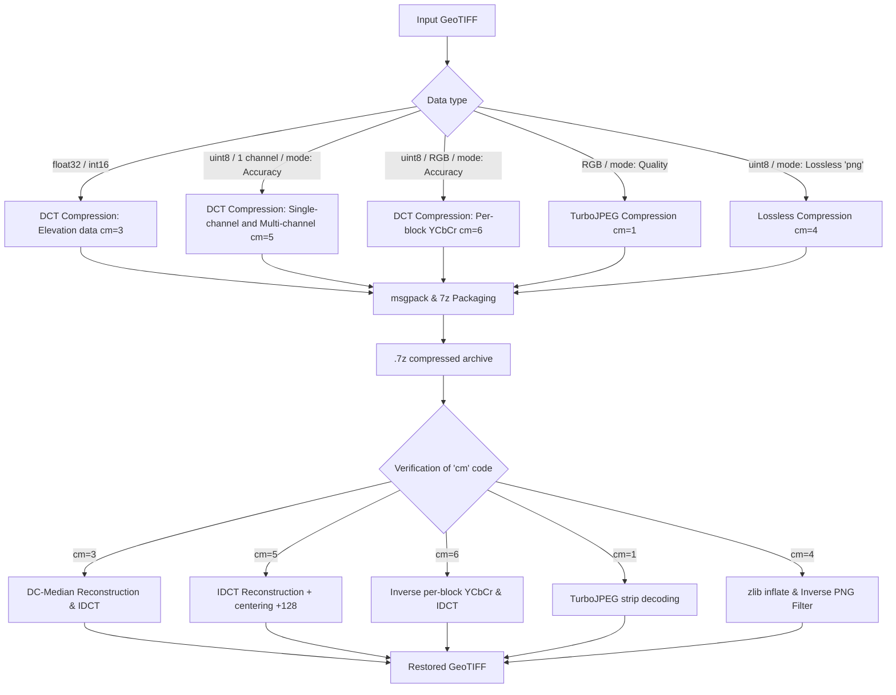
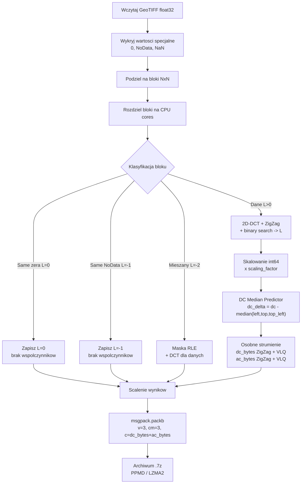
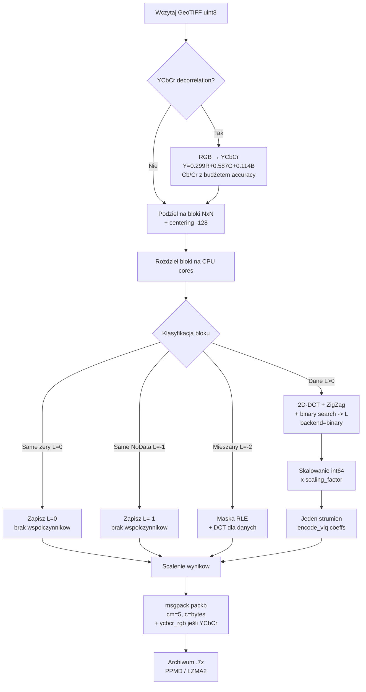
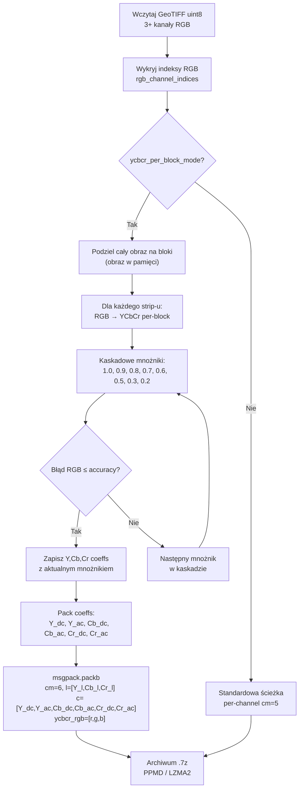
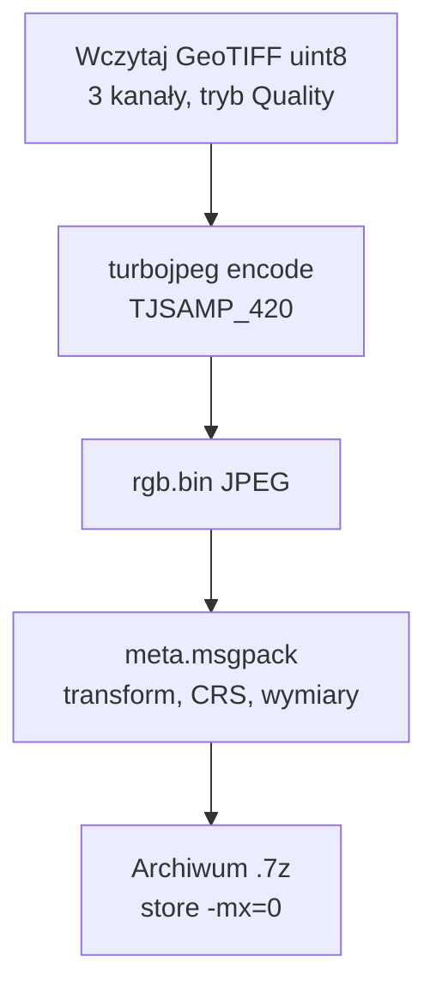
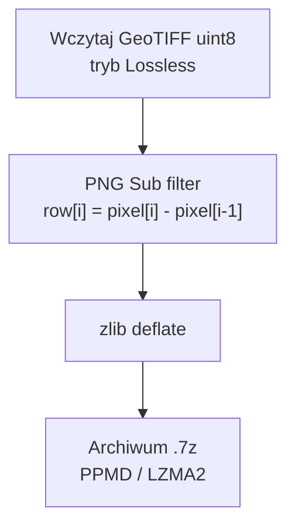
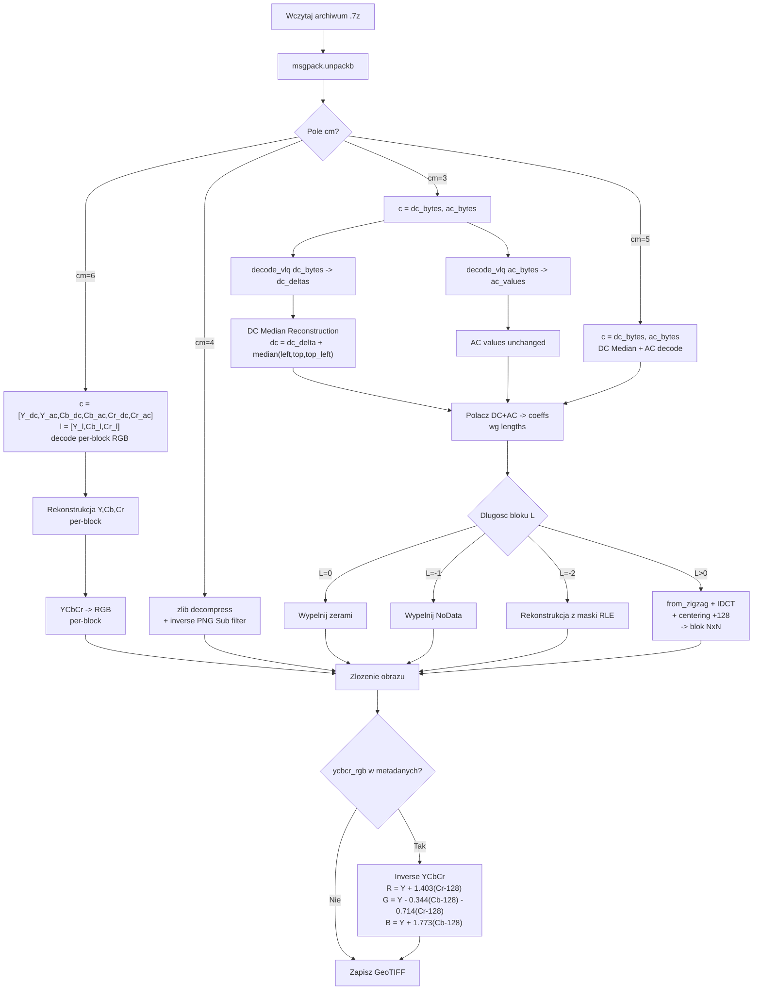
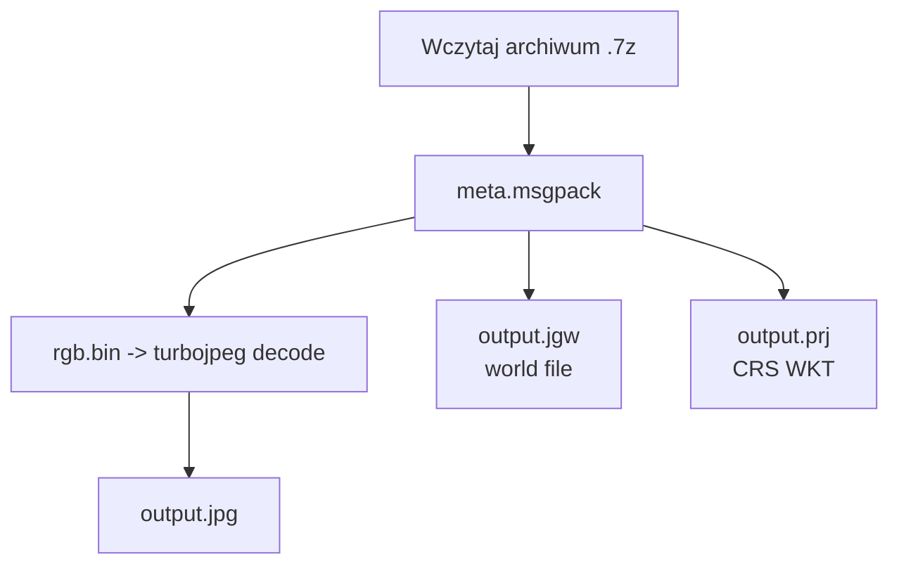
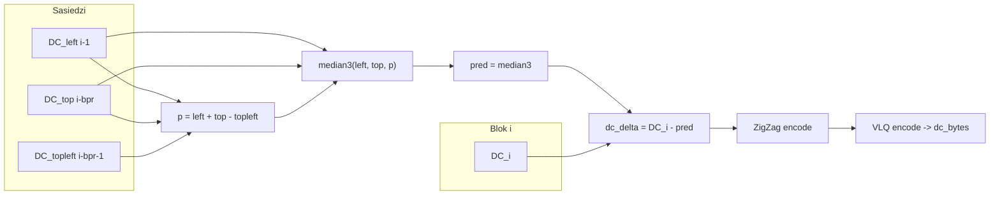
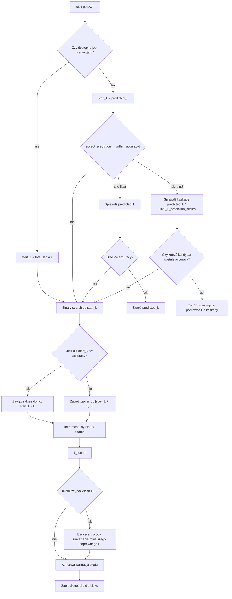

# FIDWAC v2 - Zaawansowana kompresja stratna DCT dla danych geoprzestrzennych

## Spis treści

- [Tryby kompresji (cm)](#tryby-kompresji-cm)
- [Streszczenie](#streszczenie)
- [1. Wprowadzenie i kontekst teoretyczny](#1-wprowadzenie-i-kontekst-teoretyczny)
- [2. Główne różnice względem FIDWaC v1](#2-główne-różnice-względem-fidwac-v1)
- [3. Schematy przepływu danych](#3-schematy-przepływu-danych)
- [4. Kodowanie VLQ (Variable-Length Quantity)](#4-kodowanie-vlq-variable-length-quantity)
- [5. Akceleracja Numba JIT](#5-akceleracja-numba-jit)
- [6. Metodologia predykcji optymalnej długości łańcucha DCT](#6-metodologia-predykcji-optymalnej-długości-łańcucha-dct)
- [7. Algorytm wyszukiwania optymalnej długości](#7-algorytm-wyszukiwania-optymalnej-długości)
- [8. Tryby kodowania danych po DCT](#8-tryby-kodowania-danych-po-dct)
- [9. Metody przygotowania danych](#9-metody-przygotowania-danych)
- [10. Format pliku wyjściowego](#10-format-pliku-wyjściowego)
- [11. Implementacja systemu](#11-implementacja-systemu)
  - [11.1 Architektura modułowa](#111-architektura-modułowa)
  - [11.2 Konfiguracja (config.json)](#112-konfiguracja-configjson)
  - [11.2a Desktopowe GUI (Tkinter, app_tk.py, gui/)](#112a-desktopowe-gui-tkinter-app_tkpy-gui)
  - [11.3 Webowe GUI (app.py, webui/)](#113-webowe-gui-apppy-webui)
- [12. Podsumowanie innowacji FIDWAC v2](#12-podsumowanie-innowacji-fidwac-v2)
- [13. Uruchomienie](#13-uruchomienie)
  - [Interpolacja IDW](#interpolacja-idw)
- [14. Wyniki testów wydajności — FIDWAC v2 vs SZ3](#14-wyniki-testów-wydajności--fidwac-v2-vs-sz3)
  - [14.1 Tabela wyników](#141-tabela-wyników)
  - [14.2 Wykresy](#142-wykresy)
  - [14.3 Analiza wyników](#143-analiza-wyników)
  - [14.4 Wnioski](#144-wnioski)
  - [14.5 Metodyka testów (`analysis/tests`)](#145-metodyka-testów-analysistests)
- [Ścieżka wsadowa uint8 (cm=5/cm=6), GPU i predykcja L](#ścieżka-wsadowa-uint8-cm5cm6-gpu-i-predykcja-l)
- [Wymagania systemowe i instalacja](#wymagania-systemowe-i-instalacja)
  - [Wymagania systemowe](#wymagania-systemowe)
  - [Komponenty zewnętrzne, linki i licencje](#komponenty-zewnętrzne-linki-i-licencje)
  - [Instalacja na Windows (WSL2)](#instalacja-na-windows-wsl2)
  - [Instalacja na Linux (natywnie)](#instalacja-na-linux-natywnie)
  - [Instalacja — Rozwiązywanie problemów](#instalacja--rozwiązywanie-problemów)
- [Uruchamianie](#uruchamianie)
  - [Webowe GUI (Flask)](#webowe-gui-flask)
  - [Desktopowe GUI (Tkinter)](#desktopowe-gui-tkinter)
  - [Linia poleceń (CLI)](#linia-poleceń-cli)
  - [Parametry kompresji](#parametry-kompresji)
- [Bibliografia](#bibliografia)

---

## Tryby kompresji (cm)

FIDWAC v2 wybiera tryb kompresji automatycznie na podstawie typu danych i flag. Każdy tryb ma inny format i inną gwarancję błędu:

| cm | Tryb | Dane wejściowe | Gwarancja błędu | Jak wybrać |
|----|------|----------------|-----------------|------------|
| 1 | TurboJPEG (quality) | uint8, dokładnie 3 pasma RGB | brak (parametr jakości JPEG) | domyślny dla 3-pasmowego uint8 bez `--uint8-accuracy` i `--lossless` |
| 3 | DCT + predyktor DC | float32/float64 (DEM/DTM), int16 | max błąd ≤ ε w jednostkach rastra | `--method dct` + `--accuracy` (domyślny dla float) |
| 4 | Lossless PNG Sub + zlib | uint8 | błąd = 0 (bezstratny) | `--lossless` |
| 5 | DCT integer per pasmo | uint8 / int8 / uint16 / int16 | max błąd ≤ ε na pasmo | `--uint8-accuracy` |
| 6 | Per-block YCbCr | uint8, ≥3 pasma RGB | max błąd ≤ ε w przestrzeni RGB | `--uint8-accuracy` + `--ycbcr-per-block` |
| 7 | Predykcyjny MED (near-lossless) | float/int, każde pasmo osobno | max błąd ≤ bound (`.fpred`) | `--method pred` |
| 8 | SZ3 (zewnętrzny) | float/int, każde pasmo osobno | max błąd ≤ ε SZ3 ABS (`.sz3`) | `--method sz3` (wymaga `pysz`) |
| 0 | Legacy VLQ | stare archiwa | — | tylko dekodowanie, wykrywany automatycznie |

Uwagi:

- cm=1 ma inny format archiwum (`rgb.bin` + `meta.msgpack`), nie używa pola `cm` w msgpack.
- W trybie cm=6 kompresowane są tylko 3 pasma RGB; pozostałe pasma w tym samym archiwum kodowane są jako cm=5.
- Dekoder wykrywa format automatycznie po zawartości archiwum — przy dekompresji nie trzeba podawać trybu.
- Numer cm=2 jest niewykorzystany.

---

## Streszczenie

FIDWAC v2 (Fast Inverse Distance Weighting and Compression, wersja 2) stanowi następną, rozwojową wersję, oryginalnego systemu FIDWaC (https://github.com/ZSIP/FIDWaC.git).  System podobnie jak w pierwotnej wersji, implementuje podejście do kompresji stratnej danych rastrowych z gwarancją maksymalnego błędu aproksymacji, wykorzystując dwuwymiarową dyskretną transformację kosinusową (2D-DCT) z adaptacyjnym doborem liczby współczynników.

Wersja V2, wprowadza akcelerację Numba JIT dla kluczowych operacji matematycznych z szybszą indeksacją bloków danych, hybrydowy algorytm wyszukiwania z inkrementalną rekonstrukcją błędu, dwa graficzne interfejsy użytkownika (webowe GUI we Flask i desktopowe GUI w Tkinter), interpolację IDW rozproszonych punktów oraz pięć dedykowanych ścieżek przetwarzania danych typu UINT8/INT8/FLOAT:

1. **Kompresja DCT dla danych wysokościowych (float32/int16)** — przeznaczona dla obrazów jednokanałowych danych ciągłych (np. modele wysokościowe DEM/DTM, siatki interpolacji IDW), która gwarantuje maksymalny błąd ≤ε w jednostkach pierwotnych (metry, centymetry). Wykorzystuje predyktor DC Median3 z osobnymi strumieniami DC/AC (tryb `cm=3`).
2. **Standardowa kompresja DCT (uint8 accuracy)** — przeznaczona dla obrazów jednokanałowych (np. kanały intensywności LiDAR, cieniowanie rzeźby terenu Hillshade), która gwarantuje maksymalny błąd ≤ε w skali szarości (0–255), bez transformacji przestrzeni barw (tryb `cm=5`).
3. **Per-block YCbCr z kaskadowymi mnożnikami** — przeznaczona dla wielokanałowych obrazów RGB z włączonym trybem accuracy, gwarantująca maksymalny błąd ≤ε w przestrzeni RGB przy użyciu precyzyjnego dopasowania współczynników dla poszczególnych bloków (tryb `cm=6`).
4. **TurboJPEG (SIMD)** — alternatywna, szybka ścieżka dla RGB bez trybu accuracy (oparta na jakości - quality-based), która wykorzystuje standardową kompresję JPEG (libjpeg-turbo) bez formalnej gwarancji maksymalnego błędu aproksymacji. Jest to bardzo szybka metoda pakowania plików, jednak dająca nadmiarowy niekontrolowany szum. Metoda ta nie ma trybu jednokanałowego ani trybu wielokanałowego > 3 RGB (tryb `cm=1` z meta.msgpack).
5. **Kompresja bezstratna (lossless)** — przeznaczona dla danych uint8 wymagających dokładnej rekonstrukcji (max error = 0), wykorzystująca filtr PNG Sub + kompresję zlib deflate. Metoda ta nie ma trybu jednokanałowego ani trybu wielokanałowego > 3 RGB. (tryb `cm=4`).

Oprócz domyślnego routingu DCT/JPEG/Lossless (`--method dct`) FIDWAC v2 udostępnia dwa jawnie wybierane tryby alternatywne / porównawcze, dostępne w CLI (`--method pred|sz3`) i w obu GUI:

- **Predykcyjna ścieżka near-lossless (`cm=7`, `--method pred`)** — osobny tok kwantyzacji skalarnej (`Q = 2 * (epsilon - m) * 0.999`, `m` = jeden ulp typu wyjściowego przy wielkości danych) z predyktorem MED (LOCO-I) dla gładkich rastrów (każde pasmo kodowane osobno); zapisuje skwantyzowane reszty i maskę NoData każdego pasma w `.fpred` (samodzielnie albo w `.7z`).
- **Zewnętrzna ścieżka porównawcza SZ3 (`cm=8`, `--method sz3`)** — opcjonalna nakładka na kompresor SZ3 (`pysz`, ograniczenie błędu `ABS`) z zachowaniem maski NoData i metadanych GeoTIFF w `.sz3` (samodzielnie albo w `.7z`), co pozwala porównać oba kompresory w tym samym toku pracy CLI/GUI.

**Interpolacja i GUI.** FIDWAC v2 zachowuje interpolację metodą odwrotnych odległości (IDW) z oryginalnego FIDWaC (`interpolate.py`, pakiet `interpolation/`): rozproszone punkty z plików TXT/CSV, LAS/LAZ lub SHP stają się siatką GeoTIFF, opcjonalnie z korektą geoidy, a siatkę można od razu skompresować (zob. [Interpolacja IDW](#interpolacja-idw)). Dwa GUI uruchamiają ten sam `compress.py` co linia poleceń: webowe GUI (Flask; zakładki **Compression**, **Interpolation (IDW)** i **Tests**) oraz desktopowe GUI (Tkinter; kompresja i dekompresja).

**FIDWAC:** W odróżnieniu od typowych kompresorów tablicowych, takich jak ZFP czy SZ3, FIDWAC przechowuje razem ze skompresowanymi danymi parametry georeferencji i metadane rastra. Archiwum zawiera m.in. transformację DCT dla danych dekompresowanych do GeoTIFF, parametry georeferencji CRS, wymiary obrazu, zakodowane informacje o NoData oraz maski wartości specjalnych, dzięki czemu dekompresja automatycznie odtwarza gotowy do użycia plik GeoTIFF, bez ręcznego dopisywania georeferencji lub rekonstruowania parametrów przestrzennych.

---

## 1. Wprowadzenie i kontekst teoretyczny

### 1.1 Podstawy matematyczne transformacji DCT

System FIDWAC v2 implementuje dwuwymiarową dyskretną transformację kosinusową typu II (DCT-II), definiowaną dla macierzy blokowej `A` o wymiarach `N x N` jako:

$$
X_{u,v} =
\frac{2}{N}\alpha(u)\alpha(v)
\sum_{i=0}^{N-1}\sum_{j=0}^{N-1}
A_{i,j}
\cos\left(\frac{\pi(2i+1)u}{2N}\right)
\cos\left(\frac{\pi(2j+1)v}{2N}\right)
$$

gdzie `alpha(k) = 1/sqrt(2)` dla `k = 0` oraz `alpha(k) = 1` w przeciwnym przypadku.

Przy tej normalizacji transformacja jest ortonormalna, a transformacja odwrotna (IDCT) ma postać:

$$
A_{i,j} =
\frac{2}{N}
\sum_{u=0}^{N-1}\sum_{v=0}^{N-1}
\alpha(u)\alpha(v)X_{u,v}
\cos\left(\frac{\pi(2i+1)u}{2N}\right)
\cos\left(\frac{\pi(2j+1)v}{2N}\right)
$$

### 1.2 Problem optymalizacji kompresji

Dla każdego bloku `B_k` o wymiarach `N x N` definiujemy problem minimalizacji:

$$
\min_{L_k} \quad L_k
\quad \text{przy ograniczeniu} \quad
\max_{(i,j)} \left|B_k[i,j] - \hat{B}_k^{(L_k)}[i,j]\right| \leq \varepsilon
$$

gdzie:

- `L_k` — liczba zachowanych współczynników DCT (zigzag) dla bloku `k`
- `B_hat_k(L_k)` — rekonstrukcja przy użyciu `L_k` współczynników
- `epsilon` — zadana dokładność (accuracy)

---

## 2. Główne różnice względem FIDWaC v1

| Aspekt                                                   | FIDWaC v1      | FIDWAC v2                                                                                                                              |
| -------------------------------------------------------- | -------------- | -------------------------------------------------------------------------------------------------------------------------------------- |
| **Serializacja**                                   | JSON (tekst)   | msgpack (binarny) + VLQ (Variable-Length Quantity, kodowanie zmiennej długości)                                                        |
| **Repr. współczynników**                        | ZigZag + int32 (32-bitowa liczba całkowita ze znakiem) | ZigZag + VLQ (Variable-Length Quantity, kodowanie zmiennej długości)                                   |
| **Kompresja archiwum**                             | py7zr (Python) | 7zz (7-Zip-ZSTD, natywny, wielowątkowy); konfigurowalny rozmiar bloku LZMA2 (domyślnie 2m) |
| **Metoda kompresji 7z**                            | domyślna      | PPMD / LZMA2 / BZIP2 / DEFLATE                                                                                                         |
| **Automatytczne Wyszukiwanie długości DCT -  L** | binary search  | hybrydowy: okno liniowe + binary search                                                                                                |
| **Akceleracja JIT**                                | brak           | Numba JIT (kluczowe operacje)                                                                                                          |
| **GUI**                                            | prosty interfejs Streamlit (`streamlit run app.py`) | Webowe GUI w przeglądarce (Flask; zakładki Compression, Interpolation (IDW) i Tests) i desktopowe GUI (Tkinter, `app_tk.py`); oba uruchamiają `compress.py`, rekurencja, zachowanie struktury katalogów |
| **Interpolacja IDW**                               | `interpolation.py` (KD-tree, silnik NumPy/numexpr albo Dask) | `interpolate.py` + pakiet `interpolation/`: jeden silnik NumPy z zapytaniami KD-tree w blokach, komórki z mniej niż N punktami używają istniejących punktów, GeoTIFF zorientowany na północ, standardowy nagłówek Surfer, opcjonalna kompresja wyniku (`--compress`) |
| **Predykcja**                                      | brak           | Simple / Advanced Heuristic (lookup table)                                                                                             |
| **Kompresja RGB**                                  | brak           | 1) Per-block YCbCr kaskadowe (cm=6, accuracy-based, gwarantuje błąd ≤ε) 2) TurboJPEG strips (quality-based, bez gwarancji błędu) |
| **uint8 accuracy (cm=5)**                          | brak           | binary search DCT z gwarancją błędu ≤ε pikseli (min ε=2), z centering -128, adaptacyjny sf                                       |
| **Lossless PNG (cm=4)**                            | brak           | PNG Sub filter + zlib deflate, max error = 0                                                                                           |
| **YCbCr decorrelation**                            | brak           | RGB→YCbCr przed DCT, redukcja korelacji międzykanałowej                                                                             |
| **Per-block YCbCr (cm=6)**                         | brak           | Hybrydowy per-block kaskadowy dobór mnożników YCbCr, błąd sprawdzany w RGB, szybsza kompresja niż globalne dopasowanie           |
| **Ścieżki predykcyjna i porównawcza (cm=7, cm=8)** | brak           | Opcjonalne `--method pred` (MED + kwantyzacja skalarna, `.fpred`) i `--method sz3` (zewnętrzny SZ3, `.sz3`), każde pasmo osobno, zintegrowane z `.7z` i odtwarzaniem metadanych GeoTIFF |

---

## 3. Schematy przepływu danych

### 3.0 Modułowa architektura i ścieżki (Routing) danych wejściowych

System FIDWAC v2 charakteryzuje się modułową architekturą, która automatycznie rozpoznaje format, typ danych oraz liczbę kanałów wejściowego rastra, kierując go na optymalną ścieżkę kompresji i dekompresji (wybór kodowania `cm`):



### 3.1 Kompresja - ścieżka DCT (float32, cm=3)



### 3.2 Kompresja - ścieżka uint8 accuracy (cm=5)



### 3.3 Kompresja - ścieżka per-block RGB YCbCr (cm=6)



### 3.4 Kompresja - ścieżka RGB/JPEG Quality



### 3.4 Kompresja - ścieżka Lossless (cm=4)



### 3.5 Dekompresja - ścieżka DCT



### 3.7 Dekompresja - ścieżka RGB/JPEG



### 3.7 Szczegółowy schemat DC Median Predictor (cm=3)



---

## 4. Kodowanie VLQ (Variable-Length Quantity)

Implementacja wykorzystuje dwuetapowe kodowanie.

**Etap 1 — ZigZag:** jednoznaczne odwzorowanie liczb całkowitych ze znakiem na nieujemne liczby całkowite:

$$
\mathcal{Z}(x) =
\begin{cases}
2x, & x \geq 0, \\
-2x - 1, & x < 0.
\end{cases}
$$

**Etap 2 — VLQ (Variable-Length Quantity, Base-128):** reprezentacja zmiennej długości ze znacznikiem kontynuacji.

**Efektywność:** Kodowanie ZigZag + VLQ redukuje rozmiar współczynników DCT w porównaniu do reprezentacji int32 (32-bitowych liczb całkowitych ze znakiem). Rzeczywiste oszczędności zależą od rozkładu wartości w danym obrazie i wymagają empirycznego testowania na konkretnych danych.

---

## 5. Akceleracja Numba JIT

Wersja 2 kompiluje kluczowe operacje inkrementalnej rekonstrukcji za pomocą Numba JIT (`@njit`, cache na `/dev/shm` lub `/tmp`):

| Funkcja                                                 | Opis                                                            |
| ------------------------------------------------------- | --------------------------------------------------------------- |
| `_nb_max_err(diff)`                                   | maksymalny błąd bezwzględny z bufora diff                    |
| `_nb_step_add(diff, basis_k, coeff_k)`                | inkrementalne dodanie współczynnika k (krok w dół L→L-1)   |
| `_nb_step_sub(diff, basis_k, coeff_k)`                | inkrementalne odjęcie współczynnika k (krok w górę L→L+1) |
| `_nb_jump_diff(diff, basis, coeffs, cur_L, target_L)` | skok do dowolnego L w binary search                             |

Eliminuje narzut Python dla wewnętrznej pętli backscan i wyszukiwania liniowego. Kompilacja JIT jest buforowana dla kolejnych uruchomień.

---

## 6. Metodologia predykcji optymalnej długości łańcucha DCT

### 6.1 Cel predykcji

Wszystkie backendy predykcyjne pełnią tę samą rolę: dostarczają punkt startowy `L_hat` dla algorytmu wyszukiwania. Nie zastępują końcowej walidacji błędu — poniższy warunek jest zawsze sprawdzany:

$$
\max |B - \hat{B}| \leq \varepsilon
$$

Lepsza predykcja oznacza mniej iteracji i szybszą kompresję.

**Dostępne backendy:**

- **Binary search** — tryb referencyjny bez predykcji. Sprawdza błąd rekonstrukcji i wyszukuje możliwie najmniejszą długość łańcucha DCT `L`, dlatego zwykle daje najmniejszy plik. Jest dokładniejszy pod względem minimalizacji `L`, ale może być wolniejszy od trybów predykcyjnych.
- **Advanced Heuristic** — predyktor oblicza 4 cechy bloku DCT (`ac_abs_mean`, `zero_ratio`, `ac_std`, `std_dev`) i korzysta z wcześniej wyuczonych tabel lookup przygotowanych na dużym zbiorze bloków treningowych. Tryb często skraca czas kompresji, ponieważ wybiera punkt startowy blisko oczekiwanej długości `L`. Gdy włączone jest `accept_prediction_if_within_accuracy`, może zaakceptować poprawną predykcję bez pełnego binary searcha, co dodatkowo przyspiesza kompresję, ale może dać większy plik. Aktualny szybki lookup grid używa indeksów siatki kwantylowej 2D: 64×29/31 dla float (N=8/16), 39×10 dla uint8.
- **Simple Heuristic** — predykcja oparta na wariancji bloku i prostych regułach statystycznych. Może przyspieszać analizę dla specyficznych, mało zróżnicowanych danych, np. gładkich fragmentów dna morskiego lub terenów o niewielkiej zmienności.

### 6.2 Dobór trybu i parametrów

Dokładne dopasowanie parametrów zależy od użytkownika, charakterystyki danych oraz priorytetu pracy: minimalny rozmiar pliku, krótszy czas kompresji albo kompromis między tymi celami. Zaleca się wykonanie wstępnych prób na małych, reprezentatywnych fragmentach danych i porównanie co najmniej dwóch wariantów: trybu `binary` oraz trybu `heuristic` z włączoną heurystyką zaawansowaną.

Przykładowe konfiguracje porównawcze:

| Tryb                          | `backend`   | `advanced_heuristic` | `backscan_break_after` | `accept_prediction_if_within_accuracy` |
| ----------------------------- | ------------- | ---------------------- | ------------------------ | ---------------------------------------- |
| `binary`                    | `heuristic` | `False`              | `0`                    | `False`                                |
| `advanced_heuristic_accept` | `heuristic` | `True`               | `0`                    | `True`                                 |

**Tryb `advanced_heuristic_accept`** = Advanced Heuristic + `accept_prediction_if_within_accuracy=True`. Jeśli predykcja z tabeli lookup daje długość `L_hat` spełniającą warunek błędu, algorytm akceptuje ją bez dalszego binary searcha:
$$
\max \left|B - \hat{B}^{(\hat{L})}\right| \leq \varepsilon
$$

Dla danych float sprawdzane jest jedno przewidywane `L_hat`. Dla danych uint8 system używa kaskady `uint8_L_prediction_scales`, czyli sprawdza kolejne długości `L_hat * s` (domyślnie: `0.9`, `1.0`, `1.1`, `1.3`, `1.5`, `2.0`). Jeśli któryś kandydat spełnia accuracy, algorytm akceptuje najmniejszą poprawną długość z tej kaskady bez pełnego binary searcha. Jeśli żaden kandydat nie spełnia accuracy, program przechodzi do standardowego wyszukiwania binary search z punktem startowym wynikającym z predykcji.

### 6.3 Empiryczne testowanie

Rzeczywiste wyniki porównania backendów predykcji należy oceniać na konkretnych zbiorach danych (DSM, DTM, ortofoto), ponieważ zależą one od wariancji, rozkładu wartości, udziału bloków gładkich oraz liczby fragmentów silnie zróżnicowanych. Przed kompresją dużych zasobów warto przeprowadzić krótkie testy na małych próbkach: sprawdzić `binary` i `heuristic`, kilka rozmiarów bloku, docelową dokładność oraz ustawienia `accept_prediction_if_within_accuracy`, `minimize_backscan` i `backscan_break_after`. Wyniki takich prób pozwalają dobrać konfigurację najlepiej pasującą do danego typu danych, a następnie zastosować ją dla całej serii plików.

### 6.4 Heurystyka prosta

Predykcja oparta na wariancji bloku:

$$
\hat{L}_{heur} =
\left\lfloor
\beta(\varepsilon) \cdot N^2 \cdot \gamma(\sigma_B^2)
\right\rfloor
$$

gdzie `beta(epsilon)` oznacza bazowy udział zachowywanych współczynników zależny od wymaganej dokładności, a `gamma(sigma_B^2)` oznacza korekcję wynikającą z wariancji bloku.

### 6.5 Heurystyka zaawansowana (tabela lookup w ./models/)

W katalogu `models/` udostępniono wstępnie przygotowane modele lookup, wyuczone na kilkudziesięciu milionach bloków, aby przyspieszyć predykcję długości łańcucha DCT. Modele te zostały przygotowane na zróżnicowanych danych DTM/DSM oraz RGB i mogą być używane jako domyślne tabele predykcyjne. W przypadku specyficznych zbiorów danych zaleca się jednak przygotowanie własnych tabel NPZ, dopasowanych do charakteru danych, oczekiwanej dokładności oraz zakresu wartości (np. dokładności pionowej dla modeli wysokościowych). Takie dopasowanie może znacząco usprawnić proces kompresji i poprawić relację między czasem działania a rozmiarem pliku wynikowego.

Wdrożenie ekstraktuje **4 cechy bloku DCT**: `ac_abs_mean`, `zero_ratio`, `ac_std` oraz `std_dev`. Dwie pierwsze cechy (`ac_abs_mean`, `zero_ratio`) są używane bezpośrednio jako indeksy aktualnej siatki kwantylowej 2D lookup. `ac_std` i `std_dev` pozostają liczone w predyktorze jako cechy diagnostyczne/rozszerzeniowe oraz dla zgodności z wcześniejszą analizą cech. Tabele lookup są prekomputowane offline i ładowane przy starcie systemu.
$$
\hat{L}_{adv} =
\mathcal{T}_{grid}\left[
\operatorname{qbin}\left(\log\left(1+\text{ac\_abs\_mean}\right)\right),
\operatorname{qbin}\left(\text{zero\_ratio}\right)
\right]
$$

**Dostępne modele lookup** (katalog `models/`):

#### Modele float32 (dane wysokościowe)

| Model                           | Opis                  |
| ------------------------------- | --------------------- |
| `lookup_N8_acc0.01_grid.npz`  | N=8, accuracy=0.01 m  |
| `lookup_N8_acc0.05_grid.npz`  | N=8, accuracy=0.05 m  |
| `lookup_N8_acc0.10_grid.npz`  | N=8, accuracy=0.10 m  |
| `lookup_N8_acc0.50_grid.npz`  | N=8, accuracy=0.50 m  |
| `lookup_N8_acc1.00_grid.npz`  | N=8, accuracy=1.00 m  |
| `lookup_N16_acc0.01_grid.npz` | N=16, accuracy=0.01 m |
| `lookup_N16_acc0.05_grid.npz` | N=16, accuracy=0.05 m |
| `lookup_N16_acc0.10_grid.npz` | N=16, accuracy=0.10 m |
| `lookup_N16_acc0.50_grid.npz` | N=16, accuracy=0.50 m |
| `lookup_N16_acc1.00_grid.npz` | N=16, accuracy=1.00 m |

Klucze NPZ: `grid` (uint16, 64×29 dla N=8 / 64×31 dla N=16), `edges_acm` (float32, 65/65), `edges_zr` (float32, 32), `acm_lookup`, `zr_lookup`.

#### Modele uint8 YCbCr (obrazy RGB, cm=6)

Dla trybu per-block RGB YCbCr (`cm=6`) wdrożono osobne modele lookup dopasowane do konkretnej dokładności `uint8_accuracy`. W katalogu `models/` znajdują się pliki dla dwóch wartości scaling factor (`sf=1`, `sf=10`) oraz sześciu predefiniowanych dokładności: `2`, `3`, `5`, `10`, `20`, `30` pikseli. Każdy plik zawiera trzy kanałowe siatki predykcji długości `L`: osobno dla Y, Cb i Cr.

| Model                                            | Opis                      |
| ------------------------------------------------ | ------------------------- |
| `lookup_uint8_ycbcr_L_N8_sf1_acc{A}_grid.npz`  | N=8, sf=1, accuracy=A px  |
| `lookup_uint8_ycbcr_L_N8_sf10_acc{A}_grid.npz` | N=8, sf=10, accuracy=A px |

gdzie dokładność accuracy to `{A}` ∈ `{2, 3, 5, 10, 20, 30}`.

Kod najpierw próbuje załadować plik dokładnie odpowiadający żądanej wartości `uint8_accuracy`, np. `lookup_uint8_ycbcr_L_N8_sf1_acc5_grid.npz` dla accuracy=5 i sf=1. Jeśli taki plik nie istnieje, wybierana jest najbliższa mniejsza predefiniowana dokładność z listy `{2, 3, 5, 10, 20, 30}`. Oznacza to wybór bezpieczniejszego, zwykle dokładniejszego modelu niż żądana wartość. Jeśli również taki plik nie jest dostępny, program przechodzi do ogólnej siatki YCbCr bez oznaczenia accuracy (`lookup_uint8_ycbcr_L_N8_sf{sf}_grid.npz`), a następnie do standardowej siatki uint8 (`lookup_uint8_L_N8_sf{sf}_grid.npz`).

Klucze NPZ dla modeli dopasowanych do accuracy: `grid_L_Y`, `grid_L_Cb`, `grid_L_Cr` (float32, 39×10), `edges_acm` (float64, 40), `edges_zr` (float64, 11), `coverage_Y`, `coverage_Cb`, `coverage_Cr` (int32, 39×10).

Siatki 39×10 oznaczają 39 binów `ac_abs_mean` × 10 binów `zero_ratio`. W trybie `cm=6` predyktor używa siatek kanałowych `grid_L_Y`, `grid_L_Cb`, `grid_L_Cr`, dzięki czemu długość startowa `L` może być przewidywana osobno dla luminancji i chrominancji.

**Przykładowe generowanie modeli:** skrypty do zbierania cech i budowania plików `.npz` znajdują się w katalogu `research/`. Jest to kod badawczy i pomocniczy, a nie gotowy docelowy pipeline produkcyjny. Należy traktować go jako przykład struktury danych, sposobu ekstrakcji cech i budowy siatek lookup, który trzeba dostosować do własnych zbiorów danych, własnych poziomów dokładności oraz własnej organizacji katalogów.

Dla ścieżki RGB/YCbCr przykładowy proces składa się z dwóch etapów: najpierw `research/uint8_ycbcr_L_lookup.py` może zebrać cechy bloków Y, Cb i Cr wraz z docelowymi wartościami `L`, a następnie `research/build_ycbcr_lookup.py` może przekształcić takie pliki cech z `results/ycbcr_features/` do modeli `.npz` zapisywanych w `models/`:

```bash
python3 research/build_ycbcr_lookup.py \
    --features results/ycbcr_features \
    --models models \
    --block-sizes 8 \
    --scaling-factors 1,10 \
    --accuracies 2,3,5,10,20,30 \
    --percentile 90
```

Tabele są prekomputowane offline i ładowane przy starcie systemu.

---

## 7. Algorytm wyszukiwania optymalnej długości

### 7.1 Punkt startowy (`start_L`)

Algorytm wyszukiwania długości `L` rozpoczyna pracę od punktu startowego zależnego od dostępnej predykcji. Predykcja nie zastępuje walidacji błędu. Służy tylko do zawężenia lub przyspieszenia wyszukiwania.

1. **Advanced Heuristic (`advanced_heuristic=True`)**

   - Dla danych float predyktor oblicza 4 cechy DCT: `ac_abs_mean`, `zero_ratio`, `ac_std`, `std_dev`.
   - Aktualna tabela lookup wyznacza `predicted_L` na podstawie pary (`ac_abs_mean`, `zero_ratio`).
   - `predicted_L` staje się punktem startowym: `start_L = predicted_L`.
   - Jeśli `accept_prediction_if_within_accuracy=true`, program najpierw sprawdza, czy `predicted_L` spełnia wymaganą dokładność. Jeśli tak, może zakończyć wyszukiwanie dla tego bloku bez pełnego binary searcha. Jeśli nie, przechodzi do binary search od tego punktu startowego.

2. **Uint8 / RGB YCbCr z predykcją L (`uint8_use_L_prediction=True`)**

   - Dla danych 8-bitowych predykcja `L` pochodzi z siatek NPZ dopasowanych do `sf`, `N` i, dla `cm=6`, do `uint8_accuracy`.
   - Jeśli `accept_prediction_if_within_accuracy=true`, program sprawdza kandydatów z `uint8_L_prediction_scales`, domyślnie: `0.9`, `1.0`, `1.1`, `1.3`, `1.5`, `2.0`.
   - Testowane są długości `predicted_L * scale`, po ograniczeniu do poprawnego zakresu wartości `L`.
   - Jeśli co najmniej jeden kandydat spełnia accuracy, wybierana jest najmniejsza poprawna długość z tej kaskady.
   - Jeśli żaden kandydat nie spełnia accuracy, program przechodzi do standardowego binary search z punktem startowym `predicted_L`.

3. **Simple Heuristic (`advanced_heuristic=False`)**

   - Predykcja opiera się na wariancji bloku.
   - Wynik predykcji staje się punktem startowym: `start_L = predicted_L`.
   - Dalsze dopasowanie wykonuje binary search oraz, jeśli skonfigurowano, backscan minimalizacji.

4. **Brak predykcji / tryb referencyjny**

   - Jeśli predykcja nie jest dostępna, punkt startowy ustawiany jest na połowę wszystkich współczynników: `start_L = total_len // 2`.
   - Następnie wykonywany jest pure binary search, który szuka najmniejszego `L` spełniającego zadany błąd.

### 7.2 Schemat działania (`refine.py`)



### 7.3 Cechy używane do predykcji

**Advanced Heuristic** (`advanced_heuristic=True`):

- Ekstraktor oblicza **cztery cechy bloku DCT**:
  1. **ac_abs_mean** — średnia wartość bezwzględna współczynników AC
     - Wysoka wartość = więcej energii w wysokich częstotliwościach = większe L
     - Niska wartość = mało energii = mniejsze L
  2. **zero_ratio** — ułamek zer w współczynnikach AC
     - Wysoki zero_ratio = mało znaczących współczynników = mniejsze L
     - Niski zero_ratio = wiele znaczących współczynników = większe L
  3. **ac_std** — odchylenie standardowe współczynników AC
  4. **std_dev** — odchylenie standardowe bloku wyznaczane z DCT przez twierdzenie Parsevala
- Aktualny format NPZ (`lookup_N{8,16}_acc{*}_grid.npz`) wykonuje predykcję przez wyszukanie w siatce kwantylowej 2D indeksowanej parą (`ac_abs_mean`, `zero_ratio`) — 64×29 dla N=8, 64×31 dla N=16

**Simple Heuristic** (`advanced_heuristic=False`):

- Opiera się na **wariancji pikseli** bloku (bez plików NPZ)
- Algorytm:
  1. Oblicz bazową długość L na podstawie accuracy: `base_L = accuracy_to_ratio[accuracy] × N²`
  2. Oblicz wariancję pikseli: `var = np.var(block)`
  3. Zastosuj korekcję na podstawie progów wariancji:
     - `var > high_threshold` → correction = 1.3 (trudny blok)
     - `var > mid_threshold` → correction = 1.1
     - `var < low_threshold` → correction = 0.8 (łatwy blok)
     - inaczej → correction = 1.0
  4. Wynik: `predicted_L = base_L × correction`

### 7.4 Parametry wyszukiwania

| Parametr                                 | Domyślnie          | Dotyczy backendów                  | Opis                                      | Wpływ na szybkość/plik                            |
| ---------------------------------------- | ------------------- | ----------------------------------- | ----------------------------------------- | ---------------------------------------------------- |
| `minimize_backscan`                    | 10                  | **wszystkie**                 | kroki backscanu po znalezieniu L          | Większe = wolniejsze, mniejszy plik                 |
| `backscan_break_after`                 | 3                   | **wszystkie**                 | przerwij po N failach z rzędu (0 = wyczerpujący) | Większe = szybsze, większy plik                    |
| `accept_prediction_if_within_accuracy` | True                | **wszystkie** (float & uint8) | akceptuj predykcję bez dalszego szukania | True = szybsze, ale może dać większy plik           |
| `uint8_L_prediction_scales`            | `[0.2, 0.3, 0.5, 0.7, 1.0, 1.1, 1.5, 2.0]` | uint8 accuracy + accept             | kaskada mnożników dla przewidywanego L  | Szersza kaskada = większa szansa szybkiej akceptacji, ale możliwy większy plik |

> **Uwaga:** `minimize_backscan` i `backscan_break_after` działają dla **wszystkich** backendów, w tym `binary`. Wyższy backscan = mniejszy plik, więcej obliczeń. W obecnym `config.json` `backscan_break_after=3`, więc backscan może zakończyć się po trzech kolejnych nieudanych próbach znalezienia krótszego poprawnego `L`.

---

## 8. Tryby kodowania danych po DCT

Najważniejsze są tryby kodowania:

| Tryb | Dane | Co zapisuje |
| ---- | ---- | ----------- |
| `cm=3` | float32/int16, np. DTM/DSM | DCT z gwarancją accuracy, zapis DC/AC |
| `cm=5` | pojedyncze kanały uint8/int | DCT accuracy dla danych 8-bitowych, zapis DC/AC |
| `cm=6` | RGB w trybie accuracy | per-block YCbCr, osobny zapis Y/Cb/Cr |
| `cm=4` | uint8 lossless | bezstratny PNG Sub filter + zlib |
| `cm=1` / `jpeg_strips` | RGB bez trybu accuracy | TurboJPEG quality-based, `rgb.bin + meta.msgpack` |

### 8.1 Wspólny zapis DC/AC

Dla ścieżek DCT program zapisuje współczynniki w dwóch strumieniach:

- `dc_bytes` — pierwszy współczynnik DCT każdego aktywnego bloku, zapisany jako różnica względem sąsiadów,
- `ac_bytes` — pozostałe współczynniki bloku, czyli AC, zapisane bez predykcji DC.

Oba strumienie są kodowane przez ZigZag + VLQ. Dzięki temu małe liczby i małe różnice zajmują mniej bajtów.

Predykcja DC działa tylko na aktywnych blokach, czyli takich, które mają `L > 0`. Bloki specjalne, np. same zera lub same NoData, nie mają współczynników DCT i nie biorą udziału w predykcji DC.

Reguła predykcji jest prosta:

```text
plane = left_dc + top_dc - top_left_dc
predicted_dc = median(left_dc, top_dc, plane)
dc_delta = dc - predicted_dc
```

Jeśli brakuje sąsiadów, kod używa prostego fallbacku:

| Dostępni sąsiedzi | Predykcja DC |
| ----------------- | ------------ |
| left + top + top_left | `median(left, top, left + top - top_left)` |
| tylko left | `left` |
| tylko top | `top` |
| brak sąsiadów | `0` |

Ten mechanizm jest bezstratny względem zapisanych współczynników DCT. Nie zmienia wartości `L`, nie zmienia accuracy i nie pogarsza rekonstrukcji. Zmienia tylko sposób zapisu współczynników w archiwum.

### 8.2 Tryb wysokościowy (`cm=3`)

Tryb `cm=3` jest używany dla danych wysokościowych i numerycznych, np. DTM/DSM (FLOAT). Program:

1. dzieli raster na bloki,
2. wykonuje DCT,
3. szuka najmniejszego `L`, które spełnia zadany błąd,
4. zapisuje długości bloków w `l`,
5. zapisuje współczynniki jako `c = [dc_bytes, ac_bytes]`.

Dokładność jest liczona w jednostkach danych wejściowych, np. metrach lub centymetrach. Georeferencja, NoData, wymiary i transformacja GeoTIFF są zapisywane w metadanych archiwum.

### 8.3 Tryb pojedynczego kanału uint8 (`cm=5`)

Tryb `cm=5` jest używany dla pojedynczych kanałów 8-bitowych, np. intensywności, hillshade lub kanałów obrazu przetwarzanych osobno. Program przed DCT centruje wartości wokół zera, a potem szuka `L` spełniającego `uint8_accuracy`.

W aktualnym kodzie `cm=5` również korzysta z formatu `c = [dc_bytes, ac_bytes]`. Starszy pojedynczy strumień VLQ jest obsługiwany tylko jako kompatybilność wsteczna przy dekompresji starszych archiwów.

Kompresja działa także dla rastrów wielokanałowych, zarówno takich, które zawierają kanały RGB, jak i takich, które ich nie zawierają. Dane wejściowe są czytane przez `rasterio`, najczęściej z plików GeoTIFF. Kanały alfa są pomijane, a pozostałe pasma są kompresowane jako kanały danych.

Jeśli w konfiguracji wskazano trzy kanały RGB i włączono `ycbcr_per_block_mode`, kanały RGB są kompresowane wspólnie ścieżką `cm=6`. Pozostałe kanały, jeśli istnieją, są kompresowane niezależnie standardową ścieżką DCT (`cm=5` dla danych 8-bitowych accuracy albo `cm=3` dla danych numerycznych). Jeśli RGB nie jest zdefiniowane, wszystkie kanały są traktowane niezależnie.

Dla każdego kanału może zostać zapisany własny scaling factor `sf` oraz rozmiar bloku `N`. W formacie msgpack wartość `N` kanału jest przechowywana technicznie w polu `ch_data["bs"]`, a dekompresja odczytuje ją przed rekonstrukcją kanału. Dzięki temu archiwum poprawnie odtwarza dane także wtedy, gdy kanały zostały zapisane z różnymi ustawieniami, np. po automatycznym doborze parametrów albo po retry z mniejszym rozmiarem bloku.

### 8.4 Tryb RGB YCbCr per-block (`cm=6`)

Tryb `cm=6` jest ścieżką accuracy dla obrazów RGB. Program najpierw przelicza kanały RGB na YCbCr, ponieważ rozdzielenie luminancji i chrominancji zmniejsza korelację między kanałami i zwykle poprawia skuteczność kompresji DCT:

- `Y` — luminancja,
- `Cb` — chrominancja niebieska,
- `Cr` — chrominancja czerwona.

Dla każdego bloku program kompresuje osobno komponenty Y, Cb i Cr, a następnie wykonuje pełną rekonstrukcję YCbCr → RGB i sprawdza rzeczywisty maksymalny błąd w kanałach R, G i B. Blok jest zaakceptowany dopiero wtedy, gdy błąd RGB mieści się w `uint8_accuracy`.

Dobór dokładności odbywa się przez kaskadę mnożników z `config.json`:

```json
"ycbcr_fallback_multipliers": [1.0, 0.9, 0.8, 0.7, 0.6, 0.5, 0.4, 0.3, 0.2, 0.1]
```

Dla danego mnożnika limit błędu komponentów Y, Cb i Cr jest ustawiany jako `uint8_accuracy * multiplier`. Większy mnożnik oznacza luźniejszy limit błędu dla komponentów YCbCr i zwykle mniejszy plik, ale może nie przejść końcowej walidacji RGB z poziomem accuracy. Dlatego też podczas walidacji bloku mniejszy mnożnik wymusza dokładniejszą rekonstrukcję YCbCr i jest używany dla trudniejszych bloków.

Program nie zawsze zaczyna od pierwszego mnożnika. Na podstawie trudności chrominancji oraz, jeśli dostępna jest predykcja `L`, może rozpocząć od dalszego indeksu kaskady. Jeśli wybrany mnożnik nie spełni warunku błędu RGB, program przechodzi do kolejnych, dokładniejszych mnożników. Flaga `fallback` oznacza, że blok wymagał przejścia dalej niż przewidywany punkt startowy.

W archiwum `cm=6` zapisuje trzy zestawy długości i współczynników:

| Pole | Zawartość |
| ---- | --------- |
| `l` | `[Y_lengths, Cb_lengths, Cr_lengths]` |
| `c` | `[Y_dc, Y_ac, Cb_dc, Cb_ac, Cr_dc, Cr_ac, mult_y, mult_cb, mult_cr, fallback]` |

Mnożniki `mult_y`, `mult_cb`, `mult_cr` oraz flaga `fallback` są potrzebne do poprawnej rekonstrukcji bloków RGB. Dekompresja odtwarza YCbCr, wykonuje transformację odwrotną do RGB i przycina wartości do zakresu 0–255.

### 8.5 Tryb bezstratny uint8 (`cm=4`)

Tryb `cm=4` służy do dokładnej rekonstrukcji danych uint8, czyli `max error = 0`. Nie używa DCT. Zamiast tego stosuje:

- filtr PNG Sub, czyli różnice między sąsiednimi pikselami w wierszu,
- kompresję zlib deflate.

Ten tryb daje zwykle większe pliki niż DCT accuracy, ale zachowuje dane bez żadnej straty. W nazwie pliku pojawia się suffix `LF`.

### 8.6 Najważniejsze pola msgpack

| Pole | Znaczenie |
| ---- | --------- |
| `cm` | tryb kodowania: `3`, `4`, `5` albo `6` |
| `l` | długości `L` dla bloków; dla `cm=6` osobno dla Y, Cb i Cr |
| `c` | dane współczynników lub dane lossless |
| `m` | maski RLE dla NoData i zer |
| `sf` | scaling factor kanału, jeśli został zapisany |
| `bs` | zapisany rozmiar bloku `N` dla kanału; jeśli brak, używany jest globalny `n` |

Implementacyjnie odpowiadają za to głównie `core/codec.py`, `compress/compression.py` i `compress/decompression.py`.

### 8.7 Tryb TurboJPEG (`cm=1`, quality-based)

Tryb TurboJPEG jest szybką ścieżką dla obrazów RGB `uint8`, gdy `uint8_accuracy_mode=false`. W tym trybie program nie wykonuje DCT blokowego FIDWAC z walidacją błędu. Zamiast tego używa biblioteki `libjpeg-turbo` i zapisuje obraz jako paski JPEG (`jpeg_strips`).

Ta ścieżka jest oparta na parametrze jakości JPEG:

```json
"rgb_quality": 85
```

Im wyższa wartość `rgb_quality`, tym zwykle lepsza jakość obrazu i większy plik. Im niższa wartość, tym większa stratność i mniejszy plik. Ten tryb nie gwarantuje maksymalnego błędu w pikselach ani w jednostkach danych. Do kompresji z gwarancją błędu dla RGB należy używać `cm=6`.

Format archiwum różni się od standardowej ścieżki DCT:

| Plik w archiwum | Znaczenie |
| --------------- | --------- |
| `rgb.bin` | kolejne paski JPEG zapisane binarnie |
| `meta.msgpack` | metadane: `mode="jpeg_strips"`, rozmiary i offsety pasków, CRS, transformacja GeoTIFF, NoData |

Podczas dekompresji program odczytuje `meta.msgpack`, dekoduje paski JPEG i składa pełny obraz RGB. Georeferencja oraz CRS są odtwarzane z metadanych archiwum.

---

## 9. Metody przygotowania danych

### 9.1 Ekstrakcja i padding bloków

Obraz jest dzielony na kwadratowe bloki o rozmiarze `N x N` (np. 8×8, 16×16). Jeśli wymiary obrazu nie są wielokrotnością `N`, brakujące piksele są uzupełniane (numpy padding). Bloki zawierające same zera lub same wartości NoData (-9999) są pomijane w przetwarzaniu i kodowane pojedynczym znakiem, co przyspiesza kompresję.

### 9.2 Obsługa wartości NoData i zer

Bloki zawierające wartości NoData lub zera są specjalnie kodowane dla lepszej kompresji:

1. **Detekcja:** tworzone są maski pozycji NoData i zer
2. **Interpolacja:** wartości NoData i zera są zastępowane średnimi wartościami sąsiednich pikseli (interpolacja nearest-neighbor), co wygładza dane i daje lepszą komresję DCT.
3. **Kompresja DCT:** przeprowadzana na zinterpolowanym bloku (bez "dziur")
4. **Zapis:** maski pozycji zakodowane metodą RLE + współczynniki DCT
5. **Dekompresja:** przy odtwarzaniu maski przywracają oryginalne wartości NoData i zer na ich właściwe pozycje.

### 9.3 Automatyczny dobór rozmiaru bloku

Automatyczny dobór działa, gdy `auto_select_block_size=true`. Kod rozróżnia dwie ścieżki: dane numeryczne/float oraz dane integer/uint8.

**Dane float / wysokościowe (`cm=3`):**

Najpierw liczona jest wariancja/zmienność kanału, a następnie wybierane są kandydackie rozmiary bloku `N`:

- `sigma > auto_select_std_threshold_high` (domyślnie `10.0`) → testowane jest tylko `N=8`,
- `auto_select_std_threshold_medium < sigma <= auto_select_std_threshold_high` (domyślnie `5.0–10.0`) → testowane są `N=8` i `N=16`,
- `sigma <= auto_select_std_threshold_medium` → testowane są `N=8`, `N=16`, `N=32`.

Lista ta jest dodatkowo ograniczana przez `allowed_block_sizes` z `config.json`. Dla każdego dopuszczalnego `N` program pobiera próbkę bloków (`auto_select_sample_size`, domyślnie `1000`), wykonuje próbną kompresję i estymuje rozmiar zapisu w msgpack. Wybierane jest `N` z najmniejszym szacowanym rozmiarem.

**Dane integer / uint8 (`cm=5`):**

Dla danych uint8 kod dobiera nie tylko rozmiar bloku `N`, ale również scaling factor `sf`. Najpierw próbuje użyć szybkiej tabeli `models/lookup_uint8_grid.npz`, która przewiduje parę `(sf, N)` na podstawie cech DCT próbki. Jeśli tabela nie jest dostępna, program przechodzi do próbkowania.

Próbkowanie i wstępna selekcja kandydatów są kontrolowane przez trzy parametry w pliku config.json lub gui:

- `auto_select_sample_size` (domyślnie `1000`) — maksymalna liczba bloków pobieranych do próbnej kompresji. Program wybiera bloki równomiernie z całego kanału, więc większa wartość daje stabilniejszą ocenę kosztem czasu.
- `auto_select_std_threshold_high` (domyślnie `10.0`) — próg dużej zmienności. Gdy odchylenie standardowe kanału jest większe od tej wartości, dla danych float testowane jest tylko `N=8`, bo duża lokalna zmienność zwykle wymaga mniejszych bloków.
- `auto_select_std_threshold_medium` (domyślnie `5.0`) — próg średniej zmienności. Gdy odchylenie standardowe mieści się między progiem średnim i wysokim, testowane są `N=8` oraz `N=16`; przy niższej zmienności dopuszczane jest również `N=32`.

W trybie próbkowania testowane są kombinacje `sf` z `uint8_scaling_factor` oraz dopuszczalnych wartości `N`. Kod wybiera najmniejszy szacowany rozmiar spośród konfiguracji, które spełniają `uint8_accuracy`; jeśli żadna konfiguracja z próbki nie przejdzie walidacji, wybierana jest konfiguracja o najmniejszym szacowanym rozmiarze.

**Retry na błąd validity:**

Jeśli po pełnej kompresji kanału wynik `validity=False` i `N > 8`, program ponawia kompresję z mniejszym blokiem: `32 -> 16 -> 8`. Przy retry `auto_select_block_size` jest wyłączany, aby wymusić konkretny mniejszy rozmiar bloku. Plik wyjściowy otrzymuje suffix `_VT` (valid) albo `_VF` (invalid).

---

## 10. Format pliku wyjściowego

FIDWAC zapisuje wynik jako format msgpack zoptymalizowany pod kompresję archiwum `.7z`. W środku są dane skompresowane oraz metadane potrzebne do automatycznego odtworzenia GeoTIFF, m.in.: wymiary rastra, CRS, transformacja georeferencyjna, NoData, maski i parametry kompresji.

### 10.1 Dwa formaty archiwum

| Ścieżka | Kiedy jest używana | Zawartość archiwum |
| ------- | ------------------ | ------------------ |
| DCT / accuracy (`cm=3`, `cm=4`, `cm=5`, `cm=6`) | dane wysokościowe, pojedyncze kanały uint8, RGB accuracy, lossless | jeden plik `{nazwa}.msgpack` spakowany do `.7z` |
| TurboJPEG (`cm=1`, `jpeg_strips`) | RGB `uint8`, gdy `uint8_accuracy_mode=false` | `rgb.bin` z paskami JPEG oraz `meta.msgpack` |

Ścieżka DCT jest używana wtedy, gdy ważna jest kontrola błędu albo rekonstrukcja bezstratna. Ścieżka TurboJPEG jest szybsza i jakościowa, ale nie daje gwarancji maksymalnego błędu.

Do tworzenia archiwum program używa natywnego 7z działającego na wielu rdzeniach: najpierw `7zz` (7-Zip-ZSTD, instalowany przez `install/setup_linux.sh`), potem `7zip` lub `7z`; w razie potrzeby przechodzi na fallback `py7zr`.

Archiwa LZMA2 są zapisywane z rozmiarem bloku ustawianym w `output.lzma2_block_size` (domyślnie `2m`; w CLI `--lzma2-block-size`, także w obu GUI; pusta wartość = domyślne ustawienie 7-Zip). 7-Zip kompresuje bloki równolegle, ze słownikiem dopasowanym do bloku, więc archiwizacja jest dużo szybsza, a archiwum pozostaje standardowym `.7z` z LZMA2, które otworzy każdy 7-Zip i `py7zr`. Na trzech arkuszach RGB 5120 × 5120 (accuracy 2) archiwizacja trwała 0,4–0,5 s zamiast 5–11 s (na jednym wątku 2,8–5,7 s zamiast 7–19 s), całe kodowanie 13–17 s zamiast 18–27 s, a rozmiar archiwum zmienił się o −0,8% do +0,02% przy identycznej zawartości. Bloki 512k zaczynają powiększać archiwum; zstd (7-Zip-ZSTD) dawał archiwa większe o 1,4–6,2% na szybkich poziomach, a na poziomach 19–22 był wolniejszy od LZMA2.

### 10.2 Archiwum DCT

Archiwum DCT ma prostą strukturę:

```text
output.7z
└── {nazwa}.msgpack
```

Plik `.msgpack` zawiera zarówno dane kompresji, jak i metadane przestrzenne. Dla jednego kanału pola `l`, `c`, `m` i `cm` są zapisane bezpośrednio w słowniku. Dla rastrów wielokanałowych używane jest pole `channels`, w którym każdy kanał ma własne dane kompresji, np. `cm`, `l`, `c`, `m`, `sf`, `bs`.

Najważniejsze pola:

| Pole | Znaczenie |
| ---- | --------- |
| `v` | wersja formatu |
| `cm` | tryb kompresji kanału |
| `ch` | liczba kanałów danych |
| `n` | globalny rozmiar bloku `N` |
| `channels` | lista kanałów w rastrze wielokanałowym |
| `s`, `p` | oryginalny rozmiar rastra i rozmiar po paddingu |
| `t`, `r` | transformacja GeoTIFF i CRS |
| `d`, `dn` | wartość NoData i informacja, czy NoData występuje |
| `ycbcr_rgb` | indeksy kanałów RGB, jeśli użyto ścieżki YCbCr |

### 10.3 Archiwum TurboJPEG

Ścieżka TurboJPEG zapisuje obraz RGB jako paski JPEG:

```text
output.7z
├── rgb.bin
└── meta.msgpack
```

`rgb.bin` zawiera sklejone paski JPEG. `meta.msgpack` opisuje, jak je odczytać: rozmiary pasków, pozycje `y_start`, jakość JPEG, wymiary obrazu, CRS, transformację GeoTIFF i NoData. Podczas dekompresji program odtwarza pełny raster RGB i zapisuje go jako GeoTIFF.

### 10.4 Nazwa pliku

Nazwa archiwum koduje najważniejsze ustawienia, m.in. tryb doboru `N`, accuracy albo jakość JPEG, typ DCT, liczbę miejsc po przecinku i CRS.

Przykładowy schemat dla ścieżki DCT:

```text
{nazwa}_{AUTO|N}{N}_{Acc...|U8acc...}_tdct{dct}_dec{decimal}_CRS{crs}_{VT|VF|LF}.7z
```

Dla TurboJPEG nazwa zawiera jakość JPEG, np. `_Q85_`.

| Suffix | Znaczenie |
| ------ | --------- |
| `_VT` | wszystkie bloki spełniają zadany błąd |
| `_VF` | część bloków przekracza zadany błąd |
| `_LF` | tryb bezstratny `cm=4` |
| `_Q85` | TurboJPEG z jakością 85 lub inną wartością `rgb_quality` |

---

## 11. Implementacja systemu

### 11.1 Architektura modułowa

```
FIDWAC_v2/
├── app.py               # Punkt wejścia webowego GUI (Flask)
├── app_tk.py            # Punkt wejścia desktopowego GUI (Tkinter)
├── compress.py          # Interfejs CLI (kompresja i dekompresja z poziomu konsoli)
├── interpolate.py       # Interfejs CLI interpolacji IDW
├── config.py            # Definicje klas konfiguracji (dataclasses) i obsługa config.json
├── compress/            # Pakiet operacji kompresji i dekompresji plików
│   ├── compression.py       # Główny kontroler kierujący na ścieżki DCT, JPEG lub Lossless
│   ├── compression_dct.py   # Kompresja DCT dla float32 (kanały wysokościowe) i uint8 accuracy
│   ├── compression_jpeg.py  # Ścieżka TurboJPEG (quality-based) dla uint8 RGB
│   ├── compression_lossless.py # Ścieżka Lossless PNG (cm=4) dla uint8
│   ├── compression_utils.py # Pomocnicze funkcje (pakowanie 7z, zapis plików)
│   └── decompression.py     # Odwracanie procesów kompresji (rekonstrukcja GeoTIFF)
├── core/                # Rdzeń algorytmów kodowania i transformacji
│   ├── codec.py             # Kodowanie entropijne VLQ, ZigZag i DC Median Predictor (Numba JIT)
│   └── dct.py               # Prekomputowane bazy transformacji IDCT i operacje matematyczne
├── predictor/           # Pakiet backendów predykcji L
│   ├── predictor.py         # Implementacja HeuristicPredictor i AdvancedHeuristicPredictor
│   ├── predictor_npy.py     # Odpytywanie siatek kwantylowych (cKDTree / lookup z npy)
│   └── predictor_uint8.py   # Predyktor L dla uint8: load/query siatek (39×10) per kanał YCbCr i accuracy
├── engine/              # Silnik przetwarzania bloków
│   ├── blocks.py            # Podział rastra na bloki, multiprocesowe przetwarzanie i dekorelacja YCbCr
│   ├── refine.py            # Hybrydowe wyszukiwanie L (linear window + binary search + backscan)
│   └── utils.py             # Operacje pomocnicze (interpolacja nearest-neighbor, RLE maski)
├── interpolation/       # Interpolacja IDW (zaadaptowana z ZSIP/FIDWaC)
│   ├── points.py            # Odczyt punktów (TXT/CSV, LAS/LAZ, SHP), korekta geoidy
│   ├── idw.py               # Siatka, IDW z KD-tree, wygładzanie Gaussa
│   ├── export.py            # GeoTIFF, CSV, siatka Surfer, SHP punktów, podgląd PNG
│   ├── run.py               # Tok dla jednego pliku punktów, opcjonalna kompresja
│   └── geoid/PL_geod.7z     # Dołączony model geoidy (Polska)
├── gui/                 # Desktopowe GUI Tkinter (panele, presety, runner, motyw, widżety)
├── webui/               # Webowe GUI (Flask)
│   ├── server.py            # Trasy: strona, przeglądarka katalogów, uruchamianie, status, stop, testy
│   ├── jobs.py              # Jedno zadanie naraz; uruchamia compress.py / interpolate.py / run_tests.py
│   ├── settings.py          # Wartości domyślne formularza, walidacja, presety, argumenty CLI, ustawienia testów
│   ├── interp.py            # Zakładka interpolacji: wartości domyślne, walidacja, argumenty interpolate.py
│   ├── templates/           # index.html, _interp_panel.html, tests_results.html
│   └── static/              # app.css, app.js, interp.js, tests.js (bez zewnętrznych bibliotek)
├── models/              # Pliki prekomputowanych tabel lookup dla Advanced Heuristic (*.npz)
├── research/            # Skrypty badawcze do zbierania cech i budowania przykładowych modeli NPZ
│   ├── build_ycbcr_lookup.py # Przykładowe budowanie tabel lookup uint8 YCbCr (per sf, per accuracy)
│   └── ...              # Pozostałe narzędzia treningowe/analityczne; wymagają dostosowania do własnych danych
```

**Ścieżka streaming** (`compress_channel_dct_streaming`): dla dużych plików wysokościowych (DSM/DTM), gdzie załadowanie całego kanału do RAM jest niepraktyczne. Pracownicy ekstraktują bloki wewnętrznie, eliminując narzut picklowania per-blok. Automatycznie wybierana gdy plik przekracza próg pamięci.

### 11.2 Konfiguracja (config.json)

Plik `config.json` grupuje ustawienia programu w sześciu blokach: katalogi robocze, parametry kompresji, wydajność, predykcja, format wyjścia oraz interpolacja IDW. Poniżej opisano najważniejsze pola zgodne z aktualnym repozytorium. Plik ten jest też modyfikowany a  w razie potrzeby nadpisywany przez webowe GUI (`app.py`) po uruchomieniu zadania.

#### `directories`

| Parametr | Znaczenie |
| -------- | --------- |
| `source` | domyślny katalog danych wejściowych |
| `results` | domyślny katalog wyników |
| `models` | katalog modeli lookup NPZ dla heurystyk |
| `cache` | katalog pomocniczy dla danych treningowych/cache |

#### `compression`

| Parametr | Aktualnie | Znaczenie |
| -------- | --------- | --------- |
| `accuracy` | `0.05` | maksymalny błąd dla danych float, np. DTM/DSM |
| `block_size` | `8` | bazowy rozmiar bloku `N`; może być zmieniony przez auto-dobór |
| `decimal_places` | `2` | liczba miejsc po przecinku przy kwantyzacji współczynników DCT |
| `crs` | `""` | puste pole = CRS pliku wejściowego (brak CRS, gdy wejście go nie ma); `none` = zapis bez CRS; kod EPSG (np. `epsg:2180`) zastępuje CRS wejścia |
| `auto_select_block_size` | `true` | włącza automatyczny dobór `N`, a dla uint8 także dobór `sf` |
| `auto_select_sample_size` | `1000` | liczba bloków używana do próbnej oceny ustawień |
| `allowed_block_sizes` | `[8, 16, 32]` | dopuszczalne wartości `N` dla auto-doboru |
| `uint8_accuracy_mode` | `true` | włącza tryb accuracy dla danych 8-bitowych |
| `uint8_accuracy` | `5` | maksymalny błąd pikseli dla ścieżek uint8 accuracy |
| `uint8_scaling_factor` | `[1, 10]` | kandydaci `sf` testowani dla danych uint8 |
| `ycbcr_per_block_mode` | `true` | włącza ścieżkę RGB per-block YCbCr (`cm=6`) |
| `ycbcr_fallback_multipliers` | `1.0 → 0.1` | kaskada mnożników dokładności dla bloków RGB YCbCr |
| `rgb_quality` | `85` | jakość TurboJPEG, używana tylko gdy `uint8_accuracy_mode=false` |
| `lossless` | `false` | włącza bezstratny tryb PNG/zlib dla uint8 (`cm=4`) |

#### `performance`

| Parametr | Znaczenie |
| -------- | --------- |
| `num_processes` | `"auto"` używa liczby rdzeni CPU, ograniczonej przy aktywnym GPU tak, aby konteksty CUDA i dane pliku zmieściły się w 75% wolnej pamięci VRAM; można podać konkretną liczbę procesów |
| `gpu` | `auto` (GPU, gdy jest dostępne, w przeciwnym razie CPU z komunikatem), `on` (GPU wymagane), `off` (tylko CPU); w CLI `--gpu` |
| `fast_eval_basis` | użycie szybkiej bazy IDCT przy ocenie błędu |
| `verify_with_full_idct` | końcowa weryfikacja pełną rekonstrukcją IDCT |
| `l2_precheck_enabled` | szybki precheck odrzucający oczywiście zbyt krótkie `L` |
| `incremental_backscan` | przyspiesza cofanie `L` po znalezieniu poprawnej długości |

#### `model`

| Parametr | Aktualnie | Znaczenie |
| -------- | --------- | --------- |
| `backend` | `binary` | backend wyszukiwania `L` (`binary` lub `heuristic`) |
| `advanced_heuristic` | `false` | używa tabel lookup z katalogu `models/`, gdy aktywny jest `heuristic` |
| `minimize_backscan` | `10` | liczba kroków cofania w celu znalezienia mniejszego `L` |
| `backscan_break_after` | `3` | przerwanie backscanu po 3 kolejnych nieudanych próbach |
| `accept_prediction_if_within_accuracy` | `false` | pozwala zaakceptować predykcję, jeśli od razu spełnia accuracy |
| `uint8_use_L_prediction` | `false` | używa predykcji `L` dla bloków uint8 |
| `uint8_L_prediction_scales` | `[0.2, 0.3, 0.5, 0.7, 1.0, 1.1, 1.5, 2.0]` | kaskada długości testowanych wokół przewidywanego `L` |

#### `output`

| Parametr | Aktualnie | Znaczenie |
| -------- | --------- | --------- |
| `quiet` | `false` | pokazuje logi i paski postępu |
| `delete_temp_files` | `true` | usuwa pliki tymczasowe po utworzeniu archiwum |
| `compression_method` | `LZMA2` | metoda 7z dla archiwów DCT (`LZMA2`, `PPMD`, `BZIP2`, `DEFLATE`) |
| `lzma2_block_size` | `2m` | rozmiar bloku LZMA2 w archiwum `.7z` (np. `1m`, `2m`, `4m`; pusta wartość = domyślne ustawienie 7-Zip); mniejsze bloki kompresują dużo szybciej przy prawie tym samym rozmiarze (sekcja 10) |
| `tiff_compression` | `DEFLATE` | kompresja GeoTIFF przy dekompresji |

RGB per-block (`cm=6`) aktywuje się, gdy dane są `uint8`, `uint8_accuracy_mode=true`, podano trzy indeksy `rgb_channel_indices`, a `ycbcr_per_block_mode=true`. Bez tego kanały są kompresowane niezależnie.

#### `interpolation`

Wartości domyślne `interpolate.py` i zakładki Interpolation (IDW); odpowiadające im opcje opisano w sekcji [Interpolacja IDW](#interpolacja-idw).

| Parametr | Aktualnie | Znaczenie |
| -------- | --------- | --------- |
| `z_field_name` | `z` | atrybut wysokości w plikach SHP |
| `filter_las`, `filter_classes` | `false`, `[2]` | zachowanie tylko tych klas LAS/LAZ |
| `neighbours` | `10` | liczba najbliższych punktów na komórkę (N) |
| `resolution` | `0.5` | rozmiar komórki, w jednostkach `source_crs` |
| `max_distance` | `5.0` | promień wyszukiwania |
| `weights` | `2.0` | potęga p wag 1 / d^p |
| `leafsize` | `10` | rozmiar liścia KD-tree |
| `r_min_function`, `r_min` | `false`, `0.5` | redukcja odległości poniżej `r_min` |
| `smooth_result`, `smooth_level` | `true`, `1.0` | wygładzanie Gaussa, sigma w komórkach |
| `geoid_correction`, `geoid_correction_file` | `false`, `interpolation/geoid/PL_geod.7z` | korekta geoidy i jej model |
| `source_crs`, `geoid_crs` | `epsg:2180`, `epsg:4326` | CRS punktów i siatki geoidy |
| `geoid_max_distance` | `2000.0` | punkty geoidy dalsze niż to nie są używane |
| `csv_result`, `surfer_grd`, `save_points_shp`, `preview_png` | `true`, `false`, `false`, `false` | domyślne dodatkowe wyniki |

### 11.2a Desktopowe GUI (Tkinter, app_tk.py, gui/)

Desktopowe GUI to ten sam front end kompresji, zbudowany w Tkinter (pakiet `gui/`, punkt wejścia `app_tk.py`). Uruchomienie: `python3 app_tk.py` na maszynie z ekranem (w WSL2 przez WSLg). Nie wymaga przeglądarki ani portu sieciowego.

- Zakładka **Main**: wejście (plik albo folder) i folder wyjściowy z przyciskami **Browse…**, presety, ustawienia danych float (dokładność: suwak, wpisywana wartość 0,001–1,0 i przyciski 0.01 / 0.05 / 0.1 / 0.5 / 1.0; metoda `dct` / `pred` / `sz3`, rozmiar bloku albo automatyczny wybór spośród 8 / 16 / 32, backend) oraz danych 8-bitowych (Quality, Accuracy albo Lossless PNG; jakość JPEG, dokładność 8-bit, pasma RGB, mnożniki YCbCr).
- Zakładka **Advanced**: opcje modelu i wyszukiwania (advanced heuristic, accept prediction, backscan), ustawienia automatycznego wyboru bloku, *Parallel Processing* (procesy, pliki naraz i wybór **GPU**: `auto` = GPU, gdy jest dostępne, w przeciwnym razie CPU z komunikatem; `on` wymaga GPU; `off` = tylko CPU) oraz *Output Settings* (metoda archiwum, rozmiar bloku LZMA2, kompresja TIFF, CRS albo brak CRS, pliki tymczasowe, tryb cichy, panel logu).
- **Run**, **Stop** i log. Archiwa (`.7z`, `.fpred`, `.sz3`) podane jako wejście są dekompresowane do GeoTIFF.

Ustawienia trafiają do `compress.py` (wybór GPU jako `--gpu`) i są zapisywane w `config.json`, tak samo jak w webowym GUI. Desktopowe GUI nie ma zakładki interpolacji ani testów; do nich służy `interpolate.py` albo webowe GUI.


### 11.3 Webowe GUI (app.py, webui/)

Webowe GUI to aplikacja Flask z trzema zakładkami: Compression, Interpolation (IDW) i Tests. `app.py` uruchamia ją domyślnie pod adresem http://127.0.0.1:5010/. Trasy są w `webui/server.py`:

- `GET /` — strona z formularzem, wypełnionym z `config.json`
- `GET /api/browse` — przeglądarka katalogów i plików za przyciskami **Browse…**
- `POST /api/run` — walidacja formularza (`webui/settings.py`), zapis do `config.json` i start zadania
- `GET /api/status` — postęp, wyniki, błędy i nowe linie logu (strona odpytuje co 0,8 s)
- `POST /api/stop` — zatrzymuje działające procesy `compress.py`
- `GET /api/inspect-input`, `GET /api/geoid-info` — sprawdzenie wybranego wejścia i pliku geoidy
- `GET /api/tests-info`, `GET /api/tests-scan`, `GET /tests/results` — zakładka Tests: ustawienia zestawu testów, przycisk Scan i strona wyników

Każdy plik zadania działa jako proces `compress.py --quiet` (zadanie interpolacji uruchamia `interpolate.py`, zadanie testów `analysis/tests/run_tests.py`), więc wyniki są takie same jak w linii poleceń. Formularz obejmuje parametry CLI: metodę (`dct`, `pred`, `sz3`), dokładność z wartościami predefiniowanymi i presetami, rozmiar bloku i automatyczny wybór, tryb 8-bitowy (jakość JPEG, dokładność, bezstratny), pasma RGB i mnożniki YCbCr, backend i opcje wyszukiwania, metodę archiwum, kompresję TIFF oraz CRS.

> **Uwaga:** sekcja **Advanced** webowego GUI udostępnia przełączniki wydajności (L2 precheck, incremental backscan, weryfikacja pełnym IDCT). Ich wartości domyślne pochodzą z `config.json`.

**Uint8 Accuracy mode:** gdy wybrany tryb Accuracy dla danych 8-bitowych w trybie YCbCr per-block (cm=6), system używa tabel lookup `lookup_uint8_ycbcr_L_N8_sf{sf}_acc{A}_grid.npz` (jeśli dostępne dla danego accuracy). Fallback na `binary` gdy brak pliku.

**Accept prediction:** opcja `accept_prediction_if_within_accuracy` pozwala pominąć binary search, gdy predykcja heurystyczna już spełnia accuracy. Działa zarówno dla danych float jak i uint8.

**Przetwarzanie katalogów (rekurencja + zachowanie struktury):**

- Kompresja: skanuje katalog rekurencyjnie → odtwarza strukturę podkatalogów w output_dir
- Dekompresja: skanuje `.7z`, `.fpred` i `.sz3` rekurencyjnie → odtwarza strukturę podkatalogów w output_dir

Uruchomienie: `bash run_linux.sh` albo `python3 app.py --port 5010`

---

## 12. Podsumowanie innowacji FIDWAC v2

FIDWAC v2 wprowadza następujące usprawnienia względem FIDWaC v1:

| Nr | Obszar | FIDWaC v1 | FIDWAC v2 |
| -- | ------ | --------- | -------- |
| 1 | **DCT-II + ZigZag scanning** | Transformacja kosinusowa i skanowanie zygzakowe. | Zachowuje podejście DCT-II + ZigZag, zgodne z logiką kompresji podobną do JPEG. |
| 2 | **Wyszukiwanie długości `L`** | Klasyczny binary search startujący od `agt = len // 2`. | Hybrydowe wyszukiwanie: okno liniowe + binary search + backscan minimalizacji. |
| 3 | **Maski RLE dla NoData/zer** | Kodowanie specjalnych wartości i interpolacja nearest-neighbor. | Zachowuje tę logikę oraz integruje ją z nowym formatem zapisu i ścieżkami DCT. |
| 4 | **Multiprocessing** | Równoległe przetwarzanie bloków przez `multiprocessing.Pool`. | Równoległe przetwarzanie bloków z batchami i niższym narzutem organizacji pracy. |
| 5 | **Serializacja** | JSON / tekstowy zapis danych. | `msgpack`, czyli binarna serializacja lepiej dopasowana do dalszej kompresji archiwum. |
| 6 | **Ścieżki RGB** | Brak dedykowanej kompresji RGB. | Dwie ścieżki: per-block YCbCr (`cm=6`, accuracy-based, błąd <= epsilon) oraz TurboJPEG SIMD (`cm=1`, quality-based, bez gwarancji błędu). |
| 7 | **Kodowanie współczynników** | Współczynniki po ZigZag zapisywane jako `int32` po `scaling_factor`. | ZigZag + VLQ (Variable-Length Quantity), czyli kodowanie zmiennej długości po transformacji ZigZag. |
| 8 | **DC Median Predictor + DC/AC** | Brak osobnej predykcji DC i rozdzielonych strumieni DC/AC. | Predykcja przestrzenna DC (`median3` z left, top, top_left), zapis delty oraz osobne strumienie DC/AC dla `cm=3`, `cm=5` i kanałów `cm=6`. |
| 9 | **Numba JIT** | Czysty Python/NumPy w krytycznych fragmentach. | Akceleracja inkrementalnej rekonstrukcji i backscanu przez Numba JIT. |
| 10 | **Hybrydowy binary search** | Zwracany był pierwszy `L` spełniający dokładność. | Po znalezieniu poprawnego `L` wykonywany jest backscan, aby znaleźć mniejszą poprawną długość. |
| 11 | **Predykcja `L`** | Brak predykcji, start od `agt = len // 2`. | Simple / Advanced Heuristic z automatycznym fallback; ścieżka AI została usunięta. |
| 12 | **Kompresja archiwum** | `py7zr`, Python, zwykle jednowątkowo. | Natywne 7z/7zz z PPMD/LZMA2; priorytet: `7zz > 7zip > 7z > py7zr`; domyślnie bloki LZMA2 po 2 MB (`lzma2_block_size`), kompresowane równolegle. |
| 13 | **GUI** | Prosty interfejs Streamlit; obsługa głównie z CLI. | Webowe GUI (Flask) w przeglądarce (zakładki Compression, Interpolation (IDW) i Tests: formularz ustawień, presety, przeglądarka katalogów, postęp na żywo, tabela wyników i log) oraz desktopowe GUI Tkinter do kompresji i dekompresji. |
| 14 | **Backscan adaptacyjny** | Brak backscanu. | `minimize_backscan` i `backscan_break_after`; domyślnie możliwe przerwanie po 3 kolejnych nieudanych próbach. |
| 15 | **Adaptacyjny dobór `N`** | Stały rozmiar bloku z konfiguracji. | Automatyczny dobór `N` na podstawie statystyk obrazu i próbkowania. |
| 16 | **Baza IDCT** | Pełna IDCT liczona przy kolejnych ocenach. | Prekomputowane wektory bazowe przyspieszające ocenę rekonstrukcji. |
| 17 | **Analiza cech DCT** | Brak tabelowego predyktora cech. | Predyktor liczy 4 cechy (`ac_abs_mean`, `zero_ratio`, `ac_std`, `std_dev`), a szybki lookup używa pary (`ac_abs_mean`, `zero_ratio`). |
| 18 | **Tabele lookup grid** | Brak prekomputowanych tabel predykcji. | Prekomputowane tabele lookup z interpolacją/fallback dla pustych komórek. |
| 19 | **Szybka weryfikacja L2** | Pełniejsza ewaluacja kandydatów. | Precheck L2 odrzuca nieodpowiednie długości przed pełną oceną błędu. |
| 20 | **Wersjonowanie formatu** | Ograniczona kontrola zgodności formatu. | Numer wersji w nagłówku i mechanizmy kompatybilności wstecznej. |
| 21 | **Rekurencyjne katalogi** | Brak pełnego odtwarzania struktury katalogów. | GUI i CLI skanują katalogi rekurencyjnie i odtwarzają hierarchię w katalogu wynikowym. |
| 22 | **Dekorelacja YCbCr** | Brak transformacji RGB -> YCbCr. | RGB -> YCbCr przed DCT dla uint8 accuracy, co zmniejsza rozmiar pliku przy tej samej gwarancji błędu RGB. |
| 23 | **Tryb uint8 accuracy (`cm=5`)** | Brak dedykowanej ścieżki accuracy dla pojedynczych kanałów 8-bitowych. | Gwarancja maksymalnego błędu w wartościach 0-255, centering -128 i adaptacyjny `scaling_factor`. |
| 24 | **Tryb lossless PNG (`cm=4`)** | Brak dedykowanego trybu bezstratnego uint8. | PNG Sub filter + zlib, `max error = 0`. |
| 25 | **Per-block RGB YCbCr (`cm=6`)** | Brak ścieżki RGB z gwarancją błędu. | Domyślna ścieżka RGB accuracy: kaskadowe mnożniki, walidacja w RGB i zaawansowane upakowanie strumieni. |
| 27 | **Weryfikacja RGB dekoderem (`ycbcr_decode_verify`)** | Tylko szybka kontrola po stronie kodera. | Ostateczny kandydat `cm=6` jest sprawdzany dokładnym torem dekodera: IDCT + `clip(+128)` + `ycbcr_to_rgb` (`_rgb_error_via_decoder`). |
| 28 | **Wsadowe dekodowanie płaszczyzn `cm=6`** | Pętla IDCT blok po bloku przy dekompresji. | `_reconstruct_plane_batched` liczy `scipy.fft.idct` na paczkach bloków. |
| 29 | **Tryby predykcyjny (`cm=7`) i SZ3 (`cm=8`)** | Tylko DCT. | Opcjonalne `--method pred` (`.fpred`, MED + kwantyzacja skalarna) i `--method sz3` (`.sz3`, zewnętrzny SZ3) z pełną integracją `.7z` i metadanych GeoTIFF. |
| 30 | **Interpolacja IDW** | `interpolation.py` z silnikiem NumPy/numexpr albo Dask; komórki z mniej niż N punktami mogły dostać wartości bliskie zeru (Dask). | `interpolate.py` / `interpolation/`: jeden silnik KD-tree z zapytaniami w blokach, używane są istniejące punkty, GeoTIFF zorientowany na północ, limit geoidy jako ustawienie, opcjonalna kompresja siatki z kontrolą VT/VF, zakładka w webowym GUI. |

---

## 13. Uruchomienie

**Webowe GUI (Flask):**

```bash
bash run_linux.sh        # http://127.0.0.1:5010/
```

**Desktopowe GUI (Tkinter):**

```bash
python3 app_tk.py
```

**CLI:**

```bash
# Kompresja
python3 compress.py -i plik.tif -o wyniki/ --accuracy 0.05

# Dekompresja
python3 compress.py -i plik.7z -o wyniki/
```

**Zależności:**

```bash
pip install -r install/requirements.txt
```

Wymagane zewnętrznie: `7zz` (7-Zip-ZSTD, instalowany przez `install/setup_linux.sh`; bez niego używany jest `py7zr`, wolniej). Linki i licencje: sekcja „Komponenty zewnętrzne, linki i licencje”.

### Interpolacja IDW

FIDWAC v2 zamienia rozproszone punkty w raster metodą odwrotnych odległości (IDW). Algorytm pochodzi z oryginalnego FIDWaC ([ZSIP/FIDWaC](https://github.com/ZSIP/FIDWaC), licencja MIT) i jest zaadaptowany w pakiecie `interpolation/`. Wejściem mogą być:

- tabele TXT lub CSV: jeden wiersz nagłówka, potem `x`, `y`, `z` w pierwszych trzech kolumnach;
- pliki LAS i LAZ, opcjonalnie filtrowane klasami ASPRS (`--las-classes 2` zostawia punkty gruntu);
- pliki punktów SHP, z wysokością w atrybucie podanym w `--z-field` (domyślnie `z`).

Folder przetwarzany jest rekurencyjnie, a jego struktura podfolderów jest odtwarzana w folderze wyjściowym. Wyniki z wcześniejszych przebiegów (nazwy zawierające `-dist-`) są pomijane.

Przetwarzanie jednego pliku punktów (`interpolation/run.py`), w kolejności jak w oryginalnym FIDWaC:

1. Odczyt punktów; wiersze z NaN lub -9999 są usuwane, punkty LAS/LAZ opcjonalnie filtrowane klasą.
2. Opcjonalna korekta geoidy: najbliższy punkt geoidy (KD-tree, nie dalej niż `--geoid-max-distance`) daje falowanie, które jest odejmowane od z.
3. Budowa siatki wyrównanej do wielokrotności `--resolution`, pokrywającej wszystkie punkty (najwyżej 400 mln komórek).
4. Wyszukanie N najbliższych punktów każdego środka komórki w promieniu `--max-distance` przez KD-tree (`scipy.spatial.cKDTree`, wszystkie rdzenie CPU, zapytania w blokach po 500 000 komórek, aby ograniczyć pamięć).
5. IDW: średnia ważona znalezionych punktów z wagami 1 / d^p (potęga p = `--weights`, domyślnie 2 jak w oryginale). Odległość zerowa jest zastępowana połową najmniejszej niezerowej odległości; z `--r-min-function` odległości poniżej `r_min` są redukowane w ten sam sposób. Komórka bez punktu w promieniu zostaje NoData (-9999).
6. Opcjonalne wygładzanie Gaussa (`--smooth-level` = sigma w komórkach), potem eksport i, z `--compress`, kompresja przez `compress.py`.

GeoTIFF (Float32, DEFLATE, NoData -9999, CRS z `--source-crs`) jest zapisywany zawsze; pozostałe pliki są opcjonalne:

| Opcja | Plik | Zawartość |
| --- | --- | --- |
| `--csv` | `*_result.csv` | `x,y,value` dla każdej komórki, wartości przed wygładzeniem |
| `--surfer` | `*_grid.grd` | siatka ASCII Surfer (DSAA) |
| `--shp` | `*_points.shp` | użyte punkty wejściowe, z plikiem `.prj` |
| `--png` | `*_preview.png` | kolorowy podgląd siatki |

Nazwy plików zawierają parametry, np. `points-N-10-R-0.5-dist-5.0_geotif.tif`.

**Wiersz poleceń** (`interpolate.py`):

```bash
# Jeden plik punktów: 10 sąsiadów, komórki 0,5 m, promień 5 m (domyślne z config.json)
python interpolate.py -i punkty.las -o wyniki/interpolacja

# Folder plików punktów, korekta geoidy, dodatkowe CSV i PNG
python interpolate.py -i punkty_folder/ -o wyniki/interpolacja --geoid --csv --png

# Interpolacja, potem kompresja GeoTIFF do pakietu .7z (DCT, dokładność 0.05)
python interpolate.py -i punkty.csv -o wyniki/interpolacja --compress --method dct --accuracy 0.05
```

Najważniejsze opcje (wartości domyślne pochodzą z bloku `interpolation` w `config.json`; pełna lista: `python interpolate.py --help`):

| Opcja | Domyślnie | Znaczenie |
| --- | --- | --- |
| `-N`, `--neighbours` | 10 | liczba najbliższych punktów na komórkę |
| `--resolution` | 0.5 | rozmiar komórki, w jednostkach `--source-crs` |
| `--max-distance` | 5 | promień wyszukiwania, w tych samych jednostkach |
| `--weights` | 2 | potęga p wag 1 / d^p; musi być dodatnia (większe wartości dają najbliższym punktom większy wpływ) |
| `--leafsize` | 10 | rozmiar liścia KD-tree (szybkość budowy kosztem pamięci) |
| `--z-field` | `z` | atrybut wysokości w plikach SHP |
| `--csv`, `--surfer`, `--shp`, `--png` | z `config.json` | dodatkowe wyniki (tabela wyżej); `--no-csv` itd. je wyłączają |
| `--smooth` / `--no-smooth`, `--smooth-level` | wł., 1 | wygładzanie Gaussa i jego sigma w komórkach |
| `--r-min-function`, `--r-min` | wył., 0.5 | redukcja odległości poniżej r_min (reguła oryginału) |
| `--las-classes` | wszystkie | klasy LAS/LAZ do zachowania, np. `2,6` |
| `--geoid`, `--geoid-file` | wył., model dołączony | odjęcie falowania geoidy od wysokości |
| `--source-crs`, `--geoid-crs` | `epsg:2180`, `epsg:4326` | CRS punktów i siatki geoidy |
| `--geoid-max-distance` | 2000 | punkty geoidy dalsze niż to nie są używane |
| `--compress`, `--method`, `--accuracy` | wył., `dct`, z `config.json` | kompresja GeoTIFF przez `compress.py`; pakiet dostaje tę samą kontrolę VT/VF co każdy inny wynik |

Dołączony model geoidy `interpolation/geoid/PL_geod.7z` obejmuje Polskę (WGS 84, długość i szerokość geograficzna, siatka 0,01°). Źródło i licencja nie są podane w archiwum; trzeba je potwierdzić przed publikacją (zob. tabele licencji).

**GUI webowe:** otwórz zakładkę **Interpolation (IDW)**. Ma te same opcje co CLI, przeglądarkę plików dla punktów i modelu geoidy oraz kontrolę pliku geoidy. Wybierz *Interpolation only*, aby dostać sam GeoTIFF, albo *Interpolation and compression*, aby dodatkowo zapisać pakiet `.7z` z metodą (`dct`, `pred`, `sz3`) i dokładnością z zakładki Compression. Każde uruchomienie zapisuje ustawienia w bloku `interpolation` pliku `config.json`. Desktopowe GUI (Tkinter) nie ma zakładki interpolacji.

**Różnice względem oryginalnego FIDWaC** (świadome zmiany):
- Komórka z mniejszą liczbą niż N punktów w promieniu jest interpolowana z istniejących punktów. Oryginalny wariant Dask (`idw_dask: true`) daje takim komórkom wartości bliskie zeru.
- Siatka pokrywa cały zasięg punktów; oryginał obcinał na dalekiej krawędzi do jednej komórki.
- GeoTIFF jest zorientowany na północ (ujemny rozmiar komórki w Y); oryginał zapisywał dodatni.
- Siatka Surfer ma standardowy nagłówek DSAA z `zmin zmax`; oryginał wpisywał tam rozmiar komórki.
- Wygładzanie zostaje jak w oryginale, więc komórka NaN rozlewa się na sąsiadów.
- Limit wyszukiwania punktów geoidy (2000 m) jest ustawieniem, a nie stałą w kodzie.
- `--weights` jest potęgą p wag 1 / d^p. W oryginale potęga była na stałe równa 2 w kodzie, a `weights` tylko mnożył wagi (skraca się w średniej ważonej), więc zmiana nie miała skutku; przy domyślnym 2 wyniki są takie same.
- Jeden silnik IDW (NumPy z zapytaniami KD-tree w blokach) zastępuje oryginalny wybór między `idw_numpy` / numexpr a `idw_dask`; mapa KNN i interfejs Streamlit oryginału nie zostały przeniesione.

---

## 14. Wyniki testów wydajności — FIDWAC v2 vs SZ3

Testy wykonano na rzeczywistych danych geoprzestrzennych: numerycznych modelach pokrycia terenu i terenu (DSM, DTM; Float32), sześciopasmowych obrazach wielokanałowych (UInt8) i ortofotomapach RGB (UInt8). Kompresorem referencyjnym był **SZ3** 3.3.2 (narzędzie wiersza poleceń, domyślne ustawienia algorytmu, bezwzględne ograniczenie błędu `-M ABS -A ε`; każde pasmo kompresowane jako osobna tablica 2D, Float32 bezpośrednio przez `-f`, UInt8 jako liczby 32-bitowe przez `-I 32`). Testy wykonano na najnowszej, cały czas rozwijanej wersji FIDWaC v2, więc wartości mogą się różnić od uzyskanych we wcześniejszych wydaniach.

> **Środowisko testowe:** AMD Ryzen 9 5950X, 128 GB RAM, NVIDIA RTX 5090, Ubuntu 22.04 w WSL2

**Jak liczone są wartości:**

- **Losowanie zamiast stałej liczby plików:** z każdego zbioru wylosowano trzy niezależne próby po 1 000 plików, czyli 3 000 przebiegów na zbiór, wariant i próg błędu. Pliki wylosowane więcej niż raz dają identyczne wyniki (`max_diff = 0`), co służy też jako test powtarzalności.
- **Zbiory źródłowe:** 6 000 plików DSM, 6 000 DTM i 10 000 obrazów Multiband (zbiór FIDWAC na Zenodo, DOI 10.5281/zenodo.21393089) oraz 10 000 ortofotomap RGB (299,5 GB, nieopublikowane z powodu limitu rozmiaru repozytorium).
- **Współczynnik kompresji:** CR = rozmiar surowej tablicy rastra (wiersze × kolumny × pasma × bajty na próbkę) / rozmiar archiwum. Rozmiar pliku wejściowego zależy od kontenera (GeoTIFF, PNG), jego wewnętrznej kompresji i systemu plików, dlatego podajemy go tylko w nawiasie, dla porównania z wcześniejszymi wynikami. Wartości łączne to sumy ze wszystkich przebiegów.
- **Mediany:** miary jakości to mediany po plikach po odrzuceniu 2% największych wartości w grupie; błąd objętości mas ziemnych to wartość bezwzględna |ΔV/V|.

---

### 14.1 Tabela wyników

#### UInt8 i RGB (sumy ze wszystkich przebiegów; CR w nawiasie względem rozmiaru pliku wejściowego)

| Zbiór | Maks. błąd [DN] | SZ3 [GB] | FIDWAC v2 [GB] | CR SZ3 | CR FIDWAC v2 |
| ----- | :-------------: | :------: | :------------: | :----: | :----------: |
| Multiband UInt8 (6 pasm, 12,13 GB surowych) | 2 | 3,82 | **3,46** | 3,18 (2,57) | **3,51 (2,84)** |
| | 5 | **2,34** | 2,73 | **5,19 (4,19)** | 4,45 (3,60) |
| | 10 | **1,47** | 2,12 | **8,27 (6,69)** | 5,73 (4,63) |
| | 20 | **0,82** | 1,44 | **14,82 (11,98)** | 8,42 (6,81) |
| Ortofotomapy RGB (3 pasma, 235,93 GB surowych) | 2 | 78,92 | **55,80** | 2,99 (1,24) | **4,23 (1,76)** |
| | 5 | 44,68 | **32,19** | 5,28 (2,19) | **7,33 (3,04)** |
| | 10 | 24,79 | **21,81** | 9,52 (3,95) | **10,82 (4,49)** |
| | 20 | **11,80** | 12,09 | **19,99 (8,30)** | 19,52 (8,10) |

FIDWAC v2: `auto` dla obrazów Multiband, N = 8 dla ortofotomap RGB.

#### Float32 (DSM 1 920 MB i DTM 480 MB surowych; sumy ze wszystkich przebiegów)

| Zbiór | ε [m] | SZ3 [MB] | FIDWAC v2 N = 8 [MB] | FIDWAC v2 auto [MB] | CR SZ3 | CR N = 8 | CR auto |
| ----- | :---: | :------: | :------------------: | :-----------------: | :----: | :------: | :-----: |
| DSM | 0,01 | 463,8 | 706,2 | 707,3 | **4,14** | 2,72 | 2,71 |
| DSM | 0,05 | 295,8 | 476,5 | 477,6 | **6,49** | 4,03 | 4,02 |
| DSM | 0,1 | 240,7 | 460,7 | 461,8 | **7,98** | 4,17 | 4,16 |
| DSM | 0,5 | 138,1 | 285,7 | 287,3 | **13,90** | 6,72 | 6,68 |
| DSM | 1,0 | 99,9 | 261,7 | 262,4 | **19,22** | 7,34 | 7,32 |
| DTM | 0,01 | 43,5 | 86,7 | 87,3 | **11,04** | 5,54 | 5,50 |
| DTM | 0,05 | 16,7 | 28,4 | 28,3 | **28,79** | 16,92 | 16,96 |
| DTM | 0,1 | 9,3 | 15,5 | 15,7 | **51,62** | 30,99 | 30,59 |
| DTM | 0,5 | 2,0 | 3,6 | 3,0 | **241,81** | 134,76 | 159,01 |
| DTM | 1,0 | 1,1 | 3,0 | 2,1 | **434,69** | 161,82 | 229,35 |

---

### 14.2 Wykresy

#### Krzywe rate–distortion

Łączny współczynnik kompresji względem mediany błędu rekonstrukcji w pliku (RMSE dla modeli wysokościowych, średni błąd barwny ΔE76 dla obrazów UInt8); każdy punkt to jeden próg błędu ε.

#### Wielkości pochodne terenu (DSM, DTM)

Mediana RMSE nachylenia (metoda Horna) i mediana |ΔV/V| objętości mas ziemnych (ppm, skala logarytmiczna) w funkcji progu ε.

> Wykresy rate–distortion i wielkości pochodnych terenu są w manuskrypcie; zestaw testów i skrypty wykresów (`analysis/tests`) nie wchodzą w skład tej gałęzi.

---

### 14.3 Analiza wyników

#### UInt8 / RGB (dane obrazowe — ortofotomapy, obrazy wielokanałowe)

- **Ortofotomapy RGB:** FIDWAC v2 daje wyższy współczynnik kompresji niż SZ3 przy 2, 5 i 10 DN (4,23, 7,33 i 10,82 wobec 2,99, 5,28 i 9,52), a przy 20 DN oba kompresory są porównywalne (19,52 wobec 19,99). Przy każdym progu FIDWAC v2 ma też mniejszy błąd barwny: mediana średniego ΔE76 0,56–2,16 wobec 1,02–5,23 dla SZ3.
- **Obrazy Multiband:** FIDWAC v2 daje wyższy współczynnik kompresji tylko przy 2 DN (3,51 wobec 3,18). Przy 5, 10 i 20 DN mniejsze archiwa daje SZ3, natomiast FIDWAC v2 odtwarza dane dokładniej przy każdym progu (wyższy PSNR, mniejszy ΔE76).

Część przewagi na danych RGB wynika z **transformacji YCbCr na blok z kaskadowymi mnożnikami (`cm=6`)**, która dekoreluje kanały barwne; SZ3 kompresuje każde pasmo niezależnie.

#### FLOAT32 (DEM — DSM, DTM)

SZ3 daje wyższy współczynnik kompresji niż FIDWAC v2 przy każdym progu, z największą różnicą na gładkich powierzchniach DTM (28,79 wobec 16,92 przy 0,05 m; dla DSM 6,49 wobec 4,03). Predyktor SZ3 (Lorenzo/interpolacja) działa bardzo dobrze na prawie płaskich powierzchniach, a DCT musi zapisać składową DC i kilka współczynników AC każdego bloku.

Przy tym samym progu błędu FIDWAC v2 odtwarza jednak obie powierzchnie dokładniej (niższy RMSE przy każdym progu) i lepiej zachowuje wielkości pochodne: błąd nachylenia jest mniejszy na DSM przy każdym progu i na DTM do 0,1 m, a mediana różnicy objętości mas ziemnych pozostaje poniżej 1 ppm, podczas gdy dla SZ3 przy 1 m sięga 91 ppm (DSM) i 361 ppm (DTM). Na gładkim DTM przy 0,5–1 m SZ3 ma nieco mniejszy błąd nachylenia (2,86–3,29° wobec 3,34–3,83°).

#### Kontekst zastosowania: dane morfologiczne (CMORPH)

Narzędzie FIDWAC (Łysko et al., 2025) zastosowano w oprogramowaniu **CMORPH** (Śledziowski et al., 2025), które przetwarza wysokorozdzielcze DEM z UAV/LiDAR do automatycznej detekcji linii brzegowej oraz morfologii wydm i klifów. Dane wejściowe stanowią pliki GeoTIFF (float32/uint8) o rozdzielczości <1 m.

FIDWAC v2 wykorzystano do kompresji zbiorów danych w projekcie realizowanym w ramach Strategicznego Programu Badań Naukowych i Prac Rozwojowych **INFOSTRATEG V** Narodowego Centrum Badań i Rozwoju, temat: **„Automatyczna detekcja obiektów topograficznych (ADETOPO)”**. Projekt był realizowany w konsorcjum naukowo-przemysłowym przez Politechnikę Morską w Szczecinie oraz firmę GISPRO.

---

### 14.4 Wnioski

| Typ danych | Rekomendacja | Powód |
| ---------- | ------------ | ----- |
| Ortofotomapy RGB (ε ≤ 10 DN) | **FIDWAC v2** | CR wyższy o 14–41% i mniejszy błąd barwny, gwarancja błędu na piksel |
| Ortofotomapy RGB (ε = 20 DN) | dowolny | porównywalny CR (−2%); FIDWAC v2 zachowuje mniejszy błąd barwny |
| Multiband UInt8 (ε = 2 DN) | **FIDWAC v2** | CR wyższy o 10% i mniejszy błąd |
| Multiband UInt8 (ε ≥ 5 DN) | **SZ3** dla rozmiaru, **FIDWAC v2** dla dokładności | archiwa SZ3 mniejsze o 14–43%; FIDWAC v2 ma mniejsze błędy |
| Float32 DTM / DSM | **SZ3** dla rozmiaru, **FIDWAC v2** dla dokładności | CR SZ3 wyższy 1,5–2,7 razy; FIDWAC v2 ma mniejszy RMSE i błąd objętości |
| **Dane wymagające gwarancji maksymalnego błędu i metadanych GIS** | **FIDWAC v2** | zapisuje georeferencję, NoData i parametry w jednym archiwum i kontroluje błąd każdego piksela |

---

### 14.5 Metodyka testów (`analysis/tests`)

Wyniki pochodzą z odtwarzalnego zestawu testów (`analysis/tests/run_tests.py`, nie ma go w tej gałęzi), który wykonuje każdą kombinację (zbiór × plik × próg błędu × wariant) i zapisuje jeden wiersz CSV na kombinację.

- **Zbiory:** `dsm` i `dtm` (kafle GeoTIFF Float32), `multi_uint_6ch` (sześciopasmowe GeoTIFF UInt8), `rgb` (trzypasmowe ortofotomapy PNG z plikiem `.pgw`). Zbiór `multi_float32_5ch` ma tylko 3 pliki i nie wchodzi do wyników.
- **Progi błędu:** 0,01, 0,05, 0,1, 0,5 i 1,0 dla Float32; 2, 5, 10 i 20 DN dla UInt8.
- **Warianty:** DSM i DTM `fidwac_n8`, `fidwac_n16`, `fidwac_auto`, `sz3_default`; Multiband `fidwac_auto`, `sz3_default`; RGB `fidwac_n8`, `sz3_default`.
- **Losowanie:** z każdego zbioru losowane jest `run.max_files_per_dataset` plików (`run.random_sample_seed`); wyniki powyżej łączą trzy próby po 1 000 plików.
- **Ponowne przeliczenie listy kombinacji:** `--manifest` (lista plików dla zbioru) razem z `--threshold` i `--variant` przelicza dokładnie te kombinacje; `--results-suffix` zapisuje je w osobnym katalogu.
- **Miary:** `cr` (surowa tablica / archiwum), czasy kodowania i dekodowania, szczytowe RSS (próbkowane co 0,1 s; krótsze przebiegi dają 0), PSNR, RMSE, maks. błąd, `rel_l2`, `rel_linf`, liczba pikseli ponad progiem, SSIM, ΔE76 (RGB), dla DEM: RMSE nachylenia, cieniowania i względna różnica objętości (w podsumowaniach |ΔV/V|).
- **Podsumowania i wykresy:** `summary_medians.py` (mediany po odrzuceniu wartości powyżej kwantyla 0,98), `plot_sweep.py`, `plot_review_figs.py`, `plot_manuscript_figs.py`.
- **Wykonanie:** `--workers` ustala liczbę kombinacji liczonych jednocześnie. Z GPU każdy proces ma własną sesję (ok. 3 GB VRAM dla pliku RGB 5120 × 5120), więc na karcie 32 GB ok. 7–8 plików RGB naraz nie przechodzi na CPU; czasy mierzone przy wielu równoległych zadaniach są dłuższe niż dla pojedynczego pliku. Opcjonalnie działa też tryb klastra (podział partii na serwery, weryfikacja liczby wierszy, wznawianie).

**Błąd wykryty i poprawiony w trakcie testów.** Przy 2 DN ok. 30% przebiegów RGB i 1,3% przebiegów Multiband przekraczało próg w całych blokach 8 × 8 (do 128 DN), mimo znacznika VT. Przyczyną był dekoder, który kanał barwny zapisany bez współczynników (`L = 0`) wypełniał wartością 0 zamiast neutralnej 128 (sekcja *Ścieżka wsadowa uint8*). Archiwa były poprawne; po poprawce (commit `c717cea`) wszystkie te pliki przeliczono i żaden ze 168 000 przebiegów nie przekracza progu.

---

## Ścieżka wsadowa uint8 (cm=5/cm=6), GPU i predykcja L

Ta sekcja opisuje zmiany w ścieżkach uint8 (accuracy, cm=5 i cm=6) wprowadzone w gałęzi `numba_gpu_optimalisation`.

### Co się zmieniło

- **Podział wyszukiwania L na trzy fazy** (`engine/u8_lockstep.py`): binarne wyszukiwanie z backscanem (numba `prange` albo GPU), weryfikacja pełną IDCT (scipy, wektorowo, dokładna), kwantyzacja i sprawdzenie po kwantyzacji (numba albo GPU). Fazy 1 i 3 działają na całych tablicach, bez list krotek per blok.
- **Sesja GPU** (`engine/gpu_u8/`): cały batch (kanały i oryginały RGB) trafia do VRAM raz; na każdym mnożniku przesyłane są tylko indeksy i parametry. Kernele CUDA: `search_u8_phases.cu`, `session.cu`, `rgb_pre.cu`. Wiersze, których GPU nie rozstrzyga dokładnie (remis zaokrąglenia), liczy CPU i łata je w VRAM.
- **Ścieżka tablicowa** w `engine/blocks.py` (`search_u8_arrays`, `process_rgb_arrays`, `_rgb_lockstep_core`) i w `compress/compression_dct.py` (`_compress_blocks_arrays`); wektoryzowana klasyfikacja bloków.
- **Dopasowanie sf=1 bez zmiany formatu** (`_integer_refine_batch`, `_integer_refine_block`, `_pair_move`): blok, którego żaden mnożnik nie spełnia tolerancji, dostaje przeszukiwanie współczynników całkowitych (najpierw pojedyncze ruchy ±1, potem pary). Faza pojedynczych ruchów działa na CPU dla wszystkich takich bloków naraz (`_integer_refine_batch`) i daje wynik identyczny bitowo z wersją per blok; tylko bloki wymagające par ruchów przechodzą przez `_integer_refine_block`. Format strumienia i dekoder są bez zmian, a grupa RGB zostaje przy sf=1. Dotyczy to tylko bloków, które inaczej wymusiłyby sf=10. Na CPU działa tylko ten mały krok dopracowania (jego wariant GPU był testowany i nie był szybszy); wyszukiwanie L, kwantyzacja i kontrola błędu RGB wszystkich bloków nadal działają na GPU, gdy `gpu` jest włączone (patrz sesja GPU powyżej).
- **Kanały bez współczynników (`L = 0`) w cm=6**: dopracowanie może zostawić cały kanał Y, Cb lub Cr bloku bez współczynników. Taki kanał jest zapisywany z `L = 0` i dekodowany jako płaszczyzna neutralna (128); `L = 0` we wszystkich trzech kanałach to marker bloku zerowego, dekodowany jako czarny, dlatego dopracowanie nigdy nie zapisuje trzech pustych kanałów (Y zachowuje jeden zerowy współczynnik DC). Kontrole „jak dekoder” w koderze używają tej samej reguły. Przed commitem `c717cea` dekoder wypełniał pojedynczy pusty kanał wartością 0, co przy accuracy 2 dawało błędy do 128 DN w całych blokach 8 × 8 mimo znacznika VT; same archiwa były poprawne i bieżący dekoder odczytuje je prawidłowo.
- **Flagowane bloki stałe** (`_dc_only_rows`, `search_rows`): wiersze z remisem zaokrąglenia w weryfikacji, których końcowe L wynosi 1 (blok stały, tylko składowa DC), są rozstrzygane wektorowo przez scipy, tj. tą samą weryfikacją co w ścieżce produkcyjnej, bez pełnego wyszukiwania na CPU. Pozostałe przypadki (L > 1 albo niespełniona tolerancja) idą starą ścieżką. Wynik jest identyczny z pełną ścieżką CPU, a format i dekoder się nie zmieniają.
- **Predykcja L** (`uint8_use_L_prediction`): domyślnie wyłączona. Przy dostępnym GPU zawsze wyłączona (z komunikatem), na CPU można ją włączyć ustawieniem `true`.
- **Wsadowe przetwarzanie wielu plików**: `compress_many.py` (jedna inicjalizacja na proces roboczy, dynamiczny przydział plików).
- **Szybszy start**: import `scipy.interpolate` jest leniwy (około 1 s mniej przy starcie).

### Jak włączyć

- Ścieżka tablicowa (wsadowa) jest domyślna dla uint8 (cm=5/cm=6) i float32 (cm=3); ścieżka per blok działa dla przypadków, których tablice nie obsługują (np. predyktory heuristic, maski NoData/zer). Liczbę procesów ustala `performance.parallel.num_processes`: `auto` = liczba rdzeni, ograniczona przy aktywnym GPU tak, aby konteksty CUDA i dane pliku zmieściły się w 75% wolnej pamięci VRAM (`_gpu_process_cap` w `compress.py`). Gdy wiele plików działa naraz na jednym GPU (`compress_many.py`, `run_tests.py`), każdy proces ma własną sesję: plik RGB 5120 × 5120 potrzebuje ok. 3 GB VRAM, więc na karcie 32 GB można jednocześnie uruchomić ok. 7–8 takich plików bez przechodzenia na CPU.
- GPU: sterowane przez `performance.gpu` (`auto` | `on` | `off`) i opcję `--gpu` w CLI, domyślnie `auto`: GPU, gdy biblioteki są zbudowane i jest urządzenie CUDA; w przeciwnym razie CPU z komunikatem.
- Biblioteki GPU nie są w repozytorium. Budowa: `bash engine/gpu_u8/build.sh` (wymaga `nvcc`; skrypt rozpoznaje architekturę zainstalowanej karty przez `nvidia-smi`, np. `sm_120` dla RTX 5090; zmienna `FIDWAC_CUDA_ARCH` ją nadpisuje, a `sm_75` jest wartością zapasową). Build używa `-fmad=false`, bez tego zaokrąglenia nie zgadzają się z numpy.
- Brak zbudowanych bibliotek nie powoduje błędu: kod po cichu działa na CPU.

Przykład:

```
python3 compress.py -i in.tif -o out.7z --uint8-accuracy 2 --block-size 8 \
    --rgb-channel-indices 1,2,3 --ycbcr-per-block --quiet
```

Wiele plików naraz:

```
python3 compress_many.py --list files.txt -o out_dir \
    --uint8-accuracy 2 --block-size 8 --rgb-channel-indices 1,2,3 --ycbcr-per-block --quiet
```

### Predykcja L

`uint8_use_L_prediction` w `config.json` (domyślnie `false`). Na CPU `true` ją włącza, przy dostępnym GPU jest wyłączona bez względu na wartość.

Predykcja działa jako tryb 3: predykcja L i akceptacja po dekodowaniu. Wymaga `uint8_use_L_prediction: true` oraz `accept_prediction_if_within_accuracy: true`. Kandydaci to `round(L_hat * s)` dla `s` z `uint8_L_prediction_scales`, rosnąco; bierze się pierwszy, którego błąd po dekodowaniu mieści się w accuracy, a pozostałe bloki idą do binary search. Tryb 3 bez akceptacji (predykcja, potem binary search) zostaje na starej ścieżce per blok i jest wolny.

Ścieżka tablicowa działa na CPU i GPU (`engine/u8_lockstep.py`, `accept_predicted`). Wynik na 10 plikach z acc 2, z procesem ograniczonym do 4 rdzeni (`taskset`), 4 procesy robocze:

| wariant | czas łączny | rozmiar |
|---|---|---|
| binary (bez predykcji) | około 15 s | 10,84 MB |
| tryb 3, ścieżka tablicowa | około 12 s (−17%) | 11,42 MB (+5%) |
| tryb 3, stara ścieżka per blok | około 173 s | 13,89 MB (+28%) |

Pomiar wykonano na serwerze z 32 rdzeniami i 314 GB RAM. Ograniczenie do 4 rdzeni odwzorowuje słabszy procesor, ale nie ograniczenie pamięci laptopa. Predykcja jest opcją dla słabszego sprzętu, a nie ustawieniem domyślnym: na mocnej maszynie z GPU binary search pozostaje najmniejszy.

### Wyniki (wersja z gałęzi, sprawdzona na `main`)

- Plik 1 z acc 2: GPU i CPU dają identyczny plik (768 067 B), błąd ≤ 2 we wszystkich pasmach, znacznik VT.
- 20 plików z acc 2 (zbiór wzorcowy `multi_uint_6ch_auto_2px`): łączny rozmiar +0,002% względem wzorca, rozmiar nie większy w 12 z 20 plików (pozostałe różnią się najwyżej o 0,2%), błąd ≤ 2 w 20 z 20.
- 10 plików z acc 5: rozmiary identyczne z wersją produkcyjną sprzed zmian (10 z 10).
- Czas, 10 plików z acc 2, 8 procesów: GPU około 9–10 s, CPU około 12–13 s. Jeden plik: GPU około 4,8 s, CPU około 5,6 s. Produkcja: około 55–90 s na plik (pomiar na czystej maszynie).
- Zużycie CPU (użytkownik + system), batch 10 plików, 8 procesów, mediana z 5 powtórzeń: przed zmianą 90,2 s, po zmianie 75,5 s (spadek o około 16%). Pomiar zużycia CPU jest mniej wrażliwy na obciążenie maszyny niż czas ścienny; wartość zawiera też czekanie na GPU, które jest takie samo w obu wersjach. Czas ścienny po tej zmianie nie zmienił się mierzalnie.

### Ograniczenia

- Ścieżka float32 (cm=3) używa wyszukiwania tablicowego tylko na CPU (bez kerneli GPU). Float16 bez zmian.
- Forward DCT i weryfikacja IDCT zostają na CPU (scipy), bo tylko scipy daje te same zaokrąglenia przy remisach.

## Wymagania systemowe i instalacja

### Wymagania systemowe

#### Systemy operacyjne

- **Windows 10 lub Windows 11** z **WSL2** (Windows Subsystem for Linux 2)
- **Linux** (natywnie):
  - Debian/Ubuntu 20.04 LTS lub nowszej
  - Fedora 35+
  - RHEL 8+
  - Arch Linux
  - Inne dystrybucje z Python 3.9+

#### Wymagane komponenty

**Na Windows:**
- WSL2 zainstalowany i skonfigurowany
- Dowolna dystrybucja Linux (Debian zalecana)

**Na Linux (WSL2 lub natywnie):**
- Python 3.9 lub nowszy
- pip (menedżer pakietów Python)
- Podstawowe narzędzia: `build-essential` lub równoważne
- Dla pełnej funkcjonalności (kompresja JPEG, GDAL, etc.):
  - `libgdal-dev` (Debian/Ubuntu), `gdal-devel` (Fedora/RHEL), `gdal` (Arch)
  - `cmake` i `nasm` (Debian/Ubuntu, Fedora/RHEL, Arch). `nasm` włącza SIMD w libjpeg-turbo; samego libjpeg-turbo nie instalujesz z systemu, instalator buduje go z `install/turbojpeg`
  - `llvm-dev` (Debian/Ubuntu), `llvm-devel` (Fedora/RHEL), `llvm` (Arch)
  - `7zz` (7-Zip-ZSTD) nie jest pakietem dystrybucji: `install/setup_linux.sh` instaluje najnowsze wydanie do `/usr/local/bin/7zz` (wymaga sudo; zob. „Komponenty zewnętrzne, linki i licencje”)

**Pamięć RAM:** minimum 2 GB; dla dużych rastrów zob. „Zużycie pamięci i wielkość pliku” poniżej
**Miejsce na dysku:** minimum 500 MB (+ miejsce na przetwarzane pliki rastrów)

#### Zużycie pamięci i wielkość pliku

Kompresja i dekompresja głównych trybów działa pasami, więc pamięć zajmowana przez sam obraz **nie rośnie** z rozmiarem rastra: pasma RGB per blok (`cm=6`) i uint8 (`cm=5`) są kompresowane pasami wierszy bloków, pasma float32 (`cm=3`) w pamięci do 256 MB na pasmo i pasami powyżej tego rozmiaru, a wszystkie są dekompresowane pasami bezpośrednio do GeoTIFF. Bloki są niezależne, więc pas daje te same bloki co cały obraz: przy ustalonym rozmiarze bloku archiwum jest identyczne z tym, które powstaje bez pasów (sprawdzone bajt w bajt na obrazach testowych).

Szczytowe zużycie pamięci (suma pamięci wszystkich procesów, 1 GB = 2^30 bajtów), zmierzone przy ustawieniach domyślnych (`num_processes: auto`, GPU `auto`) na serwerze z Linuksem, 45 rdzeniami i 235 GB RAM. Rozmiar macierzy to szerokość x wysokość x liczba pasm; „surowy” to rozmiar nieskompresowanej tablicy.

| Dane i tryb | Macierz (px) | Pikseli na pasmo | Surowy | RAM, kompresja | RAM, dekompresja |
| --- | --- | --- | --- | --- | --- |
| RGB uint8, YCbCr per blok (`cm=6`), dokładność 5 | 5 120 x 5 120 x 3 | 26 mln | 0,07 GB | 2,3 GB | 1,3 GB |
| RGB uint8, `cm=6`, dokładność 5 | 8 300 x 8 300 x 3 | 69 mln | 0,19 GB | 2,6 GB | 2,5 GB |
| RGB uint8, `cm=6`, dokładność 5 | 12 000 x 12 000 x 3 | 144 mln | 0,40 GB | 3,1 GB | 2,8 GB |
| 1 pasmo uint8 (`cm=5`), dokładność 5 | 12 000 x 12 000 x 1 | 144 mln | 0,13 GB | 1,5 GB | 0,9 GB |
| 6 pasm uint8 (`cm=5`), dokładność 5 | 12 000 x 12 000 x 6 | 144 mln | 0,80 GB | 3,2 GB | 2,6 GB |
| Float32 (`cm=3`), dokładność 0,05 | 4 000 x 4 000 x 1 | 16 mln | 0,06 GB | 1,5 GB | 0,8 GB |
| Float32 (`cm=3`), w pamięci (do 256 MB na pasmo) | 8 100 x 8 100 x 1 | 66 mln | 0,24 GB | 5,9 GB | 2,5 GB |
| Float32 (`cm=3`), pasami (powyżej 256 MB na pasmo) | 12 000 x 12 000 x 1 | 144 mln | 0,54 GB | 5,7 GB | 3,2 GB |
| Float32 (`cm=3`), 5 pasm, dokładność 0,05 (prawdziwe pasma DSM i ortofotomapy) | 9 037 x 9 677 x 5 | 87 mln | 1,63 GB | 10,4 GB | 3,7 GB |
| RGB uint8 (`cm=6`), dokładność 5, prawdziwa ortofotomapa słabo się kompresująca (1,2x) | 22 347 x 24 521 x 3 | 548 mln | 1,53 GB | 10,1 GB | 11,2 GB |

Czas kompresji rośnie proporcjonalnie do liczby pikseli (na przykład RGB 12 000 x 12 000: 51 s, 6 pasm po 12 000 x 12 000: 42 s).

- Rozmiar pasa: około 8 milionów pikseli na pas dla `cm=6` i 16 milionów dla `cm=5` (`RGB_STRIP_PIXELS` i `DCT_STRIP_PIXELS` w `compress/compression_dct.py`). Pasmo do 16 milionów pikseli jest przetwarzane w całości, jak dotychczas.
- **Automatyczny dobór rozmiaru bloku** (`--auto`) dla pasma powyżej 16 milionów pikseli opiera się na oknie do 2048 x 2048 pikseli ze środka pasma, a nie na całym paśmie, więc dla takich pasm może różnić się od wyboru dla całego obrazu. Przy ustalonym `--block-size` różnicy nie ma.
- **Tryby, które nadal wczytują całe pasmo do pamięci:** bezstratny (`cm=4`) oraz `--method pred` / `--method sz3` (`cm=7`, `cm=8`). RGB bez `--ycbcr-per-block` jest kompresowany pasmo po paśmie jako `cm=5`, więc działa pasami. Bardzo duże rastry (setki milionów pikseli) w trzech wymienionych trybach należy przed kompresją podzielić na kafle; każdy kafel zachowuje własną georeferencję, więc można je później scalić w mozaikę. Zużycia pamięci w tych trybach nie mierzono.
- **Co nadal rośnie z treścią obrazu:** zapisywane współczynniki są zbierane w pamięci przed utworzeniem archiwum i wczytywane w pamięci przy dekompresji. Ich liczba to liczba zachowanych współczynników DCT, więc jest większa dla obrazów, które słabo się kompresują. Ortofotomapa 548 mln pikseli z tabeli zachowuje 0,69 współczynnika na piksel (377 mln łącznie, kompresja 1,2x) i potrzebowała ok. 30 bajtów na zapisany współczynnik w obu kierunkach (10–11 GB). Obraz, który kompresuje się dobrze, potrzebuje mniej. Obrazy testowe z pierwszych wierszy powstały przez powielenie jednej ortofotomapy, więc ich archiwa są dużo mniejsze niż dla prawdziwego obrazu tej wielkości (archiwizator znajduje powtórzenia); liczba zapisanych współczynników na piksel jest taka jak w oryginalnej ortofotomapie.
- Zużycie pamięci rośnie też z liczbą procesów roboczych; zmierzono je tylko przy ustawieniu domyślnym.

### Komponenty zewnętrzne, linki i licencje

FIDWAC v2 korzysta z poniższych zewnętrznych programów i bibliotek. Linki prowadzą do oficjalnych repozytoriów GitHub. Licencje podano według plików licencyjnych projektów i metadanych pakietów; pełny tekst znajdziesz w pliku LICENSE w podanym repozytorium. Zależności pośrednie Pythona instaluje pip i zachowują one własne licencje.

Binarka 7-Zip-ZSTD nie jest przechowywana w repozytorium: `install/setup_linux.sh` pobiera najnowsze wydanie z GitHub i sprawdza jego SHA-256. Źródła SZ3 i libjpeg-turbo są w `install/` wraz z plikami licencyjnymi.

**Zewnętrzne programy i biblioteki natywne**

| Komponent | Do czego służy | GitHub | Licencja |
| --- | --- | --- | --- |
| 7-Zip-ZSTD (`7zz`) | Tworzenie i rozpakowywanie archiwów `.7z` (instalowany systemowo przez `install/setup_linux.sh`) | https://github.com/mcmilk/7-Zip-zstd | LGPL-2.1-or-later; niektóre pliki LGPL z ograniczeniem unRAR; niektóre pliki BSD-3-Clause |
| SZ3 | Backend SZ3 (`--method sz3`), w repozytorium w `install/sz3` | https://github.com/szcompressor/SZ3 | BSD-3-Clause (UChicago Argonne, LLC) |
| pysz (binding Pythona do SZ3) | Budowany z `install/sz3/tools/pysz` dla `--method sz3` | https://github.com/szcompressor/SZ3/tree/master/tools/pysz | BSD-3-Clause |
| libjpeg-turbo | Tryb jakości JPEG (`cm=1`), w repozytorium w `install/turbojpeg`, budowany do środowiska wirtualnego | https://github.com/libjpeg-turbo/libjpeg-turbo | Licencja IJG (API libjpeg) i zmodyfikowana BSD-3-Clause (API TurboJPEG i system budowania); pozostałe komponenty wg `LICENSE.md` |
| zstd (libzstd) | Pliki developerskie potrzebne do budowy SZ3 (`libzstd-dev`) | https://github.com/facebook/zstd | BSD-3-Clause lub GPL-2.0 (podwójna licencja, do wyboru) |
| NASM | Kod SIMD w libjpeg-turbo (tylko czas budowania, opcjonalnie) | https://github.com/netwide-assembler/nasm | BSD-2-Clause |
| Zenity | Okno wyboru interfejsu w `run_linux.sh` (instaluje `setup_linux.sh`) | https://gitlab.gnome.org/GNOME/zenity | LGPL-2.0-or-later |
| CMake | Budowanie libjpeg-turbo i SZ3 (czas budowania) | https://github.com/Kitware/CMake | BSD-3-Clause |
| GDAL | Odczyt i zapis rastrów (w paczkach rasterio; pakiety systemowe `libgdal-dev`, `gdal-devel`, `gdal`) | https://github.com/OSGeo/gdal | Styl MIT (komponenty w `LICENSE.TXT`) |
| LLVM | Pakiet `llvm-dev` instalowany przez instalator (czas budowania) | https://github.com/llvm/llvm-project | Apache-2.0 z LLVM Exceptions |
| Python | Interpreter, wersja 3.10 lub nowsza | https://github.com/python/cpython | Python Software Foundation License 2.0 |
| ZSIP/FIDWaC (algorytm IDW) | Oryginalny algorytm interpolacji, zaadaptowany w `interpolation/` (nota o prawach autorskich w `interpolation/idw.py`) | https://github.com/ZSIP/FIDWaC | MIT |
| Model geoidy PL, siatka WGS 84 co 0,01° (`interpolation/geoid/PL_geod.7z`) | Opcjonalna korekta geoidy interpolowanych wysokości (`--geoid`) | — (dane, nie repozytorium) | Do potwierdzenia przez autora przed publikacją: archiwum nie podaje źródła ani licencji |

**Pakiety Python (z `install/requirements.txt`)**

| Pakiet | Do czego służy | GitHub | Licencja |
| --- | --- | --- | --- |
| NumPy | Przetwarzanie tablic | https://github.com/numpy/numpy | BSD-3-Clause (wbudowane komponenty mają inne licencje permisywne) |
| SciPy | Funkcje naukowe | https://github.com/scipy/scipy | BSD-3-Clause |
| rasterio | Odczyt i zapis rastrów (wiązania GDAL) | https://github.com/rasterio/rasterio | BSD-3-Clause |
| laspy | Odczyt chmur punktów LAS i LAZ (wejście interpolacji) | https://github.com/laspy/laspy | BSD-2-Clause |
| lazrs | Dekompresja LAZ używana przez laspy | https://github.com/laz-rs/laz-rs | MIT (metadane pakietu) |
| pyshp | Odczyt i zapis plików SHP (wejście i wyjście punktów) | https://github.com/GeospatialPython/pyshp | MIT |
| matplotlib | Podgląd PNG siatki interpolacji | https://github.com/matplotlib/matplotlib | Matplotlib License (oparta na PSF) |
| msgpack (msgpack-python) | Binarna serializacja danych skompresowanych | https://github.com/msgpack/msgpack-python | Apache-2.0 |
| py7zr | Czysto pythonowy zapas dla archiwów `.7z`, gdy brakuje `7zz` | https://github.com/miurahr/py7zr | LGPL-2.1-or-later |
| tqdm | Paski postępu | https://github.com/tqdm/tqdm | MPL-2.0 AND MIT |
| Numba | Akceleracja JIT (instaluje llvmlite) | https://github.com/numba/numba | BSD-2-Clause (llvmlite: BSD-2-Clause i Apache-2.0 z LLVM exception) |
| PyTurboJPEG | Wrapper Pythona dla libjpeg-turbo | https://github.com/lilohuang/PyTurboJPEG | MIT |
| Flask | Webowe GUI (`app.py`) | https://github.com/pallets/flask | BSD-3-Clause |
| Werkzeug | Warstwa WSGI Flask (instalowana z Flask) | https://github.com/pallets/werkzeug | BSD-3-Clause |
| PyInstaller | Budowa wersji exe dla Windows (`build_windows.bat`, opcjonalnie) | https://github.com/pyinstaller/pyinstaller | GPL-2.0-or-later z wyjątkiem zezwalającym na pakowanie |

Front-end webowego GUI (HTML, CSS, JavaScript) został napisany dla tego projektu i nie używa zewnętrznych bibliotek JavaScript ani CSS.

Jeśli rozpowszechniasz gotową wersję (np. spakowaną), spełnij wszystkie licencje powyżej, zwłaszcza LGPL (7-Zip-ZSTD, py7zr) i GPL (PyInstaller).

### Instalacja na Windows (WSL2)

#### Krok 1: Przygotowanie WSL2

Jeśli nie masz jeszcze WSL2, zainstaluj go:

```cmd
wsl --install
```

Restartuj komputer. Po restarcie otwórz dystrybuję Linux z menu Start i ustaw nazwę użytkownika oraz hasło.

Sprawdź czy WSL2 działa:
```cmd
wsl --list --verbose
```

Powinna być widoczna dystrybucja z wersją 2.

#### Krok 2: Instalacja FIDWAC v2

Otwórz Command Prompt i przejdź do katalogu projektu:

```cmd
cd ścieżka\do\FIDWAC_v2
```

Uruchom skrypt instalacyjny:

```cmd
install\setup_windows.bat
```

Skrypt:
1. Sprawdzi dostępne dystrybucje WSL2
2. Poprosi o wybranie dystrybucji (lub zainstalowanie nowej)
3. Poprosi o wybranie/utworzenie użytkownika Linux
4. Zainstaluje Python 3 i wymagane pakiety systemowe
5. Utworzy wirtualne środowisko Python w `/home/użytkownik/.fidwac/venv`
6. Zainstaluje zależności Python z `install/requirements.txt`

**Oczekiwany czas:** 5-15 minut (zależy od szybkości internetu i dysku)

#### Krok 3: Uruchomienie aplikacji

Po pomyślnej instalacji:

```cmd
run_windows.bat
```

Interfejs FIDWAC v2 otwiera się w przeglądarce pod adresem **http://127.0.0.1:5010/**.

### Instalacja na Linux (natywnie)

#### Krok 1: Przygotowanie systemu

**Na Debian/Ubuntu:**
```bash
sudo apt update
sudo apt install -y python3 python3-pip python3-venv
```

**Na Fedora/RHEL:**
```bash
sudo dnf install -y python3 python3-pip
```

**Na Arch:**
```bash
sudo pacman -S python python-pip
```

#### Krok 2: Instalacja FIDWAC v2

Przejdź do katalogu projektu:

```bash
cd /ścieżka/do/FIDWAC_v2
```

Uruchom skrypt instalacyjny:

```bash
bash install/setup_linux.sh
```

Skrypt zainstaluje:
1. Wirtualne środowisko Python w `~/.fidwac/venv`
2. Wymagane pakiety systemowe (GDAL, LLVM, cmake, nasm, zenity — zenity rysuje okno wyboru interfejsu w run_linux.sh)
3. Zależności Python z `install/requirements.txt`
4. libjpeg-turbo (tryb JPEG, `cm=1`) z najnowszego wydania na GitHub, zbudowany z `install/turbojpeg` w `~/.fidwac/venv/libjpeg-turbo`
5. 7zz (7-Zip-ZSTD) z najnowszego wydania na GitHub do `/usr/local/bin/7zz` (wymaga sudo; bez sudo skrypt podaje gotową komendę)

Jeśli instalacja pakietów systemowych zawiedzie, skrypt wyświetli instrukcje jak zainstalować je ręcznie.

#### Krok 3: Uruchomienie aplikacji

```bash
bash run_linux.sh
```

GUI FIDWAC v2 powinno się otworzyć.

### Instalacja — Rozwiązywanie problemów

#### Problem: "Virtual environment not found"

**Przyczyna:** Skrypt uruchamiający nie znalazł zainstalowanego wirtualnego środowiska.

**Rozwiązanie:**
1. Upewnij się że uruchomiłeś `setup_windows.bat` (Windows) lub `setup_linux.sh` (Linux)
2. Czekaj na zakończenie instalacji
3. Spróbuj ponownie

#### Problem: Brak pakietów systemowych (ostrzeżenie podczas instalacji)

**Przyczyna:** Niektóre pakiety systemowe nie mogą być zainstalowane automatycznie.

**Rozwiązanie:** Skrypt wyświetli instrukcje jak zainstalować je ręcznie dla twojej dystrybucji. Przeczytaj instrukcje i uruchom zalecane komendy `sudo apt install`, `sudo dnf install`, itd.

#### Problem: "PyTurboJPEG not available"

**Przyczyna:** Nie udało się zbudować libjpeg-turbo z `install/turbojpeg` (brak `cmake` albo błąd kompilacji, log: `/tmp/fidwac_libjpeg_build.log`).

**Rozwiązanie:** Instalacja JPEG jest opcjonalna — aplikacja działa, ale tryb JPEG (`cm=1`) jest niedostępny. Zainstaluj `cmake` (oraz `nasm` dla SIMD), a potem uruchom ponownie `setup_linux.sh`.

---

## Uruchamianie

### Webowe GUI (Flask)

Interfejs działa w przeglądarce i używa tego samego kodu co linia poleceń: każdy plik przetwarza proces `compress.py`.

Na Windows uruchom `run_windows.bat`; uruchamia on WSL i launcher Linuksa, który najpierw sprawdza JPEG, SZ3 i 7zz. Na Linux / WSL:

```bash
bash run_linux.sh                             # http://127.0.0.1:5010/
bash run_linux.sh --port 8080                 # inny port
python3 app.py --host 127.0.0.1 --port 5010   # w aktywowanym środowisku
```

Otwórz w przeglądarce **http://127.0.0.1:5010/** (na Windows działa też `http://localhost:5010/` przez WSL). Domyślnie aplikacja słucha na `127.0.0.1`, więc dostęp ma tylko ten komputer. `--host 0.0.0.0` udostępnia ją w sieci, ale aplikacja nie ma logowania: używaj jej tylko w zaufanych sieciach.

Strona ma trzy zakładki: **Compression**, **Interpolation (IDW)** (zob. [Interpolacja IDW](#interpolacja-idw)) i **Tests**. W zakładce Compression strona ma dwie kolumny:
- **Lewa:** wejście (pojedynczy plik albo folder z podfolderami), folder wyjściowy, metoda i dokładność (wartości 0,01 / 0,05 / 0,1 / 0,5 oraz presety Quick, Balanced, High Quality, Lossless), rozmiar bloku, opcje 8-bitowe (jakość JPEG, dokładność 8-bit, pasma RGB, mnożniki YCbCr) i **Advanced**.
- **Prawa (we wszystkich zakładkach):** Run i Stop, postęp, tabela wyników (VT/VF, rozmiary, współczynnik) i log. Run uruchamia zadanie aktywnej zakładki.

Pliki i foldery wybierasz przyciskami **Browse…**. Wejściem mogą być rastry (GeoTIFF, PNG, JPEG, BMP, ASC, IMG) lub archiwa (`.7z`, `.fpred`, `.sz3`); archiwa są dekodowane do GeoTIFF. Każde uruchomienie zapisuje bieżące ustawienia do `config.json`, czyli tego samego pliku, który czyta linia poleceń. Naraz działa jedno zadanie. **Files at the same time** przetwarza równolegle kilka plików folderu i dzieli między nie procesy CPU.

Zakładka **Tests** uruchamia z przeglądarki zestaw testów `analysis/tests/run_tests.py` (nie ma go w tej gałęzi; bez niego zakładka pokazuje tylko podpowiedź) (warianty FIDWAC v2 i SZ3, sekcja 14): zbiory danych (foldery plików `.tif` / `.png`; **Scan** odczytuje pliki i uzupełnia ich parametry), warianty, liczba plików na zbiór, liczba workerów, *Resume* (pomija gotowe kombinacje) i *Dry-run* (tylko plan). Wyniki trafiają do `results_<zbiór>.csv` i `features.csv` i są widoczne na stronie **Results page** (`/tests/results`). Zakładka pojawia się tylko, gdy istnieje `analysis/tests/run_tests.py`.

Interfejs nie używa zewnętrznych bibliotek JavaScript ani CSS.

### Desktopowe GUI (Tkinter)

```bash
python3 app_tk.py
```

Kompresja i dekompresja w oknie systemowym, bez przeglądarki; opis zakładek w sekcji 11.2a.


### Linia poleceń (CLI)

#### Kompresja pojedynczego pliku:

```bash
# Aktywuj środowisko
source ~/.fidwac/venv/bin/activate

# Kompresja z domyślnymi parametrami DCT
python3 compress.py -i input.tif -o wyniki/ --accuracy 0.05 --auto

# Dane wysokościowe (DEM) z jawnymi parametrami DCT
python3 compress.py -i input_dem.tif -o wyniki/ --accuracy 0.10 --block-size 8 --backend binary

# Predykcja near-lossless (cm=7), każde pasmo osobno; wynik: .7z z payloadem .fpred
python3 compress.py -i input_dem.tif -o wyniki/ --accuracy 0.05 --method pred

# SZ3 (cm=8), każde pasmo osobno; wynik: .7z z payloadem .sz3
python3 compress.py -i input_dem.tif -o wyniki/ --accuracy 0.05 --method sz3

# RGB w trybie dokładności (cm=6, YCbCr per blok)
python3 compress.py -i ortofoto.tif -o wyniki/ --uint8-accuracy 5 --rgb-channel-indices 1,2,3 --ycbcr-per-block

# RGB w trybie jakości JPEG (cm=1)
python3 compress.py -i ortofoto.tif -o wyniki/ --no-uint8-accuracy-mode --rgb-quality 90
```

#### Dekompresja:

```bash
# Archiwum .7z albo kontener .fpred / .sz3 -> GeoTIFF
python3 compress.py -i wyniki/input_dem_PRED_eps0.05_VT.7z -o odtworzone/
```

### Parametry kompresji

- `--method {dct,pred,sz3}`: rodzina kompresji (domyślnie `dct`). `pred` (cm=7) i `sz3` (cm=8) przyjmują raster o dowolnej liczbie pasm, każde pasmo osobno.
- `--accuracy`: maksymalny błąd. Dla rastrów 8-bitowych w jednostkach wartości pikseli (webowe GUI bierze je z pola 8-bit accuracy przy `pred` i `sz3`).
- `--uint8-accuracy`: maksymalny błąd pikseli dla ścieżek uint8 (cm=5, cm=6)
- `--rgb-quality`: jakość JPEG dla ścieżki TurboJPEG (cm=1)
- `--block-size`: rozmiar bloku DCT (8, 16 lub 32)
- `--rgb-channel-indices`: routing RGB (cm=6) dla rastrów wielopasmowych

Pełna lista parametrów: `python3 compress.py --help` oraz webowe GUI.

---

## Bibliografia

1. Śledziowski, J., Maćków, W., Łysko, A., Giza, A., Tanwari, K., & Terefenko, P. (2025). CMORPH – An open-source application for coastal morphology detection and analysis. *SoftwareX*, 31, 102295. ISSN 2352-7110. [https://doi.org/10.1016/j.softx.2025.102295](https://doi.org/10.1016/j.softx.2025.102295).
2. Łysko, A., Maćków, W., Forczmański, P., Terefenko, P., Giza, A., Śledziowski, J., Stępień, G., & Tomczak, A. (2023). CCMORPH — Coastal Cliffs Morphology Analysis Toolbox. *SoftwareX*, 22, 101386. ISSN 2352-7110. [https://doi.org/10.1016/j.softx.2023.101386](https://doi.org/10.1016/j.softx.2023.101386).
3. Łysko, A., Maleika, W., Maćków, W., Bondarewicz, M., Śledziowski, J., & Terefenko, P. (2025). FIDWaC - Fast inverse distance weighting and compression. *SoftwareX*, 31, 102300. ISSN 2352-7110. [https://doi.org/10.1016/j.softx.2025.102300](https://doi.org/10.1016/j.softx.2025.102300).
4. Ahmed, N., Natarajan, T., & Rao, K. R. (1974). Discrete Cosine Transform. *IEEE Transactions on Computers*, C-23(1), 90–93.
5. Pennebaker, W. B., & Mitchell, J. L. (1992). *JPEG Still Image Data Compression Standard*. Springer.
6. Sayood, K. (2017). *Introduction to Data Compression* (5th ed.). Morgan Kaufmann.
7. ZSIP/FIDWaC — Oryginalna implementacja: https://github.com/ZSIP/FIDWaC
8. ZSIP/FIDWAC_v2 — https://github.com/ZSIP/FIDWAC_v2

---

*FIDWAC v2 opracowany jako rozwinięcie projektu FIDWaC, wprowadzające zaawansowane metody kodowania entropijnego, predykcji statystycznej i akceleracji JIT dla kompresji stratnej danych geoprzestrzennych.*
